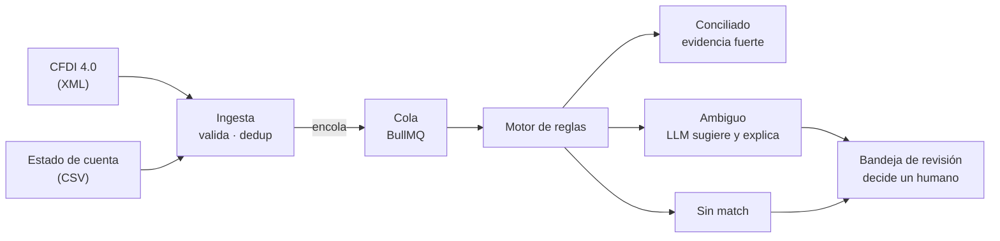
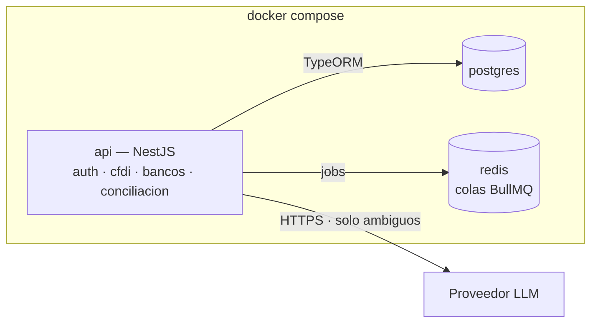
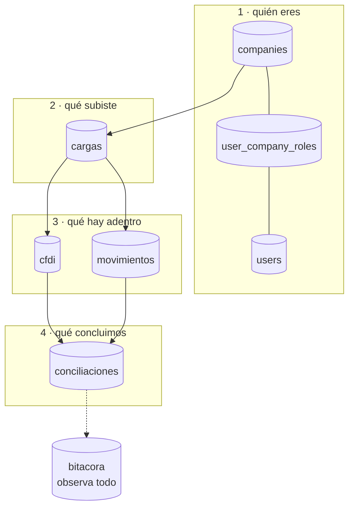

# Cuadra — contexto del proyecto

> Conciliación automática de facturas CFDI contra movimientos bancarios,
> con revisión humana en los casos dudosos.

| | |
|---|---|
| **Estado** | CU-01 a CU-26, más CU-04b · 26 / 26 historias · 99 / 99 pts · Épicas A–H cerradas (CU-24, CU-25 y CU-26 integradas a `master`) |
| **Entrega** | 2 de octubre de 2026 (backend, CU-01 a CU-18); el frontend (CU-19 a CU-26) no tiene fecha; todo está integrado |
| **Contexto** | Estancia profesional en michelada.io |
| **Alcance** | 26 historias · 99 puntos (69 del backend y 30 de la interfaz) · 9 días hábiles para el backend |
| **Última actualización** | 7 oct 2026 |

Este archivo es la fuente de verdad del proyecto. Vive en la raíz del repo.
Si usas un agente de código, apúntalo aquí desde `CLAUDE.md` o `AGENTS.md`
para que lo lea antes de tocar nada.

---

## 1. El problema

El CFDI dice que **se debe** cobrar algo. El estado de cuenta dice que
**entró** dinero. Nada los une automáticamente.

Cada mes alguien en contabilidad abre el archivo del banco al lado del
listado de facturas y los empata a mano, línea por línea. Con unos cientos
de movimientos son días de trabajo, y los errores de asignación no dejan
rastro: un pago mal empatado se descubre meses después, cuando un cliente
reclama que ya pagó.

Tres cosas lo hacen difícil de automatizar:

- **Cada banco entrega su estado de cuenta distinto.** Columnas, formatos
  de fecha, cómo nombran la referencia. No hay estándar.
- **El match rara vez es exacto.** Llegan pagos con comisión descontada,
  pagos que cubren varias facturas, referencias mal capturadas.
- **PUE y PPD son lógicas distintas.** Una factura de pago en una
  exhibición se liquida de golpe; una de pago diferido se paga en partes y
  además exige su complemento de pago.

### El requisito silencioso

**Un falso positivo es peor que no conciliar.** Marcar como pagada una
factura que no se pagó rompe la contabilidad de forma difícil de detectar.
Esto define todo el diseño: el sistema solo concilia solo cuando la
evidencia es fuerte; todo lo demás va a revisión humana.

---

## 2. Cómo funciona



El motor de reglas es quien decide. El LLM solo interviene en la rama
ambigua y nunca cierra un caso por su cuenta. Si el modelo falla, el
movimiento cae en la bandeja — que es el comportamiento correcto de todos
modos.

### Las reglas del match

Cuatro señales: **monto, fecha, RFC y referencia.**

1. La referencia normalizada (sin guiones, espacios ni ceros a la
   izquierda) es la primera llave.
2. El monto con tolerancia configurable es el confirmador.
3. Si el monto difiere más de la tolerancia, el par baja a sugerencia y no
   se concilia.

Todo el pipeline es idempotente: la huella de cada archivo se guarda como
hash, así que subir el mismo estado de cuenta dos veces no duplica
movimientos.

---

## 3. Infraestructura



Tres contenedores y un comando. El módulo `sugerencias` es el único que
habla con el LLM, detrás de una interfaz propia (`ProveedorSugerencia`) — cambiar de proveedor, o
pasar a un modelo local, es reemplazar un adaptador sin tocar el motor de
reglas.

### Stack

| Pieza | Para qué | Por qué ésta |
|---|---|---|
| NestJS | API y lógica de dominio | Módulos con fronteras explícitas: la misma estructura que tendrían los microservicios, sin la red en medio |
| PostgreSQL | Facturas, movimientos, conciliaciones, bitácora | `NUMERIC` exacto, `JSONB` para el CFDI crudo, índices parciales, RLS para multiempresa |
| Redis + BullMQ | Procesamiento en segundo plano | Un estado de cuenta con cientos de movimientos no cabe en un request |
| Docker Compose | Levantar todo con un comando | Requisito de demo, no lujo |
| Jest | Tests del parseo y del motor | Es donde vive el riesgo real |

Complementos: `fast-xml-parser` para el CFDI, `zod` o `class-validator`
para validar lo que entra, Swagger generado por decoradores de Nest.

### Convenciones

- Nombres de columna en `snake_case` (`company_id`), traducidos a camelCase
  por el ORM. Postgres distingue mayúsculas si se citan identificadores.
- Montos siempre en `NUMERIC`, nunca en flotante.
- Ninguna query del dominio sale sin filtro de `company_id`.

---

## 4. Modelo de datos, tabla por tabla

### El mapa



Cuatro capas: **quién eres**, **qué subiste**, **qué hay adentro**, **qué
concluimos** — y la bitácora observando todo. Las seis tablas de dominio
llevan `company_id` con FK `RESTRICT`: no se puede borrar una empresa que
todavía tiene datos.

---

### `companies` — la raíz

Las empresas que usan el sistema. Es el inquilino.

| Columna | Tipo | Notas |
|---|---|---|
| `rfc` | varchar(13) | único |
| `razon_social` | varchar(255) | |
| `regimen_fiscal` | varchar(3) | opcional, catálogo `c_RegimenFiscal` |
| `activa` | boolean | default `true` |

**No lleva `company_id` porque lo es.** Único caso del esquema.

`varchar(13)` porque el RFC es de 12 para persona moral y 13 para física.
`activa` en vez de borrar: cuando un cliente se va se desactiva, porque
borrarlo rompería su contabilidad histórica — y la FK `RESTRICT` de hecho lo
impide.

### `users` — globales, no de una empresa

| Columna | Tipo | Notas |
|---|---|---|
| `email` | varchar(320) | único sobre `lower(email)` |
| `nombre` | varchar(255) | |
| `password_hash` | varchar(255) | nunca texto plano |
| `activo` | boolean | default `true` |

**Un usuario no pertenece a una empresa**, pertenece al sistema. Es lo que
permite que un contador externo atienda tres clientes con una sola cuenta,
en vez de tres cuentas con tres contraseñas.

`varchar(320)` es el máximo del estándar de correo: 64 de parte local + `@`
+ 255 de dominio. El nombre `password_hash` es documentación: quien lo lea
sabe que ahí no va texto plano.

**La unicidad va sobre `lower(email)`, no sobre `email`.** Un `UNIQUE` plano
deja convivir `ana@x.mx` y `Ana@x.mx` como dos personas distintas, y el día
que el login normalice a minúsculas una de las dos queda inalcanzable para
siempre. El índice es `ux_users_email_lower`, y el login busca comparando
`lower(email)` — si buscara por `email` directo, el índice no lo usaría
nadie.

### `user_company_roles` — la tabla puente

| Columna | Tipo | Notas |
|---|---|---|
| `user_id` | uuid | FK → users, `CASCADE` |
| `company_id` | uuid | FK → companies, `CASCADE` |
| `rol` | varchar(32) | `admin` · `contador` · `revisor` |

Sin ella el rol viviría en `users` —y sería global— o en `companies` —y no
sabrías de quién. `CASCADE` en ambas llaves porque un acceso de un usuario
que ya no existe no significa nada.

**La unicidad es sobre la terna `(user_id, company_id, rol)`**, no sobre el
par: una persona puede tener dos roles en la misma empresa, a propósito. Ver
[D-08](#d-08--varios-roles-por-persona-y-la-segregación-a-nivel-de-acción).

Historias: CU-03, CU-04.

### `cargas` — la puerta de entrada

| Columna | Tipo | Notas |
|---|---|---|
| `tipo` | varchar(32) | `cfdi` · `estado_cuenta` |
| `estado` | varchar(32) | pendiente → procesando → procesada / con_errores / fallida (CU-08) |
| `nombre_archivo` | varchar(512) | como lo llamó el usuario |
| `hash_archivo` | char(64) | SHA-256 en hex: del archivo (estado de cuenta) o de los hashes ordenados del lote (CFDI) |
| `total_registros`, `registros_ok`, `registros_error`, `registros_existentes` | int | `CHECK >= 0`; suma exacta al terminar (`ck_cargas_total_cuadra`) |
| `resultados` | jsonb | CFDI: uno por archivo; estado de cuenta: una por fila que no entró |
| `banco`, `cuenta` | varchar(128), varchar(32) | estado de cuenta: se copian a cada movimiento (CU-09) |
| `error_mensaje` | text | solo en `fallida`, genérico |
| `subido_por_id` | uuid | FK `SET NULL` |

Sin esta tabla no sabrías de dónde vino cada factura. `char(64)` y no
`varchar` porque un SHA-256 en hexadecimal mide exactamente 64 caracteres
siempre.

El índice único `(company_id, hash_archivo)` es la idempotencia de CU-07.
`subido_por_id` con `SET NULL`: si el usuario se va, la carga sobrevive sin
dueño — es información histórica que no debe desaparecer porque alguien
renunció.

Historias: CU-06, CU-07, CU-08, CU-09.

### `cfdi` — la tabla con más decisiones

| Columna | Tipo | Notas |
|---|---|---|
| `uuid_fiscal` | varchar(36) | folio fiscal del SAT |
| `rfc_emisor`, `rfc_receptor` | varchar(13) | |
| `fecha_emision` | **timestamp** | sin zona horaria |
| `tipo_comprobante` | varchar(1) | `I` `E` `T` `N` `P` |
| `moneda` | char(3) | default `MXN` |
| `tipo_cambio` | numeric(18,**6**) | opcional |
| `subtotal`, `descuento`, `total` | numeric(18,4) | |
| `metodo_pago` | varchar(3) | `PUE` / `PPD` |
| `forma_pago` | varchar(2) | catálogo del SAT |
| `estado` | varchar(32) | abierta · conciliada · cancelada |
| `xml_raw` | **jsonb** | obligatorio |

**`fecha_emision` es `timestamp`, no `timestamptz`** — la única columna del
esquema sin zona horaria, y es correcto: el SAT emite la fecha en hora local
sin offset. Convertirla a UTC inventaría un dato que el documento no tiene, y
una factura del 31 de marzo podría volverse del 1 de abril.

**`tipo_cambio` con 6 decimales**, no 4: los montos llevan 4 porque es lo que
el SAT permite en impuestos, pero el tipo de cambio se cotiza con más
precisión.

**`uuid_fiscal` único por `(company_id, uuid_fiscal)`, no global.** El folio
es irrepetible en México, pero dos empresas del mismo grupo pueden recibir el
mismo CFDI y cada una lo concilia. Hay dos tests que prueban los dos lados.

**Índice parcial** `(company_id, rfc_emisor) WHERE estado = 'abierta'`: al año
habrá miles de conciliadas y decenas abiertas; el motor solo busca entre las
abiertas, así que el índice se mantiene pequeño para siempre.

**`ck_cfdi_xml_raw_integro`** exige que `xml_raw` sea un objeto y contenga la
llave `_xml` con el XML tal como llegó. El criterio "se conserva íntegro"
dejó de ser promesa. Además, si mañana hace falta un campo del SAT no
previsto, está ahí sin migrar nada.

Historias: CU-05, CU-06; es la fuente de candidatos de CU-11.

### `movimientos` — cada línea del banco

| Columna | Tipo | Notas |
|---|---|---|
| `linea_numero` | int | línea física del archivo, encabezado = 1 (CU-09), `CHECK >= 0` |
| `fecha` | **date** | sin hora |
| `descripcion` | text | |
| `referencia` | varchar(128) | opcional |
| `monto` | numeric(18,4) | `CHECK <> 0` |
| `banco`, `cuenta` | varchar | opcionales |
| `estado` | varchar(32) | abierto · conciliado · descartado |

**`fecha` es `date`**: el banco da el día, no la hora. Guardar medianoche
inventaría precisión y al convertir zonas podría saltar al día anterior.

**La idempotencia es por `(company_id, carga_id, linea_numero)`, no por hash
del contenido.** Lo intuitivo sería deduplicar por contenido, pero dos cargos
legítimos pueden ser idénticos el mismo día — dos pagos de $500 del mismo
cliente son dos pagos. Identificar por posición en el archivo resuelve las
dos cosas: reprocesar no duplica, y dos movimientos idénticos siguen siendo
dos.

**`referencia_norm` (CU-11):** columna generada `STORED` con su índice
`(company_id, referencia_norm)`, calculada por la función SQL
`normalizar_referencia` para que ninguna vía de inserción la olvide. Quita
todo lo que no sea `[A-Za-z0-9]`, pasa a mayúsculas y borra los ceros a la
izquierda solo del primer bloque de dígitos tras las letras iniciales
(`A-0001001` → `A1001`). El normalizador de TypeScript
(`src/conciliacion/referencia-normalizer.ts`) implementa lo mismo y
`referencia-normalizer.paridad.spec.ts` compara ambos contra Postgres.

- **Decisión de diseño:** declarar una columna generada en la entidad hace
  que el ejecutor de TypeORM cree `typeorm_metadata` en cada corrida, así
  que ninguna migración puede dejar esa tabla ausente al revertir. La
  migración solo inserta y borra su fila, y la prueba de reversibilidad de
  `esquema.spec.ts` exime esa tabla igual que `migrations`.
- **Hueco aceptado:** dígitos pegados a la serie sin separador (el banco
  escribe `120034` para serie 12, folio 0034) no coinciden.

#### Formato canónico del estado de cuenta (CU-09)

`POST /cargas/estado-cuenta`, multipart: un archivo en el campo `archivo`
(`.csv`, 10 MB máximo) y, opcionales, `banco` (≤ 128) y `cuenta` (≤ 32,
se guarda tal como llega: el cliente solo pide los últimos dígitos y el
servidor no la enmascara), que se copian a cada movimiento, y `perfil` (CU-10, por
defecto `cuadra`). Roles admin y contador. El formato canónico es el perfil
`cuadra` (`src/bancos/perfiles/cuadra.json`); el de cada banco se normaliza
a estos mismos cuatro datos.

```csv
fecha,descripcion,referencia,monto
2026-09-01,DEPOSITO SPEI FERRETERIA DEL BAJIO,A1001,4466.58
2026-09-02,"PAGO FACTURA A-1001, A-1002",,-1500.00
```

| Regla | Detalle |
|---|---|
| Codificación | UTF-8; el BOM se tolera. Latin-1 u otra → 400. |
| Separador | Coma, con comillas dobles estándar: `""` dentro de comillas es una comilla, y un campo entre comillas puede traer comas y saltos de línea. Fin de línea LF o CRLF. |
| Encabezados | Exactamente `fecha,descripcion,referencia,monto`, en ese orden y en minúsculas. Otro → 400. |
| `fecha` | `AAAA-MM-DD`, un día que exista. |
| `descripcion` | Obligatoria; no puede ser solo espacios. |
| `referencia` | Opcional (vacía = sin referencia), máximo 128 caracteres. |
| `monto` | Con signo: positivo = abono, negativo = cargo. Punto decimal, sin separador de miles ni notación científica, máximo 4 decimales y 14 enteros, distinto de 0. |

- **Archivo completo, en el POST, antes de guardar nada:** extensión,
  UTF-8, sin bytes nulos, CSV bien formado (comillas cerradas), encabezados
  exactos y al menos una fila. Si falla → 400 con motivo y no se crea
  carga.
- **Cada fila, en el worker:** una fila malformada (columnas de más o de
  menos, fecha inválida, monto no numérico, en 0 o con más de 4 decimales,
  referencia larga, descripción vacía) se reporta como `{fila, motivo}` en
  `cargas.resultados`, y el resto se carga. `fila` es la línea física: el
  contador la encuentra al abrir el archivo.
- Las líneas vacías se ignoran y no cuentan como filas.
- Idempotencia: SHA-256 del archivo. El mismo archivo dos veces en la
  empresa → 200 `yaExistia`, sin movimientos nuevos.

#### Cómo agregar un banco (CU-10)

Agregar un banco es configuración, no código: un archivo
`src/bancos/perfiles/<id>.json`, con el `id` igual al nombre del archivo, y
reiniciar la api. El perfil dice cómo leer el CSV del banco:
- codificación (`utf-8` o `windows-1252`) y separador (`,`, `;` o tabulador);
- cuántas líneas de preámbulo saltar antes del encabezado;
- la fila de encabezados **exacta y completa**, en orden, incluidas las
  columnas que no se usan, como el saldo. Si el banco cambia su formato, el
  archivo se rechaza en vez de leerse mal;
- qué encabezado es la fecha, el concepto y la referencia (opcional), y el
  monto: una columna con signo, o `cargo` + `abono` (monto = abono − cargo;
  sin signo, exactamente uno por fila);
- el formato de fecha y los separadores de miles y decimal.

Solo datos: nada de funciones, regex ni código en el JSON. Se validan con
Zod al arrancar (`src/bancos/perfil.ts`), y un perfil inválido impide que la
api levante, con el archivo y el campo en el error. Las líneas que se
reportan son las del archivo original, preámbulo incluido. `GET
/bancos/perfiles` lista los disponibles.

```json
{
  "id": "banco-norte",
  "nombre": "Banco del Norte (sintético)",
  "codificacion": "utf-8",
  "separador": ",",
  "lineasPreambulo": 0,
  "encabezados": ["Fecha", "Concepto", "Referencia", "Cargo", "Abono", "Saldo"],
  "columnas": {
    "fecha": "Fecha",
    "concepto": "Concepto",
    "referencia": "Referencia",
    "cargo": "Cargo",
    "abono": "Abono"
  },
  "formatoFecha": "DD/MM/AAAA",
  "separadorMiles": ",",
  "separadorDecimal": "."
}
```

`formatoFecha`: `AAAA-MM-DD`, `DD/MM/AAAA` o `DD-MM-AAAA`.
`separadorMiles`: `","`, `"."` o `null`. `separadorDecimal`: `"."` o `","`.
Con monto con signo, `"columnas"` lleva `"monto"` en lugar de `"cargo"` y
`"abono"`.

Historias: CU-09, CU-10.

### `conciliaciones` — donde vive la regla de oro

| Columna | Tipo | Notas |
|---|---|---|
| `cfdi_id` | uuid | FK `CASCADE` |
| `movimiento_id` | uuid | FK `CASCADE` |
| `estado` | varchar(32) | propuesta · confirmada · rechazada |
| `origen` | varchar(32) | regla · llm · manual |
| `regla` | varchar(64) | cuál regla disparó |
| `score` | numeric(5,4) | confianza en `[0,1]` |
| `diferencia_monto` | numeric(18,4) | |
| `motivo` | text | legible |
| `confirmada_por_id` | uuid | FK `RESTRICT` |
| `confirmada_at` | timestamptz | |

Es una tabla y no dos columnas en `cfdi` porque la conciliación **tiene
historia propia**: nace como propuesta, alguien la revisa, y termina
confirmada o rechazada. Con dos columnas solo cabría un match por factura y
no habría dónde guardar el porqué.

**Tres índices únicos:**

- `ux_conciliaciones_par (company_id, cfdi_id, movimiento_id)` — no se
  propone el mismo par dos veces.
- `ux_conciliaciones_cfdi_confirmada` — parcial, `WHERE estado='confirmada'`.
- `ux_conciliaciones_movimiento_confirmada` — parcial, igual.

Los dos parciales permiten muchas propuestas pero **una sola confirmada** por
factura y por movimiento. Es "un falso positivo es peor que no conciliar"
escrito en el esquema: aunque el código tenga un bug, la base no deja que un
pago se aplique a dos facturas.

**`ck_conciliaciones_confirmada_requiere_persona`**: llegar a `confirmada`
exige `confirmada_por_id` y `confirmada_at`. El motor y el LLM solo producen
`propuesta`, porque no tienen un `user_id` que poner. La decisión D-03 dejó
de depender de que el código se porte bien.

**`RESTRICT` en `confirmada_por_id`**: no se puede borrar a quien confirmó
algo. Si alguien se va, se desactiva. En un sistema contable, poder decir
"esto lo confirmó Fulano el 15 de marzo" tres años después no es opcional.

Historias: CU-11 a CU-15, CU-17.

### `bitacora` — append-only por construcción

| Columna | Tipo | Notas |
|---|---|---|
| `user_id` | uuid | FK `SET NULL`, **opcional** |
| `entidad` | varchar(64) | nombre de la tabla afectada |
| `entidad_id` | uuid | |
| `accion` | varchar(32) | crear · actualizar · eliminar · cargar · confirmar · rechazar |
| `datos` | jsonb | el antes y el después |
| `ip` | **inet** | |
| `user_agent` | text | |
| `created_at` | timestamptz | **sin `updated_at`** |

**No hereda de `EntidadBase`**, y ésa es la decisión que la define: heredaría
`updated_at`, y una bitácora que se puede modificar no sirve como evidencia.

`user_id` opcional porque no toda acción la hace una persona: cuando el motor
concilia solo, `NULL` significa exactamente "lo hizo el sistema".

`ip` es tipo `inet`, nativo de Postgres: valida el formato, ocupa menos que
texto y permite consultas por subred.

El diseño genérico —`entidad` + `entidad_id` en vez de una FK por tabla—
permite auditar cualquier cosa sin agregar columnas. El costo es que no hay
integridad referencial, lo cual en una bitácora es correcto: quieres
conservar el registro aunque la fila original desaparezca.

Historia: CU-16.

### `migrations` — la que no diseñaste

TypeORM la crea sola: `id serial`, `timestamp bigint`, `name varchar`.
Guarda qué migraciones ya se aplicaron, y es por eso que `migration:run`
sabe qué no repetir. Es la única tabla del esquema con `id serial` — a
TypeORM no le importa la convención de UUIDv7 para su tabla interna.

---

## 5. Alcance

### Dentro — entrega 2 de octubre

- Parseo de CFDI 4.0 con validación de RFC, montos e impuestos
- Ingesta de estado de cuenta en CSV con mapeo por banco
- Motor de conciliación por monto, fecha, RFC y referencia
- Bandeja de revisión con estados y bitácora de auditoría
- Multiempresa con `company_id`, JWT y roles por empresa

### Fuera — propuesta de continuidad

- Microservicios y RabbitMQ
- Extracción de PDF bancario con LLM
- MinIO, Prometheus, Grafana, webhooks, rate limiting (por eso tampoco hay
  bloqueo de cuenta por intentos fallidos: ver D-11)
- Adaptador Ollama para modelo local
- Complemento de pago, chat de consultas, reportes

El alcance está confirmado: **el proyecto entrega el 2 de octubre.** La
columna de fuera no es "fase 2 del mismo proyecto" — es lo que se le
presenta a la empresa como siguiente paso, con el sistema ya funcionando
como evidencia.

---

## 6. Decisiones

### D-01 · Monolito modular en lugar de microservicios

Los módulos quedan con las mismas fronteras que tendrían los servicios,
pero corren en un proceso. Extraerlos después es mover carpetas y agregar
transporte, no rediseñar.

**Qué se pierde:** escalado independiente por servicio y el argumento de
arquitectura distribuida. Ninguno se necesita para la entrega.

### D-02 · CSV antes que PDF con LLM

La extracción de PDF es la parte más vistosa y la más impredecible. Con CSV
el pipeline completo queda garantizado.

**Qué se pierde:** el argumento más fuerte del proyecto — "cada banco
entrega formato distinto y el sistema lo resuelve". Es la primera deuda a
pagar en la continuidad.

### D-03 · La IA sugiere, nunca decide

El motor de reglas resuelve los casos claros. El LLM solo opina sobre los
ambiguos, y su salida va a una bandeja humana. Si el modelo falla o no
responde, el caso queda en revisión.

**Qué se pierde:** nada. Y es la respuesta a "¿por qué IA aquí?": para lo
que las reglas no alcanzan, con un humano al final.

### D-04 · `company_id` desde la primera migración

La única pieza de la continuidad que se adelanta. Todo lo demás se agrega
después sin dolor; multiempresa retrofiteado obliga a tocar cada query.

**Qué cuesta:** una hora hoy. Tres días si se pospone.

### D-05 · El rol vive en la relación usuario–empresa

Tabla `user_company_roles` con `user_id + company_id + rol`. La misma
persona puede ser contador en una empresa y revisor en otra — el caso
normal cuando quien opera el sistema es un despacho contable o una
consultora. Los roles son un enum extensible (`admin`, `contador`,
`revisor`; después `auditor`, `super_admin`, `api`).

**Qué cuesta:** un join más en cada verificación de permiso.
Reestructurar la relación después es tocar auth completo.

### D-08 · Varios roles por persona, y la segregación a nivel de acción

Una persona **sí** puede tener varios roles en la misma empresa: la unicidad
de `user_company_roles` se queda sobre la terna, no sobre el par. El guard de
CU-03 autoriza si cualquiera de los roles del usuario en esa empresa alcanza.

La alternativa —un rol por empresa— se descartó porque en una empresa de tres
personas el contador *es* el revisor; obligar a que sean distintos daría un
sistema que nadie puede usar.

El riesgo que eso abre —que alguien confirme una conciliación de una factura
que él mismo cargó— **se cierra en CU-15, a nivel de acción y no de rol**:
quien subió una carga no puede confirmar sus conciliaciones. Es como lo
resuelven los sistemas contables, porque la segregación de funciones real se
impone sobre lo que se hace, no sobre cómo se llama el puesto.

**Qué cuesta:** una regla más en CU-15. Cambiar la unicidad después sí sería
una migración con datos encima.

### D-07 · Llaves primarias UUIDv7, no UUIDv4 ni serial

`UUID` porque con multiempresa un ID secuencial filtra volumen: un cliente
podría deducir cuántas facturas tienen los demás. Pero **v7, no v4**: el v4
es aleatorio, así que cada insert cae en una hoja distinta del B-tree,
fragmenta el índice y lo infla. El v7 lleva timestamp en los bits altos, así
que los inserts caen ordenados en el borde derecho del índice, como un
`bigserial`, sin perder la no-enumerabilidad.

Generación: `uuidv7()` nativo de Postgres 18. Alternativa en 17: el paquete
`uuidv7` de npm, generando en la aplicación.

**Qué cuesta:** nada frente a v4. A la escala del proyecto (cientos de
movimientos al mes) ni v4 se habría notado, pero el costo de elegir bien es
cero y el de corregirlo con datos encima no.

### D-06 · PostgreSQL sobre MySQL

Cuatro razones concretas: `NUMERIC` exacto para montos; `JSONB` para
guardar el CFDI parseado sin migrar el esquema cada vez que aparece un
campo del SAT no previsto; índices parciales sobre
`WHERE estado = 'abierta'`, que es justo lo que el motor consulta en cada
movimiento; y Row-Level Security, que convierte el aislamiento multiempresa
en garantía de la base en vez de disciplina del código.

**Qué cuesta:** curva de aprendizaje a mitad de un sprint de nueve días.
Se mitiga usándolo como relacional normal desde el día 1 y dejando RLS y
JSONB para cuando el flujo básico ya corra.

### D-09 · Dos tokens: selección (5 min) y sesión (15 min)

> **Retirada el 13 oct 2026 (v2, historia 1.1).** La reemplaza AD-6: una fila
> en `sesiones` con cookie `httpOnly`, `Secure` y `SameSite=Lax`, que el
> servidor puede cancelar y que vence tras 8 horas sin actividad. El JWT y
> `JWT_SECRET` ya no existen. Lo que sigue describe la v1 y se conserva como
> historial.
>
> Desde la historia 1.3 (13 oct 2026) `sesiones` también tiene sesiones de
> tipo `plataforma` para el dueño de Cuadra: sin `company_id`, con
> `plataforma_usuario_id`, rutas bajo `/plataforma` y 403 si se cruzan los
> dos mundos (AD-5).

Una persona puede pertenecer a varias empresas (D-05). El login **no** puede
saber a cuál va a entrar, así que el acceso se parte en dos pasos, cada uno
con su propio token:

| | `scope: 'seleccion'` | `scope: 'sesion'` |
|---|---|---|
| Lo emite | `POST /auth/login` | `POST /auth/empresa/:id` |
| Lleva | `sub` | `sub` + `companyId` |
| Vive | 5 min | 15 min |
| Sirve para | elegir empresa | todo lo demás |

El token de selección solo abre la lista de empresas del usuario y el
endpoint que canjea una. Dura 5 minutos porque es una pantalla de un clic —
si alguien lo roba, no alcanza a usarlo y de todos modos no abre nada del
dominio.

**El `companyId` viaja firmado dentro del token, no como parámetro.** Si
fuera un `?companyId=` o un header suelto, cualquiera lo cambiaría por el de
otra empresa; dentro del token lo protege la firma, y la validación de que
esa persona sí pertenece a esa empresa ocurre una sola vez, al canjear.

Lo que **no** va en el token son los roles: se leen de
`user_company_roles` en cada request. Un token es un papel firmado que ya
no se puede retirar — si el rol viviera ahí, quitarle permisos a alguien
tardaría hasta que expirara el token. Leyéndolos de la base, la revocación
es inmediata.

**El default del módulo se queda corto a propósito.** `JwtModule` define
`signOptions: { expiresIn: '5m' }` aunque cada `sign()` pase el suyo
explícito. Razón: si se olvida el `expiresIn` en un punto de firma y no hay
default, `jsonwebtoken` emite el token **sin `exp`**, y `verify()` acepta
tokens sin expiración para siempre. Un token eterno no se nota porque todo
"funciona". Una sesión que caduca en 5 minutos sí se nota, y se arregla en
un minuto. El default tiene que ser el restrictivo para que la falla sea
ruidosa en vez de silenciosa.

**Qué cuesta:** un request más en el login y un test por tipo de token que
decodifique el `exp` y verifique la duración — no opcional, es lo que
sostiene el punto anterior.

### D-10 · Proveedor de LLM: Anthropic detrás de un adaptador

CU-17 usa **Anthropic, modelo `claude-sonnet-5-5`**, con el SDK oficial
`@anthropic-ai/sdk`. El servicio no conoce al proveedor: habla con el puerto
`ProveedorSugerencia`; `AdaptadorAnthropic` es una implementación, y hay un
`ProveedorFalso` (pruebas) y un `ProveedorDesactivado` (función apagada).

- **Llamada:** `messages.create` con salida estructurada
  (`output_config.format` = esquema JSON) y `effort: 'low'`: elegir entre
  pocos candidatos no pide razonamiento largo. Sin `thinking`, sin
  `tool_choice`, sin betas. La respuesta se valida con zod; si el modelo
  rompe el contrato, es un fallo del proveedor, no un "no sé".
- **Sin respaldo del lado del servidor** (`fallbacks`): la documentación no
  confirma que combine con salida estructurada. Un rechazo (`refusal`) o un
  corte por `max_tokens` es simplemente "sin sugerencia".
- **Qué sale de la casa:** del movimiento, `fecha`, `monto`, `moneda`,
  `descripcion` y `referencia`; de cada CFDI, una etiqueta opaca (`C1..CN`),
  serie-folio, total, fecha y `nombre_receptor`. **Nunca** RFC, UUID, XML ni
  ids. La etiqueta solo la traduce el servidor.
- **Texto no confiable:** descripción, referencia y receptor vienen de
  bancos y terceros. Viajan como datos JSON y el prompt de sistema lo dice;
  aun si el modelo obedeciera una instrucción inyectada, la etiqueta se
  valida contra el conjunto que se le mostró.
- **Solo propone:** crea una conciliación `origen 'llm'`, `estado
  'propuesta'`, `regla 'llm_sugerencia'`, sin score, que una persona confirma
  o rechaza (CU-15). Se aceptan confianza `alta` y `media`; `baja` se
  descarta. Un falso positivo es peor que no conciliar.
- **Apagado por omisión (opt-in):** activa solo con `LLM_HABILITADO=true` **y**
  `ANTHROPIC_API_KEY`. Habilitado sin llave queda inerte con un aviso, no
  truena el arranque: el CI no necesita secretos.
- **Asíncrono:** cola `sugerencias` (BullMQ, un intento, un job por empresa),
  encolada después de conciliar una carga. Un fallo de la cola o del
  proveedor nunca falla ni altera una carga.

| Variable | Por omisión | Qué hace |
|---|---|---|
| `LLM_HABILITADO` | `false` | Interruptor. Solo `true`/`false`. |
| `ANTHROPIC_API_KEY` | (vacía) | Llave. Vacía = ausente. |
| `LLM_MODEL` | `claude-sonnet-5-5` | Modelo. Entra en la huella de la entrada. |
| `LLM_TIMEOUT_MS` | `15000` | Espera máxima por llamada (≥ 1000). |
| `LLM_MAX_LLAMADAS_POR_CORRIDA` | `20` | Tope de llamadas por corrida. |
| `LLM_CANDIDATOS_MAX` | `10` | Más candidatos que esto y se omite el movimiento. |

**Qué cuesta:** cada pregunta es una llamada de pago y sale texto bancario
al proveedor (por eso el opt-in y la lista cerrada de campos). Ollama sigue
fuera de alcance: el puerto lo permite cuando haga falta.

### D-11 · Sin bloqueo de cuenta por intentos fallidos

> **Actualizada el 13 oct 2026 (v2, historia 1.2).** El límite ya no se
> delega a un proxy: vive dentro de la aplicación (AD-15), con contadores en
> Redis por dirección de cliente, 5 intentos fallidos por minuto en el inicio
> de sesión (429), y falla cerrada con 503 si Redis no responde. **Sigue sin
> haber bloqueo de cuenta**: el límite es por origen y por tiempo, nunca por
> correo. Lo que sigue describe la v1 y se conserva como historial.

El login **no bloquea cuentas** ni cuenta intentos fallidos. Una contraseña
incorrecta devuelve siempre el mismo 401 "Credenciales inválidas" (CU-03),
sin importar cuántas veces se repita.

- **Por qué no:** cualquiera que conozca el correo de un usuario podría
  bloquearlo con cinco contraseñas erróneas. Sería una negación de servicio
  gratuita contra una persona legítima.
- **Por qué tampoco una respuesta "cuenta bloqueada":** distinguiría los
  correos que existen de los que no, y rompería el 401 único de CU-03 y el
  hash señuelo que iguala los tiempos de respuesta.

**Qué cuesta:** la aplicación no frena la fuerza bruta contra una contraseña.
Esa mitigación queda en el borde (limitación de tasa en el proxy), que es
parte de lo que sigue fuera de alcance (sección 5).

**Cuándo revisarla:** si la limitación de tasa pasa a la aplicación o si hay
evidencia de ataques de fuerza bruta. Entonces el freno debe ser por origen
o por tiempo, sin un estado de "cuenta bloqueada" visible por correo.

**Fuera de CU-19:** el token de refresco, un endpoint de cierre de sesión
(logout), los cambios de CORS y los cambios en la duración de los tokens
(D-09) no forman parte de esta historia.

---

## 7. Historias

Puntos = tamaño relativo entre historias, no horas.

### Épica A · Fundación — 22–23 sep · 16 pts

| ID | Historia | Pts | Día |
|---|---|---|---|
| CU-01 | Entorno reproducible | 3 | 22 sep |
| CU-02 | Modelo de datos multiempresa | 5 | 22 sep |
| CU-03 | Acceso con roles por empresa | 5 | 23 sep |
| CU-04 | Aislamiento verificado | 3 | 23 sep |

### Épica B · Facturas — 24–25 sep · 13 pts

| ID | Historia | Pts | Día |
|---|---|---|---|
| CU-05 | Lectura del CFDI 4.0 | 5 | 24 sep |
| CU-06 | Carga de archivos | 3 | 24 sep |
| CU-07 | Carga idempotente | 2 | 25 sep |
| CU-08 | Procesamiento en segundo plano | 3 | 25 sep |

### Épica C · Banco — 25–28 sep · 8 pts

| ID | Historia | Pts | Día |
|---|---|---|---|
| CU-09 | Carga del estado de cuenta | 3 | 25 sep |
| CU-10 | Un formato por banco | 5 | 28 sep |

### Épica D · Conciliación — 29–30 sep · 13 pts

| ID | Historia | Pts | Día |
|---|---|---|---|
| CU-11 | Match por referencia y monto | 8 | 29 sep |
| CU-12 | Tolerancia configurable | 2 | 30 sep |
| CU-13 | Cada resultado explicado | 3 | 30 sep |

### Épica E · Revisión y entrega — 30 sep–2 oct · 19 pts

| ID | Historia | Pts | Día |
|---|---|---|---|
| CU-14 | Bandeja de revisión | 5 | 30 sep |
| CU-15 | Resolver un caso | 3 | 1 oct |
| CU-16 | Bitácora de auditoría | 3 | 1 oct |
| CU-17 | Sugerencia asistida por IA | 5 | 2 oct |
| CU-18 | Demo y datos sintéticos | 3 | 2 oct |

### Frontend (épicas F, G y H · 30 pts)

El frontend vive en `frontend/`, dentro de este repositorio. Se construye
con SDD, una historia a la vez; cada pantalla sigue los mockups aprobados
(referencia: la sección `## Frontend` de `CLAUDE.md`) y admite tema claro y
oscuro. Estas épicas no tienen fecha, salvo CU-19. Los criterios de
CU-20 a CU-26 están en Jira; solo CU-19 los lleva en este archivo.

### Épica F · Base de la interfaz — KAN-96 · 10 pts

| ID | Historia | Pts | Día | Jira | Qué entrega |
|---|---|---|---|---|---|
| CU-19 | Contexto de sesión para el cliente | 2 | 1 oct | KAN-97 | El API expone usuario, roles y RFC en el login y `GET /auth/contexto` |
| CU-20 | Base del frontend con tema claro y oscuro | 5 | 1 oct | KAN-98 | Proyecto en `frontend/`, estructura y tema claro y oscuro |
| CU-21 | Inicio de sesión y elección de empresa | 3 | 5 oct | KAN-99 | Pantallas de login y de elección de empresa; sesión real en memoria |

### Épica G · Revisión en pantalla — KAN-105 · 10 pts

| ID | Historia | Pts | Día | Jira | Qué entrega |
|---|---|---|---|---|---|
| CU-22 | Bandeja de revisión en pantalla | 5 | 5 oct | KAN-100 | La bandeja de revisión (CU-14) en la interfaz, con `GET /bandeja/resumen` para los indicadores y el contador de la barra lateral. Integrada a `master` el 5 oct y probada en el navegador por el usuario |
| CU-23 | Detalle y resolución de un caso en pantalla | 5 | 5 oct | KAN-101 | El detalle del caso y su resolución (CU-15) en la interfaz, con `GET /casos/:movimientoId` (movimiento, propuestas, CFDI y tolerancia en una sola lectura). Integrada a `master` el 6 oct y probada en el navegador por el usuario |

### Épica H · Cargas y control — KAN-106 · 10 pts

| ID | Historia | Pts | Día | Jira | Qué entrega |
|---|---|---|---|---|---|
| CU-24 | Cargas desde la interfaz | 5 | 6 oct | KAN-102 | Subida de CFDI y estados de cuenta y su seguimiento en pantalla, con `GET /cargas` (las últimas 20 cargas de la empresa) para el historial. Integrada a `master` el 7 oct; el usuario la recorrió en el navegador y falta probar una subida real de archivos |
| CU-25 | Tolerancia desde la interfaz | 2 | 7 oct | KAN-103 | Consulta y cambio de la tolerancia (CU-12) en pantalla: valor exacto de hasta 4 decimales, formulario solo para el administrador y los últimos 5 cambios. Solo frontend, sin cambios en el backend. Integrada a `master` el 7 oct; falta la revisión manual en el navegador |
| CU-26 | Bitácora en pantalla | 3 | 7 oct | KAN-104 | Consulta de la bitácora de auditoría (CU-16) en pantalla: tabla paginada con fecha, usuario, acción, entidad y detalle exacto; filtros por entidad, acción, usuario y fechas en la URL; accesos denegados resaltados y solo lectura. Suma `GET /bitacora/usuarios`. Integrada a `master` el 7 oct; backend verificado con Postgres 18 (852 pruebas) y frontend con 3,946; falta la revisión manual en el navegador |

### Carga por día

| Día | Fecha | Pts |
|---|---|---|
| 1 | 22 sep | 8 |
| 2 | 23 sep | 8 |
| 3 | 24 sep | 8 |
| 4 | 25 sep | 8 |
| 5 | 28 sep | 5 |
| 6 | 29 sep | 8 |
| 7 | 30 sep | 10 |
| 8 | 1 oct | 8 |
| 9 | 2 oct | 8 |

Los días 5 y 8 quedaron ligeros a propósito: el 5 es lunes después de fin de
semana y CU-10 suele traer sorpresas; el 8 es el colchón antes de entregar.
El 1 oct sumó CU-19 (2 pts) a los 6 del plan original; CU-20 a CU-26 no
tienen fecha y no entran en esta tabla.

Los criterios de aceptación completos de cada historia están en el CSV de
Jira (`cuadra-jira.csv`) y en las issues importadas. La excepción es CU-19,
cuyos criterios se registran aquí abajo.

### Criterios de aceptación de CU-19 (EARS)

- **CU-19.1** Cuando una persona envía credenciales válidas, el sistema
  devolverá `usuario {id, nombre, email}` y, por cada empresa, `id`,
  `razonSocial`, `rfc` y `roles`.
- **CU-19.2** El sistema devolverá `roles` como un arreglo en orden fijo
  (admin, contador, revisor), con una entrada por cada rol que la persona
  tenga en esa empresa (D-08).
- **CU-19.3** Cuando un token de selección pida `GET /auth/empresas`, el
  sistema devolverá la misma lista que el login, como arreglo simple, con
  `rfc` y `roles`.
- **CU-19.4** Cuando un token de sesión pida `GET /auth/contexto`, el
  sistema devolverá `usuario`, `empresa {id, razonSocial, rfc}` y los `roles`
  de la empresa del token.
- **CU-19.5** El sistema tomará el id de la empresa solo del token de sesión
  firmado y no aceptará ningún parámetro de empresa en `GET /auth/contexto`.
- **CU-19.6** El sistema leerá usuario, empresa y roles de la base de datos
  en cada llamada, de modo que un cambio o una revocación se reflejen en la
  siguiente.
- **CU-19.7** Si el token falta, expiró o no es de scope `sesion`, el sistema
  responderá 401 "No autorizado".
- **CU-19.8** Si la membresía, el usuario o la empresa ya no están activos,
  el sistema responderá 403 "Sin acceso a esta empresa" y registrará el
  rechazo en la bitácora (CU-03.3).
- **CU-19.9** Una lectura exitosa no escribirá en la bitácora y el sistema
  no registrará en logs el correo ni el nombre.
- **CU-19.10** Los errores 400 y 403 del login seguirán igual y no incluirán
  `usuario`.
- **CU-19.11** Si las credenciales son inválidas, el sistema responderá el
  mismo 401 exista o no el correo, sin campos nuevos.
- **CU-19.12** El sistema no incluirá roles en ningún JWT (D-09) ni expondrá
  `passwordHash`.
- **CU-19.13** El sistema no bloqueará cuentas por intentos fallidos (D-11).

Nota para el cliente: cada llamada rechazada escribe una fila
`acceso_denegado` en la bitácora. Un 403 de `GET /auth/contexto` debe
tratarse como el fin de la sesión: el cliente deja de consultar y vuelve a
la elección de empresa o al login.

---

## 8. Riesgos

| Nivel | Riesgo | Mitigación |
|---|---|---|
| Cerrado | ¿Qué proveedor de LLM? | Anthropic, `claude-sonnet-5-5`, con `@anthropic-ai/sdk` detrás de `ProveedorSugerencia` (D-10). El adaptador aísla la elección: cambiar de proveedor no toca el motor. |
| Abierto | La sugerencia por IA no se ha probado contra la API real | Los tests usan un cliente doble y nunca llaman a la red. Antes de activarla en un entorno real hay que correr la prueba de humo manual (ver bitácora de CU-17). |
| Alto | El motor de match se puede ir de las manos | Cada regla nueva atrapa más casos y genera más falsos positivos. La tolerancia empieza estricta y se afloja con datos reales, nunca al revés. |
| Alto | Nueve días son nueve días | El alcance es entrega final, no hay "lo termino en la fase 2". Si algo se atrasa se corta una historia completa, nunca se entrega media. |
| Medio | CFDI 4.0 tiene más reglas del SAT de las que caben en un día | Parsear solo los campos que el motor necesita y dejar el XML íntegro en `JSONB` para extraer más después. |
| Medio | Datos de prueba | Todo el desarrollo corre con CFDI y estados de cuenta sintéticos. Nunca datos reales de clientes sin permiso explícito por escrito. |

---

## 9. Bitácora

La bitácora vive en [`docs/bitacora.md`](docs/bitacora.md): cada cambio de
decisión, alcance o plan se agrega ahí, con lo más reciente arriba. Se separó
de este archivo el 1 oct 2026 para que el contexto vigente se pueda leer sin
cargar todo el historial.

---

## Archivos del proyecto

| Archivo | Qué es |
|---|---|
| `CUADRA.md` | Este archivo. Fuente de verdad del contexto. |
| `docs/bitacora.md` | Bitácora: historial de cambios de decisión, alcance y plan. |
| `cuadra-1-epicas-historias.csv` | Paso 1 de la importación: 5 épicas y 18 historias. |
| `cuadra-3-historias-a-epicas.csv` | Paso 2: vincula cada historia con su épica. |
| `cuadra-4-tareas-en-descripcion.csv` | Paso 3: las 64 tareas como checklist en la descripción. |
| Artifact "Cuadra" | Vista navegable del mismo contenido, para compartir. |
