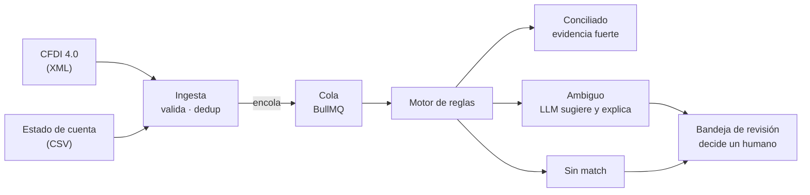
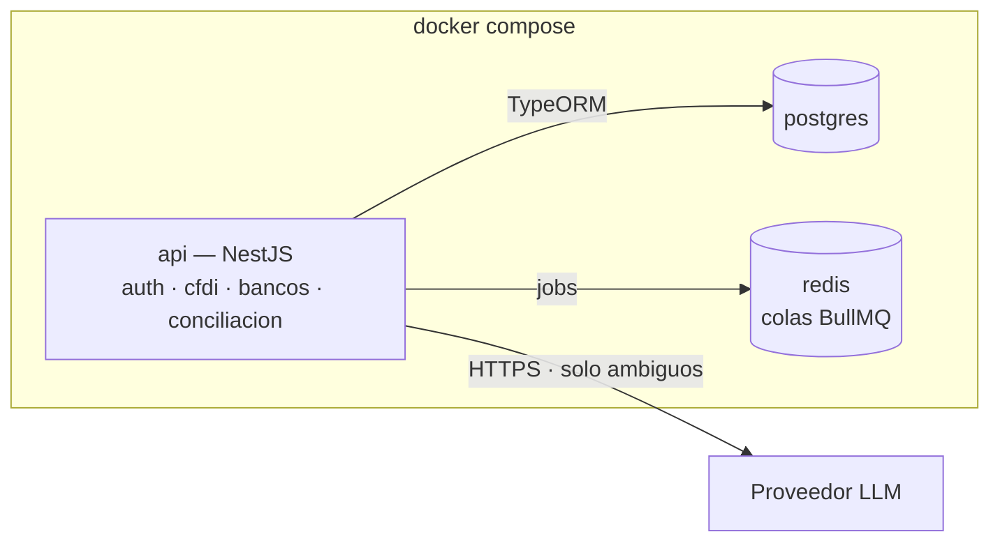
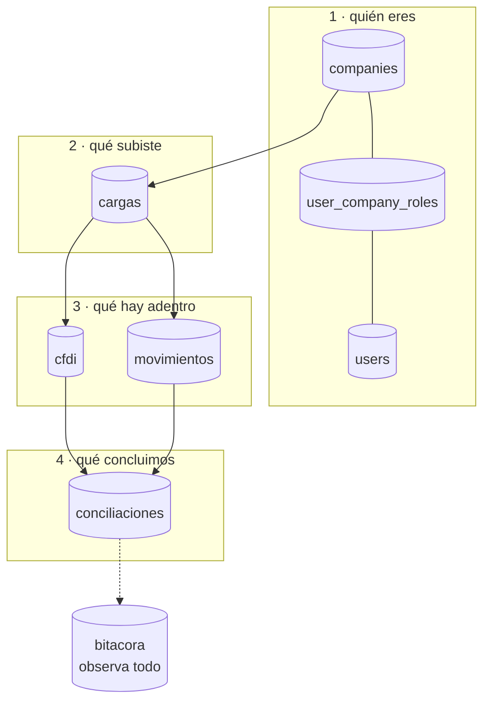

# Cuadra — contexto del proyecto

> Conciliación automática de facturas CFDI contra movimientos bancarios,
> con revisión humana en los casos dudosos.

| | |
|---|---|
| **Estado** | Día 1 de 9 ✅ · CU-01, CU-02 · 8 / 69 pts |
| **Entrega** | 2 de octubre de 2026 |
| **Contexto** | Estancia profesional en michelada.io |
| **Alcance** | 18 historias · 69 puntos · 9 días hábiles |
| **Última actualización** | 22 sep 2026 |

Este archivo es la fuente de verdad del proyecto. Vive en la raíz del repo.
Si usas un agente de código, apúntalo aquí desde `CLAUDE.md` o `AGENTS.md`
para que lo lea antes de tocar nada.

---

## 1. El problema

El CFDI dice que **se debe** cobrar algo. El estado de cuenta dice que
**entró** dinero. Nada los une automáticamente.

Cada mes alguien en contabilidad abre el archivo del banco al lado del
listado de facturas y los empata a mano, línea por línea. Con unos cientos
de movimientos son días de trabajo, y los errores de asignación no dejan
rastro: un pago mal empatado se descubre meses después, cuando un cliente
reclama que ya pagó.

Tres cosas lo hacen difícil de automatizar:

- **Cada banco entrega su estado de cuenta distinto.** Columnas, formatos
  de fecha, cómo nombran la referencia. No hay estándar.
- **El match rara vez es exacto.** Llegan pagos con comisión descontada,
  pagos que cubren varias facturas, referencias mal capturadas.
- **PUE y PPD son lógicas distintas.** Una factura de pago en una
  exhibición se liquida de golpe; una de pago diferido se paga en partes y
  además exige su complemento de pago.

### El requisito silencioso

**Un falso positivo es peor que no conciliar.** Marcar como pagada una
factura que no se pagó rompe la contabilidad de forma difícil de detectar.
Esto define todo el diseño: el sistema solo concilia solo cuando la
evidencia es fuerte; todo lo demás va a revisión humana.

---

## 2. Cómo funciona

El motor de reglas es quien decide. El LLM solo interviene en la rama
ambigua y nunca cierra un caso por su cuenta. Si el modelo falla, el
movimiento cae en la bandeja — que es el comportamiento correcto de todos
modos.

### Las reglas del match

Cuatro señales: **monto, fecha, RFC y referencia.**

1. La referencia normalizada (sin guiones, espacios ni ceros a la
   izquierda) es la primera llave.
2. El monto con tolerancia configurable es el confirmador.
3. Si el monto difiere más de la tolerancia, el par baja a sugerencia y no
   se concilia.

Todo el pipeline es idempotente: la huella de cada archivo se guarda como
hash, así que subir el mismo estado de cuenta dos veces no duplica
movimientos.

---

## 3. Infraestructura

Tres contenedores y un comando. El módulo `conciliacion` es el único que
habla con el LLM, detrás de una interfaz propia — cambiar de proveedor, o
pasar a un modelo local, es reemplazar un adaptador sin tocar el motor de
reglas.

### Stack

| Pieza | Para qué | Por qué ésta |
|---|---|---|
| NestJS | API y lógica de dominio | Módulos con fronteras explícitas: la misma estructura que tendrían los microservicios, sin la red en medio |
| PostgreSQL | Facturas, movimientos, conciliaciones, bitácora | `NUMERIC` exacto, `JSONB` para el CFDI crudo, índices parciales, RLS para multiempresa |
| Redis + BullMQ | Procesamiento en segundo plano | Un estado de cuenta con cientos de movimientos no cabe en un request |
| Docker Compose | Levantar todo con un comando | Requisito de demo, no lujo |
| Jest | Tests del parseo y del motor | Es donde vive el riesgo real |

Complementos: `fast-xml-parser` para el CFDI, `zod` o `class-validator`
para validar lo que entra, Swagger generado por decoradores de Nest.

### Convenciones

- Nombres de columna en `snake_case` (`company_id`), traducidos a camelCase
  por el ORM. Postgres distingue mayúsculas si se citan identificadores.
- Montos siempre en `NUMERIC`, nunca en flotante.
- Ninguna query del dominio sale sin filtro de `company_id`.

---

## 4. Modelo de datos, tabla por tabla

### El mapa

Cuatro capas: **quién eres**, **qué subiste**, **qué hay adentro**, **qué
concluimos** — y la bitácora observando todo. Las seis tablas de dominio
llevan `company_id` con FK `RESTRICT`: no se puede borrar una empresa que
todavía tiene datos.

---

### `companies` — la raíz

Las empresas que usan el sistema. Es el inquilino.

| Columna | Tipo | Notas |
|---|---|---|
| `rfc` | varchar(13) | único |
| `razon_social` | varchar(255) | |
| `regimen_fiscal` | varchar(3) | opcional, catálogo `c_RegimenFiscal` |
| `activa` | boolean | default `true` |

**No lleva `company_id` porque lo es.** Único caso del esquema.

`varchar(13)` porque el RFC es de 12 para persona moral y 13 para física.
`activa` en vez de borrar: cuando un cliente se va se desactiva, porque
borrarlo rompería su contabilidad histórica — y la FK `RESTRICT` de hecho lo
impide.

### `users` — globales, no de una empresa

| Columna | Tipo | Notas |
|---|---|---|
| `email` | varchar(320) | único sobre `lower(email)` |
| `nombre` | varchar(255) | |
| `password_hash` | varchar(255) | nunca texto plano |
| `activo` | boolean | default `true` |

**Un usuario no pertenece a una empresa**, pertenece al sistema. Es lo que
permite que un contador externo atienda tres clientes con una sola cuenta,
en vez de tres cuentas con tres contraseñas.

`varchar(320)` es el máximo del estándar de correo: 64 de parte local + `@`
+ 255 de dominio. El nombre `password_hash` es documentación: quien lo lea
sabe que ahí no va texto plano.

**La unicidad va sobre `lower(email)`, no sobre `email`.** Un `UNIQUE` plano
deja convivir `ana@x.mx` y `Ana@x.mx` como dos personas distintas, y el día
que el login normalice a minúsculas una de las dos queda inalcanzable para
siempre. El índice es `ux_users_email_lower`, y el login busca comparando
`lower(email)` — si buscara por `email` directo, el índice no lo usaría
nadie.

### `user_company_roles` — la tabla puente

| Columna | Tipo | Notas |
|---|---|---|
| `user_id` | uuid | FK → users, `CASCADE` |
| `company_id` | uuid | FK → companies, `CASCADE` |
| `rol` | varchar(32) | `admin` · `contador` · `revisor` |

Sin ella el rol viviría en `users` —y sería global— o en `companies` —y no
sabrías de quién. `CASCADE` en ambas llaves porque un acceso de un usuario
que ya no existe no significa nada.

**La unicidad es sobre la terna `(user_id, company_id, rol)`**, no sobre el
par: una persona puede tener dos roles en la misma empresa, a propósito. Ver
[D-08](#d-08--varios-roles-por-persona-y-la-segregación-a-nivel-de-acción).

Historias: CU-03, CU-04.

### `cargas` — la puerta de entrada

| Columna | Tipo | Notas |
|---|---|---|
| `tipo` | varchar(32) | `cfdi` · `estado_cuenta` |
| `estado` | varchar(32) | pendiente → procesando → procesada / fallida |
| `nombre_archivo` | varchar(512) | como lo llamó el usuario |
| `hash_archivo` | char(64) | SHA-256 en hex |
| `total_registros`, `registros_ok`, `registros_error` | int | `CHECK >= 0` |
| `error_mensaje` | text | opcional |
| `subido_por_id` | uuid | FK `SET NULL` |

Sin esta tabla no sabrías de dónde vino cada factura. `char(64)` y no
`varchar` porque un SHA-256 en hexadecimal mide exactamente 64 caracteres
siempre.

El índice único `(company_id, hash_archivo)` es la idempotencia de CU-07.
`subido_por_id` con `SET NULL`: si el usuario se va, la carga sobrevive sin
dueño — es información histórica que no debe desaparecer porque alguien
renunció.

Historias: CU-06, CU-07, CU-08, CU-09.

### `cfdi` — la tabla con más decisiones

| Columna | Tipo | Notas |
|---|---|---|
| `uuid_fiscal` | varchar(36) | folio fiscal del SAT |
| `rfc_emisor`, `rfc_receptor` | varchar(13) | |
| `fecha_emision` | **timestamp** | sin zona horaria |
| `tipo_comprobante` | varchar(1) | `I` `E` `T` `N` `P` |
| `moneda` | char(3) | default `MXN` |
| `tipo_cambio` | numeric(18,**6**) | opcional |
| `subtotal`, `descuento`, `total` | numeric(18,4) | |
| `metodo_pago` | varchar(3) | `PUE` / `PPD` |
| `forma_pago` | varchar(2) | catálogo del SAT |
| `estado` | varchar(32) | abierta · conciliada · cancelada |
| `xml_raw` | **jsonb** | obligatorio |

**`fecha_emision` es `timestamp`, no `timestamptz`** — la única columna del
esquema sin zona horaria, y es correcto: el SAT emite la fecha en hora local
sin offset. Convertirla a UTC inventaría un dato que el documento no tiene, y
una factura del 31 de marzo podría volverse del 1 de abril.

**`tipo_cambio` con 6 decimales**, no 4: los montos llevan 4 porque es lo que
el SAT permite en impuestos, pero el tipo de cambio se cotiza con más
precisión.

**`uuid_fiscal` único por `(company_id, uuid_fiscal)`, no global.** El folio
es irrepetible en México, pero dos empresas del mismo grupo pueden recibir el
mismo CFDI y cada una lo concilia. Hay dos tests que prueban los dos lados.

**Índice parcial** `(company_id, rfc_emisor) WHERE estado = 'abierta'`: al año
habrá miles de conciliadas y decenas abiertas; el motor solo busca entre las
abiertas, así que el índice se mantiene pequeño para siempre.

**`ck_cfdi_xml_raw_integro`** exige que `xml_raw` sea un objeto y contenga la
llave `_xml` con el XML tal como llegó. El criterio "se conserva íntegro"
dejó de ser promesa. Además, si mañana hace falta un campo del SAT no
previsto, está ahí sin migrar nada.

Historias: CU-05, CU-06; es la fuente de candidatos de CU-11.

### `movimientos` — cada línea del banco

| Columna | Tipo | Notas |
|---|---|---|
| `linea_numero` | int | posición en el archivo, `CHECK >= 0` |
| `fecha` | **date** | sin hora |
| `descripcion` | text | |
| `referencia` | varchar(128) | opcional |
| `monto` | numeric(18,4) | `CHECK <> 0` |
| `banco`, `cuenta` | varchar | opcionales |
| `estado` | varchar(32) | abierto · conciliado · descartado |

**`fecha` es `date`**: el banco da el día, no la hora. Guardar medianoche
inventaría precisión y al convertir zonas podría saltar al día anterior.

**La idempotencia es por `(company_id, carga_id, linea_numero)`, no por hash
del contenido.** Lo intuitivo sería deduplicar por contenido, pero dos cargos
legítimos pueden ser idénticos el mismo día — dos pagos de $500 del mismo
cliente son dos pagos. Identificar por posición en el archivo resuelve las
dos cosas: reprocesar no duplica, y dos movimientos idénticos siguen siendo
dos.

**Hueco conocido:** falta `referencia_norm`. Se paga en CU-11 con una columna
generada `STORED` y su índice.

Historias: CU-09, CU-10.

### `conciliaciones` — donde vive la regla de oro

| Columna | Tipo | Notas |
|---|---|---|
| `cfdi_id` | uuid | FK `CASCADE` |
| `movimiento_id` | uuid | FK `CASCADE` |
| `estado` | varchar(32) | propuesta · confirmada · rechazada |
| `origen` | varchar(32) | regla · llm · manual |
| `regla` | varchar(64) | cuál regla disparó |
| `score` | numeric(5,4) | confianza en `[0,1]` |
| `diferencia_monto` | numeric(18,4) | |
| `motivo` | text | legible |
| `confirmada_por_id` | uuid | FK `RESTRICT` |
| `confirmada_at` | timestamptz | |

Es una tabla y no dos columnas en `cfdi` porque la conciliación **tiene
historia propia**: nace como propuesta, alguien la revisa, y termina
confirmada o rechazada. Con dos columnas solo cabría un match por factura y
no habría dónde guardar el porqué.

**Tres índices únicos:**

- `ux_conciliaciones_par (company_id, cfdi_id, movimiento_id)` — no se
  propone el mismo par dos veces.
- `ux_conciliaciones_cfdi_confirmada` — parcial, `WHERE estado='confirmada'`.
- `ux_conciliaciones_movimiento_confirmada` — parcial, igual.

Los dos parciales permiten muchas propuestas pero **una sola confirmada** por
factura y por movimiento. Es "un falso positivo es peor que no conciliar"
escrito en el esquema: aunque el código tenga un bug, la base no deja que un
pago se aplique a dos facturas.

**`ck_conciliaciones_confirmada_requiere_persona`**: llegar a `confirmada`
exige `confirmada_por_id` y `confirmada_at`. El motor y el LLM solo producen
`propuesta`, porque no tienen un `user_id` que poner. La decisión D-03 dejó
de depender de que el código se porte bien.

**`RESTRICT` en `confirmada_por_id`**: no se puede borrar a quien confirmó
algo. Si alguien se va, se desactiva. En un sistema contable, poder decir
"esto lo confirmó Fulano el 15 de marzo" tres años después no es opcional.

Historias: CU-11 a CU-15, CU-17.

### `bitacora` — append-only por construcción

| Columna | Tipo | Notas |
|---|---|---|
| `user_id` | uuid | FK `SET NULL`, **opcional** |
| `entidad` | varchar(64) | nombre de la tabla afectada |
| `entidad_id` | uuid | |
| `accion` | varchar(32) | crear · actualizar · eliminar · cargar · confirmar · rechazar |
| `datos` | jsonb | el antes y el después |
| `ip` | **inet** | |
| `user_agent` | text | |
| `created_at` | timestamptz | **sin `updated_at`** |

**No hereda de `EntidadBase`**, y ésa es la decisión que la define: heredaría
`updated_at`, y una bitácora que se puede modificar no sirve como evidencia.

`user_id` opcional porque no toda acción la hace una persona: cuando el motor
concilia solo, `NULL` significa exactamente "lo hizo el sistema".

`ip` es tipo `inet`, nativo de Postgres: valida el formato, ocupa menos que
texto y permite consultas por subred.

El diseño genérico —`entidad` + `entidad_id` en vez de una FK por tabla—
permite auditar cualquier cosa sin agregar columnas. El costo es que no hay
integridad referencial, lo cual en una bitácora es correcto: quieres
conservar el registro aunque la fila original desaparezca.

Historia: CU-16.

### `migrations` — la que no diseñaste

TypeORM la crea sola: `id serial`, `timestamp bigint`, `name varchar`.
Guarda qué migraciones ya se aplicaron, y es por eso que `migration:run`
sabe qué no repetir. Es la única tabla del esquema con `id serial` — a
TypeORM no le importa la convención de UUIDv7 para su tabla interna.

---

## 5. Alcance

### Dentro — entrega 2 de octubre

- Parseo de CFDI 4.0 con validación de RFC, montos e impuestos
- Ingesta de estado de cuenta en CSV con mapeo por banco
- Motor de conciliación por monto, fecha, RFC y referencia
- Bandeja de revisión con estados y bitácora de auditoría
- Multiempresa con `company_id`, JWT y roles por empresa

### Fuera — propuesta de continuidad

- Microservicios y RabbitMQ
- Extracción de PDF bancario con LLM
- MinIO, Prometheus, Grafana, webhooks, rate limiting
- Adaptador Ollama para modelo local
- Complemento de pago, chat de consultas, reportes

El alcance está confirmado: **el proyecto entrega el 2 de octubre.** La
columna de fuera no es "fase 2 del mismo proyecto" — es lo que se le
presenta a la empresa como siguiente paso, con el sistema ya funcionando
como evidencia.

---

## 6. Decisiones

### D-01 · Monolito modular en lugar de microservicios

Los módulos quedan con las mismas fronteras que tendrían los servicios,
pero corren en un proceso. Extraerlos después es mover carpetas y agregar
transporte, no rediseñar.

**Qué se pierde:** escalado independiente por servicio y el argumento de
arquitectura distribuida. Ninguno se necesita para la entrega.

### D-02 · CSV antes que PDF con LLM

La extracción de PDF es la parte más vistosa y la más impredecible. Con CSV
el pipeline completo queda garantizado.

**Qué se pierde:** el argumento más fuerte del proyecto — "cada banco
entrega formato distinto y el sistema lo resuelve". Es la primera deuda a
pagar en la continuidad.

### D-03 · La IA sugiere, nunca decide

El motor de reglas resuelve los casos claros. El LLM solo opina sobre los
ambiguos, y su salida va a una bandeja humana. Si el modelo falla o no
responde, el caso queda en revisión.

**Qué se pierde:** nada. Y es la respuesta a "¿por qué IA aquí?": para lo
que las reglas no alcanzan, con un humano al final.

### D-04 · `company_id` desde la primera migración

La única pieza de la continuidad que se adelanta. Todo lo demás se agrega
después sin dolor; multiempresa retrofiteado obliga a tocar cada query.

**Qué cuesta:** una hora hoy. Tres días si se pospone.

### D-05 · El rol vive en la relación usuario–empresa

Tabla `user_company_roles` con `user_id + company_id + rol`. La misma
persona puede ser contador en una empresa y revisor en otra — el caso
normal cuando quien opera el sistema es un despacho contable o una
consultora. Los roles son un enum extensible (`admin`, `contador`,
`revisor`; después `auditor`, `super_admin`, `api`).

**Qué cuesta:** un join más en cada verificación de permiso.
Reestructurar la relación después es tocar auth completo.

### D-08 · Varios roles por persona, y la segregación a nivel de acción

Una persona **sí** puede tener varios roles en la misma empresa: la unicidad
de `user_company_roles` se queda sobre la terna, no sobre el par. El guard de
CU-03 autoriza si cualquiera de los roles del usuario en esa empresa alcanza.

La alternativa —un rol por empresa— se descartó porque en una empresa de tres
personas el contador *es* el revisor; obligar a que sean distintos daría un
sistema que nadie puede usar.

El riesgo que eso abre —que alguien confirme una conciliación de una factura
que él mismo cargó— **se cierra en CU-15, a nivel de acción y no de rol**:
quien subió una carga no puede confirmar sus conciliaciones. Es como lo
resuelven los sistemas contables, porque la segregación de funciones real se
impone sobre lo que se hace, no sobre cómo se llama el puesto.

**Qué cuesta:** una regla más en CU-15. Cambiar la unicidad después sí sería
una migración con datos encima.

### D-07 · Llaves primarias UUIDv7, no UUIDv4 ni serial

`UUID` porque con multiempresa un ID secuencial filtra volumen: un cliente
podría deducir cuántas facturas tienen los demás. Pero **v7, no v4**: el v4
es aleatorio, así que cada insert cae en una hoja distinta del B-tree,
fragmenta el índice y lo infla. El v7 lleva timestamp en los bits altos, así
que los inserts caen ordenados en el borde derecho del índice, como un
`bigserial`, sin perder la no-enumerabilidad.

Generación: `uuidv7()` nativo de Postgres 18. Alternativa en 17: el paquete
`uuidv7` de npm, generando en la aplicación.

**Qué cuesta:** nada frente a v4. A la escala del proyecto (cientos de
movimientos al mes) ni v4 se habría notado, pero el costo de elegir bien es
cero y el de corregirlo con datos encima no.

### D-06 · PostgreSQL sobre MySQL

Cuatro razones concretas: `NUMERIC` exacto para montos; `JSONB` para
guardar el CFDI parseado sin migrar el esquema cada vez que aparece un
campo del SAT no previsto; índices parciales sobre
`WHERE estado = 'abierta'`, que es justo lo que el motor consulta en cada
movimiento; y Row-Level Security, que convierte el aislamiento multiempresa
en garantía de la base en vez de disciplina del código.

**Qué cuesta:** curva de aprendizaje a mitad de un sprint de nueve días.
Se mitiga usándolo como relacional normal desde el día 1 y dejando RLS y
JSONB para cuando el flujo básico ya corra.

### D-09 · Dos tokens: selección (5 min) y sesión (15 min)

Una persona puede pertenecer a varias empresas (D-05). El login **no** puede
saber a cuál va a entrar, así que el acceso se parte en dos pasos, cada uno
con su propio token:

| | `scope: 'seleccion'` | `scope: 'sesion'` |
|---|---|---|
| Lo emite | `POST /auth/login` | `POST /auth/empresa/:id` |
| Lleva | `sub` | `sub` + `companyId` |
| Vive | 5 min | 15 min |
| Sirve para | elegir empresa | todo lo demás |

El token de selección solo abre la lista de empresas del usuario y el
endpoint que canjea una. Dura 5 minutos porque es una pantalla de un clic —
si alguien lo roba, no alcanza a usarlo y de todos modos no abre nada del
dominio.

**El `companyId` viaja firmado dentro del token, no como parámetro.** Si
fuera un `?companyId=` o un header suelto, cualquiera lo cambiaría por el de
otra empresa; dentro del token lo protege la firma, y la validación de que
esa persona sí pertenece a esa empresa ocurre una sola vez, al canjear.

Lo que **no** va en el token son los roles: se leen de
`user_company_roles` en cada request. Un token es un papel firmado que ya
no se puede retirar — si el rol viviera ahí, quitarle permisos a alguien
tardaría hasta que expirara el token. Leyéndolos de la base, la revocación
es inmediata.

**El default del módulo se queda corto a propósito.** `JwtModule` define
`signOptions: { expiresIn: '5m' }` aunque cada `sign()` pase el suyo
explícito. Razón: si se olvida el `expiresIn` en un punto de firma y no hay
default, `jsonwebtoken` emite el token **sin `exp`**, y `verify()` acepta
tokens sin expiración para siempre. Un token eterno no se nota porque todo
"funciona". Una sesión que caduca en 5 minutos sí se nota, y se arregla en
un minuto. El default tiene que ser el restrictivo para que la falla sea
ruidosa en vez de silenciosa.

**Qué cuesta:** un request más en el login y un test por tipo de token que
decodifique el `exp` y verifique la duración — no opcional, es lo que
sostiene el punto anterior.

---

## 7. Historias

Puntos = tamaño relativo entre historias, no horas.

### Épica A · Fundación — 22–23 sep · 16 pts

| ID | Historia | Pts | Día |
|---|---|---|---|
| CU-01 | Entorno reproducible | 3 | 22 sep |
| CU-02 | Modelo de datos multiempresa | 5 | 22 sep |
| CU-03 | Acceso con roles por empresa | 5 | 23 sep |
| CU-04 | Aislamiento verificado | 3 | 23 sep |

### Épica B · Facturas — 24–25 sep · 13 pts

| ID | Historia | Pts | Día |
|---|---|---|---|
| CU-05 | Lectura del CFDI 4.0 | 5 | 24 sep |
| CU-06 | Carga de archivos | 3 | 24 sep |
| CU-07 | Carga idempotente | 2 | 25 sep |
| CU-08 | Procesamiento en segundo plano | 3 | 25 sep |

### Épica C · Banco — 25–28 sep · 8 pts

| ID | Historia | Pts | Día |
|---|---|---|---|
| CU-09 | Carga del estado de cuenta | 3 | 25 sep |
| CU-10 | Un formato por banco | 5 | 28 sep |

### Épica D · Conciliación — 29–30 sep · 13 pts

| ID | Historia | Pts | Día |
|---|---|---|---|
| CU-11 | Match por referencia y monto | 8 | 29 sep |
| CU-12 | Tolerancia configurable | 2 | 30 sep |
| CU-13 | Cada resultado explicado | 3 | 30 sep |

### Épica E · Revisión y entrega — 30 sep–2 oct · 19 pts

| ID | Historia | Pts | Día |
|---|---|---|---|
| CU-14 | Bandeja de revisión | 5 | 30 sep |
| CU-15 | Resolver un caso | 3 | 1 oct |
| CU-16 | Bitácora de auditoría | 3 | 1 oct |
| CU-17 | Sugerencia asistida por IA | 5 | 2 oct |
| CU-18 | Demo y datos sintéticos | 3 | 2 oct |

### Carga por día

| Día | Fecha | Pts |
|---|---|---|
| 1 | 22 sep | 8 |
| 2 | 23 sep | 8 |
| 3 | 24 sep | 8 |
| 4 | 25 sep | 8 |
| 5 | 28 sep | 5 |
| 6 | 29 sep | 8 |
| 7 | 30 sep | 10 |
| 8 | 1 oct | 6 |
| 9 | 2 oct | 8 |

Los días 5 y 8 quedan ligeros a propósito: el 5 es lunes después de fin de
semana y CU-10 suele traer sorpresas; el 8 es el colchón antes de entregar.

Los criterios de aceptación completos de cada historia están en el CSV de
Jira (`cuadra-jira.csv`) y en las issues importadas.

---

## 8. Riesgos

| Nivel | Riesgo | Mitigación |
|---|---|---|
| Abierto | ¿Qué proveedor de LLM? | No bloquea hasta CU-17, el penúltimo día, porque el adaptador aísla la elección. Conviene confirmarlo antes por credenciales. |
| Alto | El motor de match se puede ir de las manos | Cada regla nueva atrapa más casos y genera más falsos positivos. La tolerancia empieza estricta y se afloja con datos reales, nunca al revés. |
| Alto | Nueve días son nueve días | El alcance es entrega final, no hay "lo termino en la fase 2". Si algo se atrasa se corta una historia completa, nunca se entrega media. |
| Medio | CFDI 4.0 tiene más reglas del SAT de las que caben en un día | Parsear solo los campos que el motor necesita y dejar el XML íntegro en `JSONB` para extraer más después. |
| Medio | Datos de prueba | Todo el desarrollo corre con CFDI y estados de cuenta sintéticos. Nunca datos reales de clientes sin permiso explícito por escrito. |

---

## 9. Bitácora

Cada cambio de decisión, alcance o plan se agrega aquí. Lo más reciente
arriba.

### 28 sep 2026

- **CU-08 terminado: procesamiento en segundo plano.**
  - **Verificación:** 120 tests en verde (110 + 10), estables en dos
    corridas y sin handles abiertos. Lint sin errores (sigue el warning de
    `main.ts:34`), build ok, `migration:generate --check` sin cambios.
    `docker compose up -d --build -V` + `/health` ok, con una carga real por
    la cola: 202 en `pendiente` y `con_errores` 2 s después.
  - **Decisión 1: los archivos en espera viven en Postgres
    (`carga_archivos`), no en Redis.** El job solo lleva `{cargaId,
    companyId}`. Motivo: Redis no tiene persistencia; si reinicia, un job
    con los archivos adentro se pierde y la carga queda en `pendiente` para
    siempre, sin error.
  - **Decisión 2: cinco estados.** `pendiente`, `procesando`, `procesada`,
    `con_errores` y `fallida`.
    - `con_errores` = terminó con al menos un XML inválido.
    - `fallida` = se agotaron los reintentos: es de infraestructura, nunca
      por los XML.
    - Motivo: mezclar las dos cosas escondía una caída del sistema detrás
      de "tus XML venían mal", y al revés. Cambia la regla de CU-07: un lote
      con todos los XML inválidos queda `con_errores`.
    - La migración pasa a `con_errores` las cargas previas con errores,
      incluidas las `fallida` de CU-06/07, que lo eran por sus XML.
  - **POST (sigue síncrono):** límites, roles, hashes e idempotencia de
    lote.
    - Guarda los archivos en `carga_archivos` y crea la carga en
      `pendiente` con `total = N`, todo en la transacción de la petición.
    - Responde **202**; un lote repetido sigue en 200 `yaExistia`, en el
      estado en que esté la original.
  - **Encolar después del COMMIT.** `ContextoEmpresa.alConfirmar()`
    registra acciones que el interceptor corre solo tras el commit, nunca
    si hay rollback.
    - Encolar antes deja que el worker tome el job y no vea la carga.
    - Esa carrera casi no se da en una corrida: la mutación "encolar antes"
      falló solo 1 de ~15 veces. Por eso hay un test determinista que
      espía `encolar()` y comprueba desde otra conexión que la carga ya es
      visible.
  - **Regla: resubir un lote que no terminó lo reencola.** Es la salida
    única para todo lo que puede dejar una carga sin terminar: Redis perdió
    el job, el encolado falló después del commit (la petición respondió 500
    con los datos ya confirmados), el worker murió a media carga, o se
    agotaron los reintentos.
    - `procesada` / `con_errores`: 200 `yaExistia`, sin cambios.
    - `pendiente` / `procesando`: se reencola.
    - `fallida`: vuelve a `pendiente` con contadores, `resultados` y
      `procesada_at` en cero o vacíos, `error_mensaje` en NULL, y se
      reencola. Los XML siguen en `carga_archivos` y el intento fallido no
      dejó CFDI.
    - La respuesta sigue diciendo `yaExistia: true`, con el estado actual.
  - **`jobId` = `cargaId`.** Mientras el job está en espera, en backoff o
    corriendo, reencolar no crea otro, así que nunca se procesa dos veces en
    paralelo.
    - Un job terminado sí bloquearía el id: BullMQ ignora el `add` aunque
      el viejo esté en `failed`. Los completados se borran solos
      (`removeOnComplete`); los fallidos se guardan para diagnosticar
      (`removeOnFail: { count: 1000 }`), así que `encolar()` los quita
      antes de agregar.
  - **Worker (`ProcesadorCargas`)**, en el mismo proceso (D-01). No pasa por
    el interceptor: usa `TransaccionEmpresa`, extraída del interceptor y
    compartida con él, que fija `app.company_id` con el companyId del job
    como `cuadra_app`.
    - (a) Transacción corta que pasa a `procesando`, para que el GET lo
      vea.
    - (b) Todo o nada: savepoints y clasificación de CU-06/07, estado final
      y commit. Si (b) lanza, rollback completo y el reintento empieza
      limpio.
    - Errores por archivo no son fallos del job; todo lo demás sí.
  - **Reintentos:** `COLA_INTENTOS` (5) con backoff exponencial desde
    `COLA_ESPERA_MS` (1000), validados con Zod. En el último intento
    fallido, la carga pasa a `fallida` con un `error_mensaje` genérico; el
    detalle va al log.
  - **`COLA_PREFIJO`**, agregado a lo pedido: los tests usan
    `cuadra_test`. Sin él, el worker de la api en Docker tomaba los jobs de
    los tests y los buscaba en la base de desarrollo.
  - **Migración `ProcesamientoEnCola1790641338024`:**
    - `carga_archivos` con RLS, FORCE, política y `GRANT SELECT, INSERT`,
      sin UPDATE ni DELETE.
    - `ck_cargas_estado` con los 5 estados.
    - `ck_cargas_total_cuadra` exacto solo en `procesada` y `con_errores`;
      en los demás estados, `ok + error + existentes <= total`.
    - El `down` se detiene si hay cargas que no cumplirían la suma exacta
      de CU-07.
    - `carga_archivos` entró a las listas de `esquema.spec` y `rls.spec`,
      que vigilan la regla de CLAUDE.md.
  - **Archivos con byte 0:** `text` no admite NUL, así que `contenido`
    queda NULL y el worker lo reporta como error del archivo, sin tumbar al
    lote. Nombre de archivo de más de 255 caracteres → 400.
  - **Tests** con el Redis del compose:
    - 202 → `procesada`.
    - `con_errores` con motivo, también cuando todos son inválidos.
    - Bytes nulos.
    - Falla de infraestructura en 2 intentos y éxito en el tercero, sin
      duplicados. El trigger falla el **segundo** archivo, así que un
      rollback incompleto dejaría el primero duplicado. La cuenta va en una
      secuencia, porque `nextval` no se revierte.
    - Falla siempre → `fallida` con cero CFDI.
    - RLS en el worker: con A fijada no se escribe un CFDI de B, y un job
      con la empresa B no toca la carga de A.
    - CU-06/07 adaptados: esperan el resultado con poll al GET.
  - **Mutaciones** (código restaurado):
    - Encolar antes del commit → rojo el test del espía.
    - Sin `marcarFallida` → rojo el de `fallida`.
    - Un commit por archivo en vez de (b) todo o nada → rojos los dos de
      reintentos.
    - Sin quitar el job fallido antes de reencolar → rojo el de resubir
      una `fallida`: el jobId viejo bloquea y se queda en `pendiente`.
    - Sin `jobId` → rojo el de "en cola": dos jobs.
    - Sin reencolar `procesando` → rojo el de la carga atorada.
  - **Tests de resubir:**
    - `fallida` → resubir → `procesada`, mismo cargaId, sin duplicados.
    - En cola, con el worker en pausa: un solo job en espera y
      `procesar()` llamado una vez.
    - Atorada en `procesando` sin job, creada a mano → resubir → termina.
  - **Dependencias:** `@nestjs/bullmq`, `bullmq` e `ioredis`. BullMQ 6 la
    trae como peer opcional y sin ella no arranca.
  - **Límite de la regla:** hace falta que alguien resubra. Una carga
    atorada no se destraba sola. Un reconciliador automático tendría que
    leer las cargas de todas las empresas, y RLS hoy no lo permite.
  - **Propuesta de continuidad: limpiar `carga_archivos`.** El XML de cada
    CFDI que entró ya vive en `cfdi.xml_raw`, y `cuadra_app` no tiene
    DELETE, así que el contenido se queda para siempre. Hay que decidir
    cuándo se limpia (al terminar, o tras N días) y con qué permiso, sin
    perder lo que necesita la regla de resubir: mientras una carga no
    termina, sus XML tienen que seguir ahí.

- **CU-07 terminado: carga idempotente.**
  - **Verificación:** 110 tests en verde (101 + 9), estables en dos corridas
    seguidas. Lint sin errores (sigue el warning de `main.ts:34`), build
    ok, `migration:generate --check` sin cambios, `/health` ok.
  - **Lote repetido → 200, no 409.** Mismo hash en la empresa: se devuelve
    la carga **original** (id, estado, contadores, resultados) con
    `yaExistia: true`, y no se crea nada.
    - Se detecta con un `SELECT` antes del `INSERT`, sobre las mismas
      columnas del índice único.
    - Si el índice salta por carrera, la respuesta es la misma. El
      `INSERT` va en su propio SAVEPOINT, porque sin él el 23505 aborta
      la transacción y ya no se podría leer la carga ganadora. En read
      committed la sentencia nueva ya la ve.
  - **El 200 lo pone `YaExistiaInterceptor`**, no `@Res()` en el handler,
    que apagaría los interceptores.
    - Funciona porque Nest 11.2.5 fija el 201 del POST al entrar la
      petición y no lo vuelve a poner al responder. Es un detalle interno;
      el test del 200 lo vigila.
  - **CFDI cuyo UUID ya está en la empresa: `ya_existia`, no error.**
    - Solo el 23505 sobre `ux_cfdi_company_id_uuid_fiscal` cuenta así; el
      resto de las reglas de CU-06 no cambia.
    - Se cuenta en `registros_existentes`.
  - **Estado:** `procesada` si al menos uno quedó en la base, nuevo o de
    antes. `fallida` solo si hubo errores y ninguno entró ni ya existía.
    - Un lote mixto (errores y nuevos) queda `procesada`, como en CU-06.
  - **Resultado por archivo** en la respuesta y en `GET /cargas/:id`:
    `resultados = [{archivo, resultado: 'nuevo' | 'ya_existia' | 'error',
    motivo?}]`, en el orden en que llegaron. Se persiste para que el GET
    lo refleje.
  - **Migración `CargaIdempotente1790640205218`**, con los CHECK a mano:
    - `registros_existentes int NOT NULL DEFAULT 0`, incluido en
      `ck_cargas_conteos_no_negativos`.
    - `ck_cargas_total_cuadra`: `total = ok + error + existentes`.
    - `errores` → `resultados`. Los errores previos se conservan con
      `resultado: 'error'`; de los archivos que entraron antes no quedó
      registro y no se inventan.
    - El `down` devuelve cada `ya_existia` como error con el motivo de
      CU-06 y lo suma a `registros_error`, para que lista y contador
      cuadren. Un `down` + `up` deja esos casos como `error`.
    - Las dos conversiones jsonb se verificaron a mano en una transacción
      revertida: ningún test las ejerce con datos.
    - Sin GRANTs nuevos.
  - **Pendiente para CU-08:** `ck_cargas_total_cuadra` obliga a crear la
    carga con `total_registros = 0` y fijarlo al final junto con los
    contadores. Con la cola, un GET a una carga `procesando` va a mostrar
    total 0, y ese es el caso de "consultar el avance". Para mostrar
    avance real, el CHECK tendría que aplicar solo a `procesada` y
    `fallida`, o `total_registros` tendría que crecer con cada archivo
    procesado.
- **Lector (CU-05): validación de largos.** Todo texto que se persiste en
  una columna con límite se valida contra el menor entre el Anexo 20 y su
  columna, y si no cabe es `CfdiRechazado` con motivo
  `campo_fuera_de_limite`.
  - Textos: Serie 25, Folio 40, Moneda 3, MetodoPago 3, FormaPago 2.
    Cuenta caracteres, no bytes: 25 `Ñ` entran, igual que en `varchar(25)`.
  - Montos: `numeric(18,4)` deja 14 enteros y 4 decimales, y el quinto
    decimal Postgres lo **redondea callado**, sin error. TipoCambio
    `numeric(18,6)` deja 12 enteros. Sin signo.
  - Un test cruza estos límites contra las columnas de la entidad Cfdi
    (`getMetadataArgsStorage`): si alguien achica una columna sin tocar
    el lector, se pone rojo.
- **El test del 500 de CU-06 cambió de disparador.** La Serie de 30 ahora
  la rechaza el lector.
  - Nuevo disparador: un trigger temporal `BEFORE INSERT ON cfdi` que hace
    `RAISE EXCEPTION` (P0001) solo para el UUID del segundo archivo. Se
    crea con el dueño y se borra en `finally`.
  - Es un error real de Postgres con un SQLSTATE que no es del archivo, y
    solo toca a ese archivo, así que el primero sí entra antes del
    rollback.
  - Se descartó revocar el INSERT a `cuadra_app`, porque fallaría también
    el primer archivo, y matar la conexión, porque es frágil.
- **Pruebas de mutación de CU-07** (código restaurado):
  - Sin el `SELECT` previo: 18 verdes, porque la red de seguridad responde
    igual.
  - Sin `SELECT` y sin el SAVEPOINT de la carga: rojos los 2 de lote
    repetido (500).
  - Sin el interceptor: rojos los mismos 2 (201 en vez de 200).
  - Sin `ROLLBACK TO SAVEPOINT` en `ya_existia`: rojos los 2 de "ya estaba
    en la empresa".

- **CU-06 terminado: carga de archivos.**
  - **Endpoints:** `POST /cargas/cfdi` (multipart, campo `archivos`, roles
    admin y contador) y `GET /cargas/:id`.
  - **Verificación:** 101 tests en verde (86 + 15), estables en dos
    corridas seguidas. Lint sin errores (sigue el warning de `main.ts:34`), build
    ok, `migration:generate --check` sin cambios, `docker compose up` +
    `/health` ok y una subida real por la api en Docker.
  - **Una fila en `cargas` por petición.** `hash_archivo` = SHA-256 de la
    lista ordenada de los SHA-256 de cada archivo: el mismo lote en otro
    orden da el mismo hash. Repetido → el índice único salta → 409. El
    resto de la idempotencia es CU-07.
  - **Síncrono dentro de la petición** (la cola es CU-08). Cada archivo pasa
    por `leerCfdi()` y un `INSERT` en `cfdi` con `carga_id`, estado inicial
    y `xml_raw`, **dentro de su propio SAVEPOINT**. Si falla, `ROLLBACK TO
    SAVEPOINT` y sigue con el siguiente.
  - **Estado final:** `procesada` si entró al menos uno, `fallida` si no.
    Contadores y `errores` = `[{archivo, motivo}]`.
  - **Error por archivo solo si es del archivo.** Son dos casos:
    `CfdiRechazado` del lector (su motivo tal cual) y la violación de
    unicidad del UUID (23505 sobre `ux_cfdi_company_id_uuid_fiscal`, "ya
    existe en la empresa"). **Cualquier otro error aborta la petición
    completa**: el interceptor hace rollback de todo, incluida la fila de
    `cargas`, y Nest responde 500. Reportarlo como fallo del archivo
    escondería un problema nuestro detrás de "el CFDI venía mal".
    - Primera versión: todo error contaba como fallo del archivo, con
      motivo genérico. Se corrigió antes del commit.
    - Caso real que hoy da 500: una `Serie` de más de 25 caracteres. El
      lector la acepta y la base la rechaza con 22001. Si se vuelve común,
      la validación de largo va en el lector y pasa a ser motivo del
      archivo.
  - **Fecha:** `fecha_emision` se inserta como texto con `$n::timestamp`.
    Pasarla por `Date` la movería a la zona del servidor.
  - **Migración `CargaDeArchivos1790639046548`:**
    - `cargas.errores jsonb NOT NULL DEFAULT '[]'`.
    - `'parcialidades'` en `ck_cfdi_estado`, escrito **a mano**:
      TypeORM no compara el texto de los CHECK y `migration:generate` no
      lo detecta.
    - Sin GRANTs nuevos: los de tabla cubren la columna nueva.
    - El `down` se detiene si ya hay CFDI en `parcialidades`: decidir a
      qué estado pasan es trabajo de una persona.
  - **Límites con motivo en español:**
    - 400: 2 MB por archivo, 500 por petición, solo `.xml`, al menos uno.
    - **413: 50 MB por petición.** Sin este tope, 500 × 2 MB = 1 GB en
      memoria.
    - El 413 tiene dos capas. Si `Content-Length` pasa el tope, se
      rechaza antes de leer un byte. Si no viene (chunked) o miente,
      cuenta un almacenamiento propio de multer (`memoriaConTope`, como
      `memoryStorage` pero con contador por petición), que corta en
      cuanto la suma pasa el tope.
  - **El multipart se lee en un guard (`ArchivosXmlGuard`) y no con
    `FilesInterceptor`, por el orden:**
    - Los guards globales corren antes, así que un revisor recibe 403 sin
      que se lea el cuerpo.
    - Los interceptores globales corren antes que los del endpoint: con
      `FilesInterceptor`, la transacción de empresa retendría una
      conexión del pool mientras el cliente sube hasta 50 MB.
  - `GET /cargas/:id`: la empresa sale del token, con `WHERE company_id`
    además de RLS. Ajena o inexistente → 404 con cuerpo idéntico. Todo va
    por `ContextoEmpresa`, sin `@Res()` y sin escribir en `bitacora`.
  - **Pruebas de mutación:**
    - **Sin los SAVEPOINT**, se pone rojo exactamente el test del UUID
      repetido: el error de la base aborta la transacción.
    - **Con el controlador leyendo `companyId` de la query**, los 12
      siguen en verde. Lo frena RLS: la empresa fijada sale del token. El
      pendiente de CU-04 queda cubierto como comportamiento, pero **ese
      test no detecta por sí solo un handler que lea la query**; la capa
      que lo detiene es RLS.
    - **Sin el contador del almacenamiento**, se pone rojo solo el 413
      chunked. El de `Content-Length` sigue verde por el atajo del
      header, y por eso el test chunked arma el multipart a mano:
      supertest siempre manda `Content-Length`.
    - **Con los errores desconocidos de vuelta como fallo del archivo**,
      se pone rojo solo el test del 500.
    - Código restaurado en todos los casos.
  - **Tests:** el spec de cargas hace `TRUNCATE cfdi, cargas` al entrar y
    al salir. Si deja un CFDI en `parcialidades`, el `down` de
    `CargaDeArchivos` se detiene y rompe los specs que revierten
    migraciones (`esquema`, `email-normalizado`).
  - **`lint --fix` quita los `as` sobre `query()`** porque cast desde
    `any` le parece innecesario, y luego truena con `no-unsafe-*`. El tipo
    va como genérico: `manager.query<Fila[]>(...)`.
  - Dependencias: `multer` pasa a ser directa (antes solo llegaba por
    Nest) y `@types/multer` en dev.
- **Al agregar dependencias, `docker compose up -d --build -V`**; sin `-V`
  el volumen anónimo de `node_modules` conserva la versión vieja.

- **CU-05 terminado: lector de CFDI 4.0.** Solo el parser, sin endpoints,
  persistencia ni colas. `leerCfdi(xml)` en `src/cfdi/lector-cfdi.ts`,
  tipos en `src/cfdi/cfdi-leido.ts`. 86 tests en verde (67 + 19), lint sin
  errores (sigue el warning de `main.ts:34`), build ok. Dependencias nuevas:
  `fast-xml-parser` y `decimal.js`. La imagen de la api necesita
  `docker compose up --build`.
  - **Montos:**
    - `fast-xml-parser` con `parseTagValue` y `parseAttributeValue` en
      `false`: todo sale como texto y nunca pasa por `number`.
    - La aritmética va por `src/common/dinero.ts`, que envuelve `decimal.js`
      (clone propio, half-up). Solo acepta decimales estrictos:
      `4.46658e3` se rechaza.
  - **Qué devuelve:**
    - Los campos de la tabla `cfdi`. `uuid_fiscal` sale del
      TimbreFiscalDigital, en mayúsculas para que la idempotencia de CU-07
      no dependa del caso.
    - Serie y Folio, opcionales.
    - Impuestos: trasladados, retenidos y los del complemento
      `ImpuestosLocales`, con `'0'` si no hay nodo.
    - `fechaEmision` como texto sin zona, tal cual viene.
    - `xmlRaw` = árbol parseado + `_xml` con el original byte por byte.
  - **Estado inicial:** PUE → `'abierta'`, PPD → `'parcialidades'`.
    **Pendiente para CU-06:** `ck_cfdi_estado` solo admite `abierta`,
    `conciliada` y `cancelada`. La migración que agrega `parcialidades` va
    con la persistencia. `ESTADOS_CFDI` no se tocó: cambiarlo sin
    migración rompería `migration:generate --check`.
  - **Rechazos**, con `CfdiRechazado` y un `motivo` estable que dice cuál
    falló:
    - Versión distinta de 4.0.
    - RFC de emisor o receptor fuera del patrón del SAT (incluye Ñ y &).
    - UUID ausente o mal formado.
    - Las tres sumas: SubTotal = Σ Importe, Descuento = Σ Descuento y
      Total = SubTotal − Descuento + trasladados − retenidos ± locales.
    - Cada suma se redondea a los decimales de la moneda y después se
      compara con igualdad exacta.
    - También: XML mal formado, campos sin formato y moneda sin decimales
      conocidos. La tabla cubre MXN, USD, EUR, CAD, GBP, JPY y XXX; una
      moneda fuera de ella se rechaza en vez de adivinar.
  - **XML con `DOCTYPE` se rechaza antes de parsear.** Un CFDI nunca lo
    trae, y así la expansión de entidades (billion laughs) no depende de
    los límites de la librería.
  - **Fixtures sintéticos** en `src/cfdi/fixtures/`. Todos se generaron
    con RFCs del seed, UUIDs inventados y sellos de relleno:
    - Válidos: PUE, PPD con retención, con descuento, USD con tipo de
      cambio de 6 decimales, Importes de 6 decimales que suman 999.999999
      y cuadran solo al redondear, e impuestos locales.
    - Un fixture por cada rechazo; cada uno rompe una sola cosa.
  - **Prueba de mutación:**
    - Sin el redondeo de Σ Importe, el fixture de 6 decimales se pone rojo.
    - Sin `isArray`, 5 casos rojos: un único `Concepto` llega como objeto y
      no como lista.
    - Código restaurado.
  - **Fuera de alcance, a propósito:** no se valida el sello ni el
    certificado, ni el esquema XSD completo, ni el cruce Σ impuestos de
    conceptos contra los totales. Solo lo que exige el criterio de CU-05.

- **CU-04b terminado: RLS como segunda capa.** Migración
  `AislamientoRls1790636466878`. Las existentes no se tocaron. 67 tests en
  verde (61 + 6), lint sin errores (sigue el warning previo de
  `main.ts:34`), build ok, `migration:generate --check` sin cambios,
  `docker compose up` + `/health` ok, con la api conectada como
  `cuadra_app`.
  - `ENABLE` + `FORCE ROW LEVEL SECURITY` en `cargas`, `cfdi`,
    `movimientos`, `conciliaciones` y `bitacora`. Política `USING` y
    `WITH CHECK` con `company_id = nullif(current_setting('app.company_id',
    true), '')::uuid`. Sin empresa fijada, cero filas. El `nullif` es
    necesario: tras la primera transacción de una conexión el valor queda
    en `''`, no en `NULL`, y `''::uuid` truena.
  - **Rol `cuadra_app`**: `LOGIN NOSUPERUSER NOBYPASSRLS` y sin
    `CREATEDB`/`CREATEROLE`/`INHERIT`/`REPLICATION`. GRANTs:
    - `SELECT` en `companies`, `users` y `user_company_roles`.
    - `SELECT/INSERT/UPDATE` en las cuatro de dominio.
    - `SELECT/INSERT` en `bitacora`.
  - **Sin `DELETE` en ninguna tabla**: nada se borra, se cambia de estado
    (`rechazada`, `descartado`). Si una historia lo pide, va en su
    migración.
  - **El rol es del clúster, no de la base.** `cuadra` y `cuadra_test` lo
    comparten, así que el `up` lo crea solo si no existe y el `down` revoca
    GRANTs y quita políticas, pero nunca hace `DROP ROLE`. Verificado: tras
    el revert completo de `esquema.spec` sobre `cuadra_test`, el rol y sus
    17 GRANTs en `cuadra` siguen intactos.
  - La contraseña de `cuadra_app` no está en el repo: la migración la toma
    de `DATABASE_APP_URL` y la aplica con `format('%L')` en el servidor.
- **Dos conexiones.** `DATABASE_URL` es del dueño (`cuadra`, superusuario en
  Docker) y solo la usan migraciones, seed y la preparación de tests.
  `DATABASE_APP_URL` es la de la app. Zod rechaza que las dos usen el
  mismo usuario: sería correr como superusuario, que ignora RLS aunque
  haya `FORCE`, sin que nada falle.
- **Transacción por petición.** `TransaccionEmpresaInterceptor` es global
  y corre después de los guards. Solo con token de sesión: abre la
  transacción, hace `SELECT set_config('app.company_id', $1, true)`
  parametrizado y corre el handler dentro de un `AsyncLocalStorage`.
  Commit o rollback, y `release` en `finally`. Los handlers piden
  `ContextoEmpresa.manager()`: sin transacción lanza y da 500, no cae al
  pool en silencio. `@Publico` y selección no abren transacción.
  `RolesGuard` y `AuthService` siguen con el pool, sobre tablas sin RLS.
  - **`AsyncLocalStorage` y no `nestjs-cls`**: es una sola clave, y así no
    se suma una dependencia.
  - **La suscripción (`lastValueFrom(next.handle())`) va dentro del
    `run`**, no solo la llamada. Medido: en Nest 11.2.5 envolver solo la
    llamada **también pasa** (5 verdes), porque Nest hace
    `AsyncResource.bind` al llamar `handle()`. Se deja la suscripción
    dentro para no depender de ese detalle interno. Control: sin ALS, 4 de
    5 en rojo con 500 ("Sin transacción de empresa").
- **Tests nuevos** (`src/database/rls.spec.ts`, contra la base, sin la app):
  - Como `cuadra_app` y sin empresa, `SELECT * FROM cargas` da cero filas.
    Antes comprueba con el dueño que hay al menos 2, para que el cero
    pruebe algo.
  - Con Ferretería fijada ve exactamente su empresa.
  - Un `INSERT` con el `company_id` de Transportes falla por RLS.
  - La empresa no sobrevive al `COMMIT` en la misma conexión: es el caso
    del pool.
  - Atributos del rol y flags de RLS/FORCE en las 5 tablas.
- **Prueba de mutación.** Sin el `AND company_id = $2` en el handler de
  `aislamiento.spec.ts`, **los 5 casos de CU-04 siguen en verde** gracias a
  RLS. Contraprueba: la misma mutación con la app conectada como `cuadra`
  (superusuario) pone 3 en rojo. Es RLS quien los salva. Handler
  restaurado.
- **Ajustes a tests existentes.**
  - `email-normalizado.spec` revertía "la última migración" dando por hecho
    que era la suya. Ahora revierte hasta `EmailSinMayusculas` incluida.
  - `auth.integracion.spec` borraba roles con la conexión de la app. Ahora
    prepara datos con la del dueño.
  - Las apps de prueba corren como `cuadra_app` (`urlAppDePruebas()`).
- **Regla nueva en `CLAUDE.md`:** toda tabla de dominio nueva lleva
  `company_id`, RLS con FORCE y su política, y GRANTs explícitos para
  `cuadra_app` en la misma migración. No hay `ALTER DEFAULT PRIVILEGES`
  a propósito: una tabla nueva sin su GRANT falla ruidoso, no queda
  abierta.

### 24 sep 2026

- **Refactor: estructura por módulos de dominio.** Sin cambios de esquema,
  endpoints ni comportamiento; `migration:generate --check` sin cambios.
  61 tests antes y 61 después. Entidades junto a su dominio (`users/`,
  `companies/`, `cargas/`, `cfdi/`, `bancos/`, `conciliacion/`,
  `bitacora/`), base y tipos en `common/entities/`, decoradores en
  `common/decorators/`, lista explícita de entidades en
  `database/entidades.ts`. Specs junto a lo que prueban;
  `tsconfig.build.json` los excluye de `dist/`.
  - Rutas que cambiaron y que citan entradas anteriores:
    `src/database/__tests__/aislamiento.spec.ts` →
    `src/database/aislamiento.spec.ts`;
    `src/database/__tests__/base-de-pruebas.ts` →
    `src/database/testing/base-de-pruebas.ts`; `src/database/entities/*`
    → carpeta de su dominio; `src/auth/email.ts` → `src/users/email.ts`
    (normaliza el email del usuario y también lo usa el seed);
    `src/auth/decoradores.ts` → `src/common/decorators/decoradores.ts`.
  - **Previos, no del refactor:** `npm run lint` falla en
    `src/auth/password.ts` (cast innecesario, commit `b386a5b`).
    `docker compose up` falla con `EBUSY rmdir '/app/dist'`
    (`deleteOutDir` contra el volumen `/app/dist`); `/health` responde ok
    con `node dist/main`. Esto rompe el criterio de CU-01 y se corrige en
    el commit siguiente.
- **CU-01 restaurado: `docker compose up` vuelve a levantar la api.** Causa:
  el volumen anónimo `/app/dist` que agregó `b386a5b` choca con
  `deleteOutDir: true` (`EBUSY rmdir '/app/dist'`). Arreglo: se quita ese
  volumen y la api corre con `user: node` (uid 1000), para que lo que el
  watch escribe en `./dist` del host no quede con dueño root.
  `deleteOutDir` no cambia. Verificado con `down -v` + `up --build`:
  `/health` ok, `npm run build` en el host sin sudo, 61 tests en verde.
- **Lint sin errores.** En `src/auth/password.ts`, el cast
  `promisify(scrypt) as (...)` de `b386a5b` pasa a ser una anotación de
  tipo en `scryptAsync`. Con el cast, `--fix` lo borraba y el tipo quedaba
  sin resolver (`no-unsafe-call`). Queda un warning previo en `main.ts:34`
  (`no-floating-promises`). Build ok, 61 tests en verde.
- **CU-04 terminado. Épica A cerrada (16 de 16 pts).** Escrito a mano.
  `src/database/__tests__/aislamiento.spec.ts`, 5 casos contra la app
  levantada por HTTP, con los guards globales reales (nada de
  `overrideGuard` ni llamadas directas al controlador). 61 tests en verde.
  - Carga ajena → 404, **con el cuerpo idéntico al de una carga que no
    existe**. Si fueran distintos, con un token válido se podría averiguar
    qué UUIDs existen en otras empresas. Es el mismo principio que el 401
    único del login.
  - Jorge con token de Ferretería no ve la carga de Transportes aunque
    pertenezca a las dos: **manda el `companyId` del token, no la persona.**
  - Token de selección contra dominio → 401.
  - **Control positivo:** Jorge con token de Transportes sí ve la suya →
    200. Sin este caso, un aislamiento que bloquea todo (por ejemplo, RLS
    sin la empresa fijada) dejaría los otros cuatro en verde.
  - **Precisión sobre qué protege qué:** el 404 lo da el handler, que
    filtra por el `companyId` del token. Los guards deciden quién eres y en
    qué empresa estás, pero no saben nada de cargas. Hoy el aislamiento
    depende de que cada handler escriba ese `WHERE`, y esa es la razón de
    ser de CU-04b.
  - **Prueba de mutación:** con la comprobación del scope quitada a
    propósito de `JwtAuthGuard`, el caso 4 se puso rojo (500 en vez de 401)
    y los otros cuatro siguieron verdes. Antes, el handler de prueba
    respondía su propio 401 y **tapaba al guard**: el test habría pasado
    con el guard roto. Ahora, si el guard deja pasar un scope equivocado, el
    handler lanza un `Error` que da 500. Regla: un test que nunca has visto
    fallar no sabes si funciona.
- **Pendiente para CU-06:** el caso 3 (`companyId` en la query se ignora)
  hoy no puede fallar, porque el controlador de prueba nunca lee
  `@Query()`. El riesgo real es un handler de producción que sí lo lea, y
  eso solo se prueba contra el endpoint real de cargas.
- **Pendiente, CU-04b (RLS), 25 sep:** segunda capa sobre `cargas`, `cfdi`,
  `movimientos`, `conciliaciones` y `bitacora`, con `FORCE ROW LEVEL
  SECURITY`, el rol `cuadra_app` sin `BYPASSRLS` y `SET LOCAL
  app.company_id` dentro de una transacción por petición. Quedan fuera
  `companies`, `users` y `user_company_roles`: esta última se consulta antes
  de elegir empresa, y una política sobre ella bloquearía el login. El
  test de CU-04 detecta un RLS demasiado restrictivo, pero **no** uno que no
  haga nada; eso necesita un test propio: una consulta sin `WHERE` con el
  rol de la app que tiene que devolver cero filas. Ojo: en Docker, `cuadra`
  es superusuario y el superusuario ignora las políticas incluso con
  `FORCE`.

### 23 sep 2026

- **CU-03 terminado.** Login en dos pasos según D-09: `POST /auth/login`
  devuelve token de selección (5 min) y la lista de empresas sin duplicar;
  `POST /auth/empresa/:id` lo canjea por uno de sesión (15 min, con
  `companyId`) solo si el usuario tiene roles vigentes ahí. `GET
  /auth/empresas` repite la lista para cuando el front recarga y la pierde.
  56 tests en verde.
  - **`JwtAuthGuard` y `RolesGuard` son globales**, con `@Publico()` para las
    excepciones (`/health`, `/docs`). Mismo criterio que el default del
    `expiresIn`: si fueran por endpoint, olvidarse dejaría la ruta abierta;
    siendo globales, olvidarse la deja cerrada. La falla tiene que ser
    ruidosa.
  - Sin `@Scope` se exige el token de sesión. El restrictivo es el default.
  - **El guard rechaza tokens sin `exp` y fija el algoritmo en `HS256`.** Lo
    primero es la segunda capa contra el token eterno de D-09. Lo segundo
    cierra el ataque de `alg: "none"`, donde un token sin firma pasa como
    válido si la librería acepta el algoritmo que le dicta el header.
  - Los roles se leen de `user_company_roles` en cada request, filtrando
    además por usuario y empresa activos. Revocar un rol o desactivar a
    alguien surte efecto con el mismo token, en la siguiente petición.
  - **Unicidad de email sobre `lower(email)`**, con migración que normaliza
    lo existente y se detiene si dos correos chocan al normalizarse — sin
    escribir cuáles en el log, porque son datos personales y los logs se
    guardan. Trampa que dejó: `ON CONFLICT (email)` del seed deja de inferir
    índice al quitar el `UNIQUE` plano; va sobre `lower(email)`.
  - Swagger en `/docs`, nunca con `NODE_ENV=production`.
  - **Los tests corren contra `cuadra_test`**, una base aparte que se crea
    sola (`urlDePruebas()` en `src/database/__tests__/base-de-pruebas.ts`).
    Hace falta porque las pruebas de esquema revierten todas las migraciones:
    apuntando a la base de desarrollo, un `npm test` borraría los datos
    cargados a mano para probar.
- **CU-03 paso 1, escrito a mano** (sin agente, a propósito, para verificar
  que el módulo de auth se entiende de arriba a abajo). Paso 1 de 8 cerrado:
  `POST /auth/login` valida credenciales y responde 200 / 401.
  - `PasswordHasher` con `scrypt` **asíncrono** (`promisify`, no `scryptSync`:
    el síncrono bloquea el event loop ~100 ms por login) y `timingSafeEqual`
    para comparar el hash.
  - **Hash señuelo** contra enumeración de usuarios: si el email no existe se
    verifica igual contra un hash falso, así los dos caminos cuestan lo mismo.
    Medido en Postman: 33 ms (usuario inexistente) vs 39 ms (contraseña mala).
    Mismo mensaje 401 en ambos casos.
  - Detalle deliberado: el 400 de validación **sí** dice qué campo falta —
    el contrato de la API es público. El 401 **no** dice cuál de los dos
    falló.
- **D-09 registrada:** dos tokens, selección 5 min y sesión 15 min.
- **Corrección de rumbo (yo tenía razón, el asistente no):** se propuso
  quitar `signOptions: { expiresIn }` del `JwtModule` para forzar que cada
  firma pusiera el suyo. Se descartó: sin default, un `sign()` al que se le
  olvide el `expiresIn` emite un token **sin `exp`** que no caduca nunca, y
  `verify()` lo acepta. Se cambia un error molesto por un hueco silencioso.
  El default se queda corto, cada firma pasa el suyo explícito, y hay un test
  por tipo de token que decodifica el `exp`.

### 22 sep 2026

- **CU-02 terminado.** Ocho entidades, migración inicial aplicada y seed con
  dos empresas, cuatro usuarios y cinco roles. Tres decisiones de esquema que
  vale la pena conservar, todas encodadas en constraints y no en código:
  - Índices únicos parciales en `conciliaciones`: a lo más una fila
    `'confirmada'` por CFDI y por movimiento, con varias propuestas
    conviviendo. Es "un falso positivo es peor que no conciliar" en el
    esquema.
  - `CHECK ck_conciliaciones_confirmada_requiere_persona`: pasar a
    `'confirmada'` exige `confirmada_por_id` y `confirmada_at`. La IA no
    puede cerrar un caso aunque el código lo intente.
  - Idempotencia de movimientos por `(company_id, carga_id, linea_numero)`,
    no por hash del contenido: dos cargos legítimos pueden ser idénticos el
    mismo día.

  **Trampa de infraestructura, para no repetirla:** las imágenes
  `postgres:18+` guardan los datos en una ruta con número de versión. El
  volumen se monta en `/var/lib/postgresql`, **no** en
  `/var/lib/postgresql/data`; con la ruta vieja el contenedor sale con
  código 1 y todo lo demás falla con `ECONNREFUSED`.

  **Lección de método:** la primera corrida del agente no encontró
  `CUADRA.md` porque el archivo no estaba en el repo todavía, y generó el rol
  `auditor` en vez de `revisor`. El contexto solo sirve si está versionado.
- **CU-01 terminado.** `docker compose up` levanta api, postgres y redis;
  `/health` responde `{"status":"ok"}` con Postgres en ~11 ms. Stack
  confirmado: NestJS 11, Node 22, Postgres 17, Redis 7, validación de `.env`
  con Zod y health check con `@nestjs/terminus`.
  Nota para quien retome esto: `DATABASE_URL` usa `@postgres:5432` dentro de
  Docker y `@localhost:5432` al correr con `npm run start:dev`.
- **Jira poblado.** Proyecto `KAN`. Épicas `KAN-73`…`KAN-77`, historias
  `KAN-78`…`KAN-95` (CU-01 = KAN-78, CU-18 = KAN-95), más 64 subtareas.
  La importación va en tres pasos porque este Jira es *team-managed*: solo
  tiene el campo "Principal" y exige claves reales, así que las historias
  deben existir antes de crear sus subtareas o vincularlas a las épicas.
  Formato de fecha del importador: `yyyy-MM-dd`, sin hora.
- **Sin subtareas en Jira.** Tres intentos de importarlas fallaron con el
  mismo error (`doesn't have a valid Parent selection`), con IDs internos y
  con claves reales: el proyecto Kanban no acepta subtareas por CSV. Las 64
  tareas viven ahora como checklist dentro de la descripción de su historia.
  El tablero queda en 23 issues, que es lo que un proyecto de 9 días puede
  leer sin ruido.
- **CSV de Jira completo.** 87 filas: 5 épicas, 18 historias y 64
  subtareas, con `Issue ID`/`Parent ID` para la jerarquía y columnas
  `Link "blocks"` para las dependencias entre historias. Las subtareas
  heredan la fecha de su historia.
- **Cadena de dependencias definida.** CU-01 → CU-02 → CU-03/04 → CU-05 →
  CU-11 → CU-12/13/14 → CU-15/17. CU-11 es el cuello de botella: depende
  de CU-05, CU-08 y CU-10, y desbloquea cuatro historias.
- **Historias exportadas a Jira.** CSV con 5 épicas y 18 historias, con
  `Start date`, `Due date`, story points y etiqueta `dia-N`. Formato de
  fecha del importador: `yyyy-MM-dd`.
- **Carga rebalanceada.** Al asignar fechas salió que el último día llevaba
  14 puntos y el primero 3. Redistribuido a 5–10 puntos por día.
- **D-06: PostgreSQL sobre MySQL.** Decidido.
- **D-05: roles por empresa.** Tabla `user_company_roles` en vez de un
  campo `rol` en `users`.
- **Alcance confirmado en 2 semanas.** El proyecto entrega el 2 de octubre.
  Lo que estaba como "fase 2" pasa a ser propuesta de continuidad.
- **Roadmap reescrito como historias de usuario.** 18 historias en 5
  épicas, con criterios de aceptación en formato EARS.
- **Recorte de alcance de 4 meses a 9 días.** D-01, D-02, D-03, D-04.
  Origen: la propuesta original planteaba microservicios, MinIO,
  observabilidad y extracción de PDF con IA en un cronograma de 4 meses.

---

## Archivos del proyecto

| Archivo | Qué es |
|---|---|
| `CUADRA.md` | Este archivo. Fuente de verdad del contexto. |
| `cuadra-1-epicas-historias.csv` | Paso 1 de la importación: 5 épicas y 18 historias. |
| `cuadra-3-historias-a-epicas.csv` | Paso 2: vincula cada historia con su épica. |
| `cuadra-4-tareas-en-descripcion.csv` | Paso 3: las 64 tareas como checklist en la descripción. |
| Artifact "Cuadra" | Vista navegable del mismo contenido, para compartir. |
