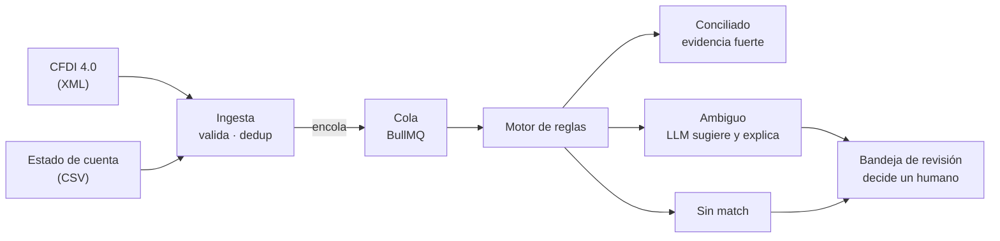
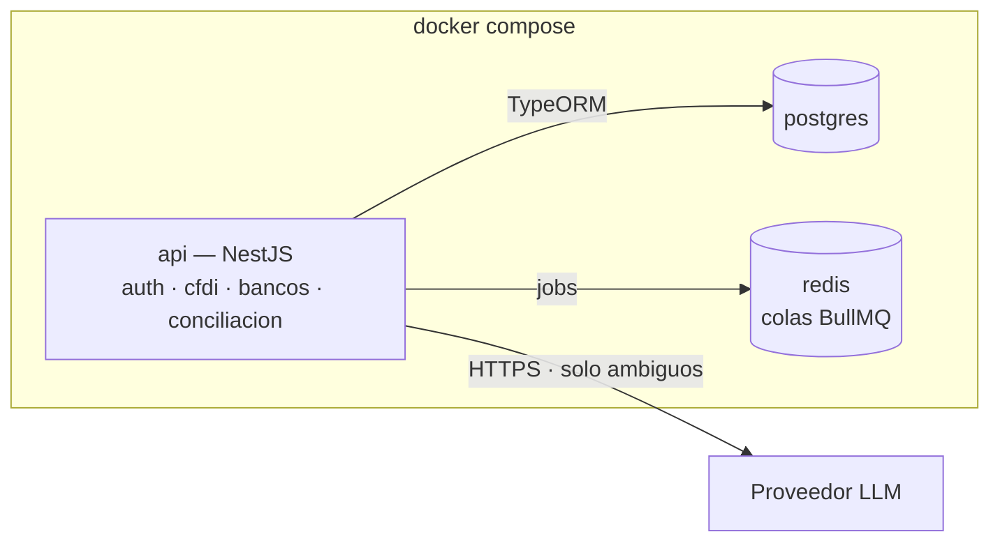

# Cuadra — contexto del proyecto

> Conciliación automática de facturas CFDI contra movimientos bancarios,
> con revisión humana en los casos dudosos.

| | |
|---|---|
| **Estado** | Día 1 de 9 · CU-01 ✅ · 3 / 69 pts |
| **Entrega** | 2 de octubre de 2026 |
| **Contexto** | Estancia profesional en michelada.io |
| **Alcance** | 18 historias · 69 puntos · 9 días hábiles |
| **Última actualización** | 22 sep 2026 |

Este archivo es la fuente de verdad del proyecto. Vive en la raíz del repo.
Si usas un agente de código, apúntalo aquí desde `CLAUDE.md` o `AGENTS.md`
para que lo lea antes de tocar nada.

---

## 1. El problema

El CFDI dice que **se debe** cobrar algo. El estado de cuenta dice que
**entró** dinero. Nada los une automáticamente.

Cada mes alguien en contabilidad abre el archivo del banco al lado del
listado de facturas y los empata a mano, línea por línea. Con unos cientos
de movimientos son días de trabajo, y los errores de asignación no dejan
rastro: un pago mal empatado se descubre meses después, cuando un cliente
reclama que ya pagó.

Tres cosas lo hacen difícil de automatizar:

- **Cada banco entrega su estado de cuenta distinto.** Columnas, formatos
  de fecha, cómo nombran la referencia. No hay estándar.
- **El match rara vez es exacto.** Llegan pagos con comisión descontada,
  pagos que cubren varias facturas, referencias mal capturadas.
- **PUE y PPD son lógicas distintas.** Una factura de pago en una
  exhibición se liquida de golpe; una de pago diferido se paga en partes y
  además exige su complemento de pago.

### El requisito silencioso

**Un falso positivo es peor que no conciliar.** Marcar como pagada una
factura que no se pagó rompe la contabilidad de forma difícil de detectar.
Esto define todo el diseño: el sistema solo concilia solo cuando la
evidencia es fuerte; todo lo demás va a revisión humana.

---

## 2. Cómo funciona

El motor de reglas es quien decide. El LLM solo interviene en la rama
ambigua y nunca cierra un caso por su cuenta. Si el modelo falla, el
movimiento cae en la bandeja — que es el comportamiento correcto de todos
modos.

### Las reglas del match

Cuatro señales: **monto, fecha, RFC y referencia.**

1. La referencia normalizada (sin guiones, espacios ni ceros a la
   izquierda) es la primera llave.
2. El monto con tolerancia configurable es el confirmador.
3. Si el monto difiere más de la tolerancia, el par baja a sugerencia y no
   se concilia.

Todo el pipeline es idempotente: la huella de cada archivo se guarda como
hash, así que subir el mismo estado de cuenta dos veces no duplica
movimientos.

---

## 3. Infraestructura

Tres contenedores y un comando. El módulo `conciliacion` es el único que
habla con el LLM, detrás de una interfaz propia — cambiar de proveedor, o
pasar a un modelo local, es reemplazar un adaptador sin tocar el motor de
reglas.

### Stack

| Pieza | Para qué | Por qué ésta |
|---|---|---|
| NestJS | API y lógica de dominio | Módulos con fronteras explícitas: la misma estructura que tendrían los microservicios, sin la red en medio |
| PostgreSQL | Facturas, movimientos, conciliaciones, bitácora | `NUMERIC` exacto, `JSONB` para el CFDI crudo, índices parciales, RLS para multiempresa |
| Redis + BullMQ | Procesamiento en segundo plano | Un estado de cuenta con cientos de movimientos no cabe en un request |
| Docker Compose | Levantar todo con un comando | Requisito de demo, no lujo |
| Jest | Tests del parseo y del motor | Es donde vive el riesgo real |

Complementos: `fast-xml-parser` para el CFDI, `zod` o `class-validator`
para validar lo que entra, Swagger generado por decoradores de Nest.

### Convenciones

- Nombres de columna en `snake_case` (`company_id`), traducidos a camelCase
  por el ORM. Postgres distingue mayúsculas si se citan identificadores.
- Montos siempre en `NUMERIC`, nunca en flotante.
- Ninguna query del dominio sale sin filtro de `company_id`.

---

## 4. Alcance

### Dentro — entrega 2 de octubre

- Parseo de CFDI 4.0 con validación de RFC, montos e impuestos
- Ingesta de estado de cuenta en CSV con mapeo por banco
- Motor de conciliación por monto, fecha, RFC y referencia
- Bandeja de revisión con estados y bitácora de auditoría
- Multiempresa con `company_id`, JWT y roles por empresa

### Fuera — propuesta de continuidad

- Microservicios y RabbitMQ
- Extracción de PDF bancario con LLM
- MinIO, Prometheus, Grafana, webhooks, rate limiting
- Adaptador Ollama para modelo local
- Complemento de pago, chat de consultas, reportes

El alcance está confirmado: **el proyecto entrega el 2 de octubre.** La
columna de fuera no es "fase 2 del mismo proyecto" — es lo que se le
presenta a la empresa como siguiente paso, con el sistema ya funcionando
como evidencia.

---

## 5. Decisiones

### D-01 · Monolito modular en lugar de microservicios

Los módulos quedan con las mismas fronteras que tendrían los servicios,
pero corren en un proceso. Extraerlos después es mover carpetas y agregar
transporte, no rediseñar.

**Qué se pierde:** escalado independiente por servicio y el argumento de
arquitectura distribuida. Ninguno se necesita para la entrega.

### D-02 · CSV antes que PDF con LLM

La extracción de PDF es la parte más vistosa y la más impredecible. Con CSV
el pipeline completo queda garantizado.

**Qué se pierde:** el argumento más fuerte del proyecto — "cada banco
entrega formato distinto y el sistema lo resuelve". Es la primera deuda a
pagar en la continuidad.

### D-03 · La IA sugiere, nunca decide

El motor de reglas resuelve los casos claros. El LLM solo opina sobre los
ambiguos, y su salida va a una bandeja humana. Si el modelo falla o no
responde, el caso queda en revisión.

**Qué se pierde:** nada. Y es la respuesta a "¿por qué IA aquí?": para lo
que las reglas no alcanzan, con un humano al final.

### D-04 · `company_id` desde la primera migración

La única pieza de la continuidad que se adelanta. Todo lo demás se agrega
después sin dolor; multiempresa retrofiteado obliga a tocar cada query.

**Qué cuesta:** una hora hoy. Tres días si se pospone.

### D-05 · El rol vive en la relación usuario–empresa

Tabla `user_company_roles` con `user_id + company_id + rol`. La misma
persona puede ser contador en una empresa y revisor en otra — el caso
normal cuando quien opera el sistema es un despacho contable o una
consultora. Los roles son un enum extensible (`admin`, `contador`,
`revisor`; después `auditor`, `super_admin`, `api`).

**Qué cuesta:** un join más en cada verificación de permiso.
Reestructurar la relación después es tocar auth completo.

### D-07 · Llaves primarias UUIDv7, no UUIDv4 ni serial

`UUID` porque con multiempresa un ID secuencial filtra volumen: un cliente
podría deducir cuántas facturas tienen los demás. Pero **v7, no v4**: el v4
es aleatorio, así que cada insert cae en una hoja distinta del B-tree,
fragmenta el índice y lo infla. El v7 lleva timestamp en los bits altos, así
que los inserts caen ordenados en el borde derecho del índice, como un
`bigserial`, sin perder la no-enumerabilidad.

Generación: `uuidv7()` nativo de Postgres 18. Alternativa en 17: el paquete
`uuidv7` de npm, generando en la aplicación.

**Qué cuesta:** nada frente a v4. A la escala del proyecto (cientos de
movimientos al mes) ni v4 se habría notado, pero el costo de elegir bien es
cero y el de corregirlo con datos encima no.

### D-06 · PostgreSQL sobre MySQL

Cuatro razones concretas: `NUMERIC` exacto para montos; `JSONB` para
guardar el CFDI parseado sin migrar el esquema cada vez que aparece un
campo del SAT no previsto; índices parciales sobre
`WHERE estado = 'abierta'`, que es justo lo que el motor consulta en cada
movimiento; y Row-Level Security, que convierte el aislamiento multiempresa
en garantía de la base en vez de disciplina del código.

**Qué cuesta:** curva de aprendizaje a mitad de un sprint de nueve días.
Se mitiga usándolo como relacional normal desde el día 1 y dejando RLS y
JSONB para cuando el flujo básico ya corra.

---

## 6. Historias

Puntos = tamaño relativo entre historias, no horas.

### Épica A · Fundación — 22–23 sep · 16 pts

| ID | Historia | Pts | Día |
|---|---|---|---|
| CU-01 | Entorno reproducible | 3 | 22 sep |
| CU-02 | Modelo de datos multiempresa | 5 | 22 sep |
| CU-03 | Acceso con roles por empresa | 5 | 23 sep |
| CU-04 | Aislamiento verificado | 3 | 23 sep |

### Épica B · Facturas — 24–25 sep · 13 pts

| ID | Historia | Pts | Día |
|---|---|---|---|
| CU-05 | Lectura del CFDI 4.0 | 5 | 24 sep |
| CU-06 | Carga de archivos | 3 | 24 sep |
| CU-07 | Carga idempotente | 2 | 25 sep |
| CU-08 | Procesamiento en segundo plano | 3 | 25 sep |

### Épica C · Banco — 25–28 sep · 8 pts

| ID | Historia | Pts | Día |
|---|---|---|---|
| CU-09 | Carga del estado de cuenta | 3 | 25 sep |
| CU-10 | Un formato por banco | 5 | 28 sep |

### Épica D · Conciliación — 29–30 sep · 13 pts

| ID | Historia | Pts | Día |
|---|---|---|---|
| CU-11 | Match por referencia y monto | 8 | 29 sep |
| CU-12 | Tolerancia configurable | 2 | 30 sep |
| CU-13 | Cada resultado explicado | 3 | 30 sep |

### Épica E · Revisión y entrega — 30 sep–2 oct · 19 pts

| ID | Historia | Pts | Día |
|---|---|---|---|
| CU-14 | Bandeja de revisión | 5 | 30 sep |
| CU-15 | Resolver un caso | 3 | 1 oct |
| CU-16 | Bitácora de auditoría | 3 | 1 oct |
| CU-17 | Sugerencia asistida por IA | 5 | 2 oct |
| CU-18 | Demo y datos sintéticos | 3 | 2 oct |

### Carga por día

| Día | Fecha | Pts |
|---|---|---|
| 1 | 22 sep | 8 |
| 2 | 23 sep | 8 |
| 3 | 24 sep | 8 |
| 4 | 25 sep | 8 |
| 5 | 28 sep | 5 |
| 6 | 29 sep | 8 |
| 7 | 30 sep | 10 |
| 8 | 1 oct | 6 |
| 9 | 2 oct | 8 |

Los días 5 y 8 quedan ligeros a propósito: el 5 es lunes después de fin de
semana y CU-10 suele traer sorpresas; el 8 es el colchón antes de entregar.

Los criterios de aceptación completos de cada historia están en el CSV de
Jira (`cuadra-jira.csv`) y en las issues importadas.

---

## 7. Riesgos

| Nivel | Riesgo | Mitigación |
|---|---|---|
| Abierto | ¿Qué proveedor de LLM? | No bloquea hasta CU-17, el penúltimo día, porque el adaptador aísla la elección. Conviene confirmarlo antes por credenciales. |
| Alto | El motor de match se puede ir de las manos | Cada regla nueva atrapa más casos y genera más falsos positivos. La tolerancia empieza estricta y se afloja con datos reales, nunca al revés. |
| Alto | Nueve días son nueve días | El alcance es entrega final, no hay "lo termino en la fase 2". Si algo se atrasa se corta una historia completa, nunca se entrega media. |
| Medio | CFDI 4.0 tiene más reglas del SAT de las que caben en un día | Parsear solo los campos que el motor necesita y dejar el XML íntegro en `JSONB` para extraer más después. |
| Medio | Datos de prueba | Todo el desarrollo corre con CFDI y estados de cuenta sintéticos. Nunca datos reales de clientes sin permiso explícito por escrito. |

---

## 8. Bitácora

Cada cambio de decisión, alcance o plan se agrega aquí. Lo más reciente
arriba.

### 22 sep 2026

- **CU-01 terminado.** `docker compose up` levanta api, postgres y redis;
  `/health` responde `{"status":"ok"}` con Postgres en ~11 ms. Stack
  confirmado: NestJS 11, Node 22, Postgres 17, Redis 7, validación de `.env`
  con Zod y health check con `@nestjs/terminus`.
  Nota para quien retome esto: `DATABASE_URL` usa `@postgres:5432` dentro de
  Docker y `@localhost:5432` al correr con `npm run start:dev`.
- **Jira poblado.** Proyecto `KAN`. Épicas `KAN-73`…`KAN-77`, historias
  `KAN-78`…`KAN-95` (CU-01 = KAN-78, CU-18 = KAN-95), más 64 subtareas.
  La importación va en tres pasos porque este Jira es *team-managed*: solo
  tiene el campo "Principal" y exige claves reales, así que las historias
  deben existir antes de crear sus subtareas o vincularlas a las épicas.
  Formato de fecha del importador: `yyyy-MM-dd`, sin hora.
- **Sin subtareas en Jira.** Tres intentos de importarlas fallaron con el
  mismo error (`doesn't have a valid Parent selection`), con IDs internos y
  con claves reales: el proyecto Kanban no acepta subtareas por CSV. Las 64
  tareas viven ahora como checklist dentro de la descripción de su historia.
  El tablero queda en 23 issues, que es lo que un proyecto de 9 días puede
  leer sin ruido.
- **CSV de Jira completo.** 87 filas: 5 épicas, 18 historias y 64
  subtareas, con `Issue ID`/`Parent ID` para la jerarquía y columnas
  `Link "blocks"` para las dependencias entre historias. Las subtareas
  heredan la fecha de su historia.
- **Cadena de dependencias definida.** CU-01 → CU-02 → CU-03/04 → CU-05 →
  CU-11 → CU-12/13/14 → CU-15/17. CU-11 es el cuello de botella: depende
  de CU-05, CU-08 y CU-10, y desbloquea cuatro historias.
- **Historias exportadas a Jira.** CSV con 5 épicas y 18 historias, con
  `Start date`, `Due date`, story points y etiqueta `dia-N`. Formato de
  fecha del importador: `yyyy-MM-dd`.
- **Carga rebalanceada.** Al asignar fechas salió que el último día llevaba
  14 puntos y el primero 3. Redistribuido a 5–10 puntos por día.
- **D-06: PostgreSQL sobre MySQL.** Decidido.
- **D-05: roles por empresa.** Tabla `user_company_roles` en vez de un
  campo `rol` en `users`.
- **Alcance confirmado en 2 semanas.** El proyecto entrega el 2 de octubre.
  Lo que estaba como "fase 2" pasa a ser propuesta de continuidad.
- **Roadmap reescrito como historias de usuario.** 18 historias en 5
  épicas, con criterios de aceptación en formato EARS.
- **Recorte de alcance de 4 meses a 9 días.** D-01, D-02, D-03, D-04.
  Origen: la propuesta original planteaba microservicios, MinIO,
  observabilidad y extracción de PDF con IA en un cronograma de 4 meses.

---

## Archivos del proyecto

| Archivo | Qué es |
|---|---|
| `CUADRA.md` | Este archivo. Fuente de verdad del contexto. |
| `cuadra-1-epicas-historias.csv` | Paso 1 de la importación: 5 épicas y 18 historias. |
| `cuadra-3-historias-a-epicas.csv` | Paso 2: vincula cada historia con su épica. |
| `cuadra-4-tareas-en-descripcion.csv` | Paso 3: las 64 tareas como checklist en la descripción. |
| Artifact "Cuadra" | Vista navegable del mismo contenido, para compartir. |
