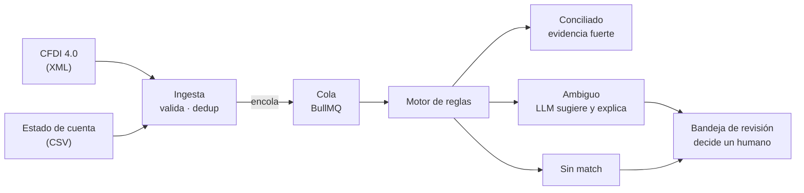
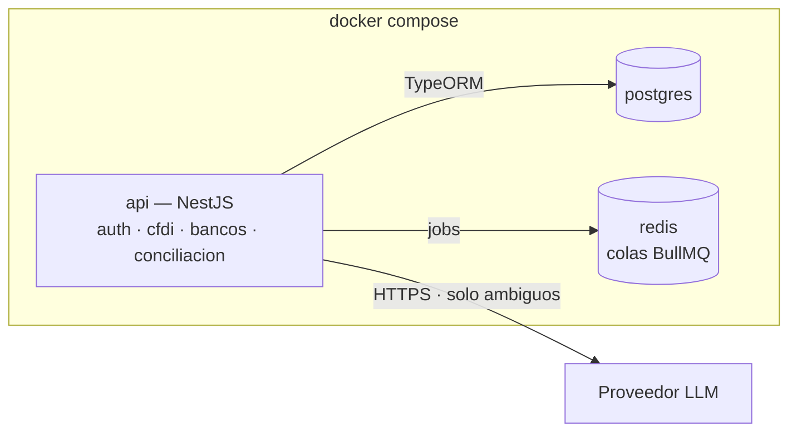
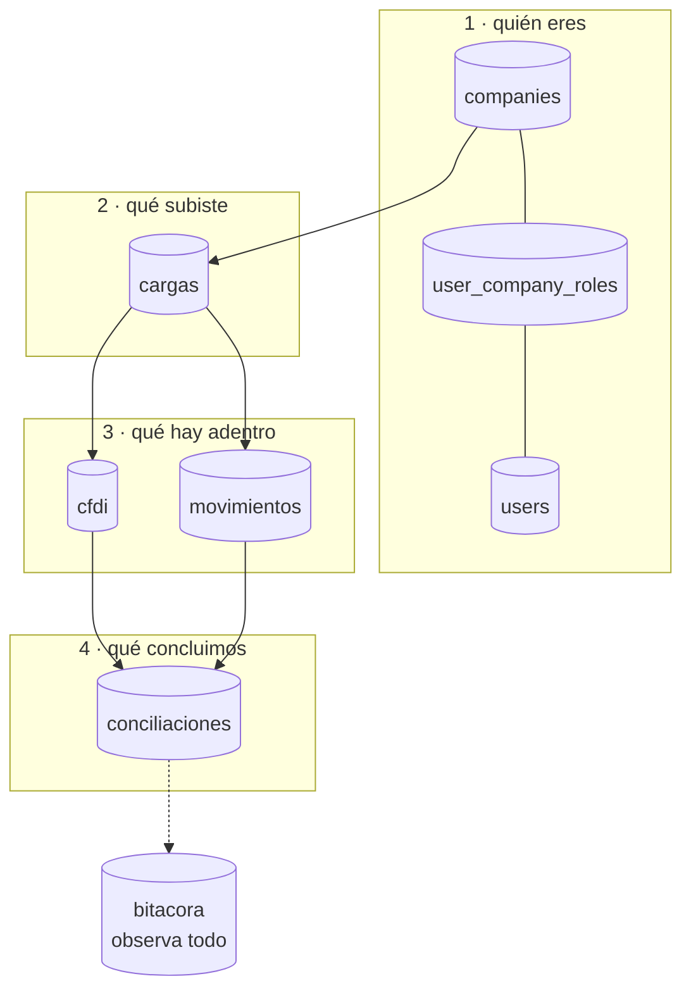

# Cuadra — contexto del proyecto

> Conciliación automática de facturas CFDI contra movimientos bancarios,
> con revisión humana en los casos dudosos.

| | |
|---|---|
| **Estado** | Día 8 de 9 · CU-01 a CU-19, más CU-04b · 71 / 99 pts · Épicas A–E cerradas, F en curso, G y H pendientes |
| **Entrega** | 2 de octubre de 2026 (backend, CU-01 a CU-18); el frontend (CU-19 a CU-26) no tiene fecha |
| **Contexto** | Estancia profesional en michelada.io |
| **Alcance** | 26 historias · 99 puntos (69 del backend y 30 de la interfaz) · 9 días hábiles para el backend |
| **Última actualización** | 1 oct 2026 |

Este archivo es la fuente de verdad del proyecto. Vive en la raíz del repo.
Si usas un agente de código, apúntalo aquí desde `CLAUDE.md` o `AGENTS.md`
para que lo lea antes de tocar nada.

---

## 1. El problema

El CFDI dice que **se debe** cobrar algo. El estado de cuenta dice que
**entró** dinero. Nada los une automáticamente.

Cada mes alguien en contabilidad abre el archivo del banco al lado del
listado de facturas y los empata a mano, línea por línea. Con unos cientos
de movimientos son días de trabajo, y los errores de asignación no dejan
rastro: un pago mal empatado se descubre meses después, cuando un cliente
reclama que ya pagó.

Tres cosas lo hacen difícil de automatizar:

- **Cada banco entrega su estado de cuenta distinto.** Columnas, formatos
  de fecha, cómo nombran la referencia. No hay estándar.
- **El match rara vez es exacto.** Llegan pagos con comisión descontada,
  pagos que cubren varias facturas, referencias mal capturadas.
- **PUE y PPD son lógicas distintas.** Una factura de pago en una
  exhibición se liquida de golpe; una de pago diferido se paga en partes y
  además exige su complemento de pago.

### El requisito silencioso

**Un falso positivo es peor que no conciliar.** Marcar como pagada una
factura que no se pagó rompe la contabilidad de forma difícil de detectar.
Esto define todo el diseño: el sistema solo concilia solo cuando la
evidencia es fuerte; todo lo demás va a revisión humana.

---

## 2. Cómo funciona



El motor de reglas es quien decide. El LLM solo interviene en la rama
ambigua y nunca cierra un caso por su cuenta. Si el modelo falla, el
movimiento cae en la bandeja — que es el comportamiento correcto de todos
modos.

### Las reglas del match

Cuatro señales: **monto, fecha, RFC y referencia.**

1. La referencia normalizada (sin guiones, espacios ni ceros a la
   izquierda) es la primera llave.
2. El monto con tolerancia configurable es el confirmador.
3. Si el monto difiere más de la tolerancia, el par baja a sugerencia y no
   se concilia.

Todo el pipeline es idempotente: la huella de cada archivo se guarda como
hash, así que subir el mismo estado de cuenta dos veces no duplica
movimientos.

---

## 3. Infraestructura



Tres contenedores y un comando. El módulo `sugerencias` es el único que
habla con el LLM, detrás de una interfaz propia (`ProveedorSugerencia`) — cambiar de proveedor, o
pasar a un modelo local, es reemplazar un adaptador sin tocar el motor de
reglas.

### Stack

| Pieza | Para qué | Por qué ésta |
|---|---|---|
| NestJS | API y lógica de dominio | Módulos con fronteras explícitas: la misma estructura que tendrían los microservicios, sin la red en medio |
| PostgreSQL | Facturas, movimientos, conciliaciones, bitácora | `NUMERIC` exacto, `JSONB` para el CFDI crudo, índices parciales, RLS para multiempresa |
| Redis + BullMQ | Procesamiento en segundo plano | Un estado de cuenta con cientos de movimientos no cabe en un request |
| Docker Compose | Levantar todo con un comando | Requisito de demo, no lujo |
| Jest | Tests del parseo y del motor | Es donde vive el riesgo real |

Complementos: `fast-xml-parser` para el CFDI, `zod` o `class-validator`
para validar lo que entra, Swagger generado por decoradores de Nest.

### Convenciones

- Nombres de columna en `snake_case` (`company_id`), traducidos a camelCase
  por el ORM. Postgres distingue mayúsculas si se citan identificadores.
- Montos siempre en `NUMERIC`, nunca en flotante.
- Ninguna query del dominio sale sin filtro de `company_id`.

---

## 4. Modelo de datos, tabla por tabla

### El mapa



Cuatro capas: **quién eres**, **qué subiste**, **qué hay adentro**, **qué
concluimos** — y la bitácora observando todo. Las seis tablas de dominio
llevan `company_id` con FK `RESTRICT`: no se puede borrar una empresa que
todavía tiene datos.

---

### `companies` — la raíz

Las empresas que usan el sistema. Es el inquilino.

| Columna | Tipo | Notas |
|---|---|---|
| `rfc` | varchar(13) | único |
| `razon_social` | varchar(255) | |
| `regimen_fiscal` | varchar(3) | opcional, catálogo `c_RegimenFiscal` |
| `activa` | boolean | default `true` |

**No lleva `company_id` porque lo es.** Único caso del esquema.

`varchar(13)` porque el RFC es de 12 para persona moral y 13 para física.
`activa` en vez de borrar: cuando un cliente se va se desactiva, porque
borrarlo rompería su contabilidad histórica — y la FK `RESTRICT` de hecho lo
impide.

### `users` — globales, no de una empresa

| Columna | Tipo | Notas |
|---|---|---|
| `email` | varchar(320) | único sobre `lower(email)` |
| `nombre` | varchar(255) | |
| `password_hash` | varchar(255) | nunca texto plano |
| `activo` | boolean | default `true` |

**Un usuario no pertenece a una empresa**, pertenece al sistema. Es lo que
permite que un contador externo atienda tres clientes con una sola cuenta,
en vez de tres cuentas con tres contraseñas.

`varchar(320)` es el máximo del estándar de correo: 64 de parte local + `@`
+ 255 de dominio. El nombre `password_hash` es documentación: quien lo lea
sabe que ahí no va texto plano.

**La unicidad va sobre `lower(email)`, no sobre `email`.** Un `UNIQUE` plano
deja convivir `ana@x.mx` y `Ana@x.mx` como dos personas distintas, y el día
que el login normalice a minúsculas una de las dos queda inalcanzable para
siempre. El índice es `ux_users_email_lower`, y el login busca comparando
`lower(email)` — si buscara por `email` directo, el índice no lo usaría
nadie.

### `user_company_roles` — la tabla puente

| Columna | Tipo | Notas |
|---|---|---|
| `user_id` | uuid | FK → users, `CASCADE` |
| `company_id` | uuid | FK → companies, `CASCADE` |
| `rol` | varchar(32) | `admin` · `contador` · `revisor` |

Sin ella el rol viviría en `users` —y sería global— o en `companies` —y no
sabrías de quién. `CASCADE` en ambas llaves porque un acceso de un usuario
que ya no existe no significa nada.

**La unicidad es sobre la terna `(user_id, company_id, rol)`**, no sobre el
par: una persona puede tener dos roles en la misma empresa, a propósito. Ver
[D-08](#d-08--varios-roles-por-persona-y-la-segregación-a-nivel-de-acción).

Historias: CU-03, CU-04.

### `cargas` — la puerta de entrada

| Columna | Tipo | Notas |
|---|---|---|
| `tipo` | varchar(32) | `cfdi` · `estado_cuenta` |
| `estado` | varchar(32) | pendiente → procesando → procesada / con_errores / fallida (CU-08) |
| `nombre_archivo` | varchar(512) | como lo llamó el usuario |
| `hash_archivo` | char(64) | SHA-256 en hex: del archivo (estado de cuenta) o de los hashes ordenados del lote (CFDI) |
| `total_registros`, `registros_ok`, `registros_error`, `registros_existentes` | int | `CHECK >= 0`; suma exacta al terminar (`ck_cargas_total_cuadra`) |
| `resultados` | jsonb | CFDI: uno por archivo; estado de cuenta: una por fila que no entró |
| `banco`, `cuenta` | varchar(128), varchar(32) | estado de cuenta: se copian a cada movimiento (CU-09) |
| `error_mensaje` | text | solo en `fallida`, genérico |
| `subido_por_id` | uuid | FK `SET NULL` |

Sin esta tabla no sabrías de dónde vino cada factura. `char(64)` y no
`varchar` porque un SHA-256 en hexadecimal mide exactamente 64 caracteres
siempre.

El índice único `(company_id, hash_archivo)` es la idempotencia de CU-07.
`subido_por_id` con `SET NULL`: si el usuario se va, la carga sobrevive sin
dueño — es información histórica que no debe desaparecer porque alguien
renunció.

Historias: CU-06, CU-07, CU-08, CU-09.

### `cfdi` — la tabla con más decisiones

| Columna | Tipo | Notas |
|---|---|---|
| `uuid_fiscal` | varchar(36) | folio fiscal del SAT |
| `rfc_emisor`, `rfc_receptor` | varchar(13) | |
| `fecha_emision` | **timestamp** | sin zona horaria |
| `tipo_comprobante` | varchar(1) | `I` `E` `T` `N` `P` |
| `moneda` | char(3) | default `MXN` |
| `tipo_cambio` | numeric(18,**6**) | opcional |
| `subtotal`, `descuento`, `total` | numeric(18,4) | |
| `metodo_pago` | varchar(3) | `PUE` / `PPD` |
| `forma_pago` | varchar(2) | catálogo del SAT |
| `estado` | varchar(32) | abierta · conciliada · cancelada |
| `xml_raw` | **jsonb** | obligatorio |

**`fecha_emision` es `timestamp`, no `timestamptz`** — la única columna del
esquema sin zona horaria, y es correcto: el SAT emite la fecha en hora local
sin offset. Convertirla a UTC inventaría un dato que el documento no tiene, y
una factura del 31 de marzo podría volverse del 1 de abril.

**`tipo_cambio` con 6 decimales**, no 4: los montos llevan 4 porque es lo que
el SAT permite en impuestos, pero el tipo de cambio se cotiza con más
precisión.

**`uuid_fiscal` único por `(company_id, uuid_fiscal)`, no global.** El folio
es irrepetible en México, pero dos empresas del mismo grupo pueden recibir el
mismo CFDI y cada una lo concilia. Hay dos tests que prueban los dos lados.

**Índice parcial** `(company_id, rfc_emisor) WHERE estado = 'abierta'`: al año
habrá miles de conciliadas y decenas abiertas; el motor solo busca entre las
abiertas, así que el índice se mantiene pequeño para siempre.

**`ck_cfdi_xml_raw_integro`** exige que `xml_raw` sea un objeto y contenga la
llave `_xml` con el XML tal como llegó. El criterio "se conserva íntegro"
dejó de ser promesa. Además, si mañana hace falta un campo del SAT no
previsto, está ahí sin migrar nada.

Historias: CU-05, CU-06; es la fuente de candidatos de CU-11.

### `movimientos` — cada línea del banco

| Columna | Tipo | Notas |
|---|---|---|
| `linea_numero` | int | línea física del archivo, encabezado = 1 (CU-09), `CHECK >= 0` |
| `fecha` | **date** | sin hora |
| `descripcion` | text | |
| `referencia` | varchar(128) | opcional |
| `monto` | numeric(18,4) | `CHECK <> 0` |
| `banco`, `cuenta` | varchar | opcionales |
| `estado` | varchar(32) | abierto · conciliado · descartado |

**`fecha` es `date`**: el banco da el día, no la hora. Guardar medianoche
inventaría precisión y al convertir zonas podría saltar al día anterior.

**La idempotencia es por `(company_id, carga_id, linea_numero)`, no por hash
del contenido.** Lo intuitivo sería deduplicar por contenido, pero dos cargos
legítimos pueden ser idénticos el mismo día — dos pagos de $500 del mismo
cliente son dos pagos. Identificar por posición en el archivo resuelve las
dos cosas: reprocesar no duplica, y dos movimientos idénticos siguen siendo
dos.

**`referencia_norm` (CU-11):** columna generada `STORED` con su índice
`(company_id, referencia_norm)`, calculada por la función SQL
`normalizar_referencia` para que ninguna vía de inserción la olvide. Quita
todo lo que no sea `[A-Za-z0-9]`, pasa a mayúsculas y borra los ceros a la
izquierda solo del primer bloque de dígitos tras las letras iniciales
(`A-0001001` → `A1001`). El normalizador de TypeScript
(`src/conciliacion/referencia-normalizer.ts`) implementa lo mismo y
`referencia-normalizer.paridad.spec.ts` compara ambos contra Postgres.

- **Decisión de diseño:** declarar una columna generada en la entidad hace
  que el ejecutor de TypeORM cree `typeorm_metadata` en cada corrida, así
  que ninguna migración puede dejar esa tabla ausente al revertir. La
  migración solo inserta y borra su fila, y la prueba de reversibilidad de
  `esquema.spec.ts` exime esa tabla igual que `migrations`.
- **Hueco aceptado:** dígitos pegados a la serie sin separador (el banco
  escribe `120034` para serie 12, folio 0034) no coinciden.

#### Formato canónico del estado de cuenta (CU-09)

`POST /cargas/estado-cuenta`, multipart: un archivo en el campo `archivo`
(`.csv`, 10 MB máximo) y, opcionales, `banco` (≤ 128) y `cuenta` (≤ 32,
enmascarada), que se copian a cada movimiento, y `perfil` (CU-10, por
defecto `cuadra`). Roles admin y contador. El formato canónico es el perfil
`cuadra` (`src/bancos/perfiles/cuadra.json`); el de cada banco se normaliza
a estos mismos cuatro datos.

```csv
fecha,descripcion,referencia,monto
2026-09-01,DEPOSITO SPEI FERRETERIA DEL BAJIO,A1001,4466.58
2026-09-02,"PAGO FACTURA A-1001, A-1002",,-1500.00
```

| Regla | Detalle |
|---|---|
| Codificación | UTF-8; el BOM se tolera. Latin-1 u otra → 400. |
| Separador | Coma, con comillas dobles estándar: `""` dentro de comillas es una comilla, y un campo entre comillas puede traer comas y saltos de línea. Fin de línea LF o CRLF. |
| Encabezados | Exactamente `fecha,descripcion,referencia,monto`, en ese orden y en minúsculas. Otro → 400. |
| `fecha` | `AAAA-MM-DD`, un día que exista. |
| `descripcion` | Obligatoria; no puede ser solo espacios. |
| `referencia` | Opcional (vacía = sin referencia), máximo 128 caracteres. |
| `monto` | Con signo: positivo = abono, negativo = cargo. Punto decimal, sin separador de miles ni notación científica, máximo 4 decimales y 14 enteros, distinto de 0. |

- **Archivo completo, en el POST, antes de guardar nada:** extensión,
  UTF-8, sin bytes nulos, CSV bien formado (comillas cerradas), encabezados
  exactos y al menos una fila. Si falla → 400 con motivo y no se crea
  carga.
- **Cada fila, en el worker:** una fila malformada (columnas de más o de
  menos, fecha inválida, monto no numérico, en 0 o con más de 4 decimales,
  referencia larga, descripción vacía) se reporta como `{fila, motivo}` en
  `cargas.resultados`, y el resto se carga. `fila` es la línea física: el
  contador la encuentra al abrir el archivo.
- Las líneas vacías se ignoran y no cuentan como filas.
- Idempotencia: SHA-256 del archivo. El mismo archivo dos veces en la
  empresa → 200 `yaExistia`, sin movimientos nuevos.

#### Cómo agregar un banco (CU-10)

Agregar un banco es configuración, no código: un archivo
`src/bancos/perfiles/<id>.json`, con el `id` igual al nombre del archivo, y
reiniciar la api. El perfil dice cómo leer el CSV del banco:
- codificación (`utf-8` o `windows-1252`) y separador (`,`, `;` o tabulador);
- cuántas líneas de preámbulo saltar antes del encabezado;
- la fila de encabezados **exacta y completa**, en orden, incluidas las
  columnas que no se usan, como el saldo. Si el banco cambia su formato, el
  archivo se rechaza en vez de leerse mal;
- qué encabezado es la fecha, el concepto y la referencia (opcional), y el
  monto: una columna con signo, o `cargo` + `abono` (monto = abono − cargo;
  sin signo, exactamente uno por fila);
- el formato de fecha y los separadores de miles y decimal.

Solo datos: nada de funciones, regex ni código en el JSON. Se validan con
Zod al arrancar (`src/bancos/perfil.ts`), y un perfil inválido impide que la
api levante, con el archivo y el campo en el error. Las líneas que se
reportan son las del archivo original, preámbulo incluido. `GET
/bancos/perfiles` lista los disponibles.

```json
{
  "id": "banco-norte",
  "nombre": "Banco del Norte (sintético)",
  "codificacion": "utf-8",
  "separador": ",",
  "lineasPreambulo": 0,
  "encabezados": ["Fecha", "Concepto", "Referencia", "Cargo", "Abono", "Saldo"],
  "columnas": {
    "fecha": "Fecha",
    "concepto": "Concepto",
    "referencia": "Referencia",
    "cargo": "Cargo",
    "abono": "Abono"
  },
  "formatoFecha": "DD/MM/AAAA",
  "separadorMiles": ",",
  "separadorDecimal": "."
}
```

`formatoFecha`: `AAAA-MM-DD`, `DD/MM/AAAA` o `DD-MM-AAAA`.
`separadorMiles`: `","`, `"."` o `null`. `separadorDecimal`: `"."` o `","`.
Con monto con signo, `"columnas"` lleva `"monto"` en lugar de `"cargo"` y
`"abono"`.

Historias: CU-09, CU-10.

### `conciliaciones` — donde vive la regla de oro

| Columna | Tipo | Notas |
|---|---|---|
| `cfdi_id` | uuid | FK `CASCADE` |
| `movimiento_id` | uuid | FK `CASCADE` |
| `estado` | varchar(32) | propuesta · confirmada · rechazada |
| `origen` | varchar(32) | regla · llm · manual |
| `regla` | varchar(64) | cuál regla disparó |
| `score` | numeric(5,4) | confianza en `[0,1]` |
| `diferencia_monto` | numeric(18,4) | |
| `motivo` | text | legible |
| `confirmada_por_id` | uuid | FK `RESTRICT` |
| `confirmada_at` | timestamptz | |

Es una tabla y no dos columnas en `cfdi` porque la conciliación **tiene
historia propia**: nace como propuesta, alguien la revisa, y termina
confirmada o rechazada. Con dos columnas solo cabría un match por factura y
no habría dónde guardar el porqué.

**Tres índices únicos:**

- `ux_conciliaciones_par (company_id, cfdi_id, movimiento_id)` — no se
  propone el mismo par dos veces.
- `ux_conciliaciones_cfdi_confirmada` — parcial, `WHERE estado='confirmada'`.
- `ux_conciliaciones_movimiento_confirmada` — parcial, igual.

Los dos parciales permiten muchas propuestas pero **una sola confirmada** por
factura y por movimiento. Es "un falso positivo es peor que no conciliar"
escrito en el esquema: aunque el código tenga un bug, la base no deja que un
pago se aplique a dos facturas.

**`ck_conciliaciones_confirmada_requiere_persona`**: llegar a `confirmada`
exige `confirmada_por_id` y `confirmada_at`. El motor y el LLM solo producen
`propuesta`, porque no tienen un `user_id` que poner. La decisión D-03 dejó
de depender de que el código se porte bien.

**`RESTRICT` en `confirmada_por_id`**: no se puede borrar a quien confirmó
algo. Si alguien se va, se desactiva. En un sistema contable, poder decir
"esto lo confirmó Fulano el 15 de marzo" tres años después no es opcional.

Historias: CU-11 a CU-15, CU-17.

### `bitacora` — append-only por construcción

| Columna | Tipo | Notas |
|---|---|---|
| `user_id` | uuid | FK `SET NULL`, **opcional** |
| `entidad` | varchar(64) | nombre de la tabla afectada |
| `entidad_id` | uuid | |
| `accion` | varchar(32) | crear · actualizar · eliminar · cargar · confirmar · rechazar |
| `datos` | jsonb | el antes y el después |
| `ip` | **inet** | |
| `user_agent` | text | |
| `created_at` | timestamptz | **sin `updated_at`** |

**No hereda de `EntidadBase`**, y ésa es la decisión que la define: heredaría
`updated_at`, y una bitácora que se puede modificar no sirve como evidencia.

`user_id` opcional porque no toda acción la hace una persona: cuando el motor
concilia solo, `NULL` significa exactamente "lo hizo el sistema".

`ip` es tipo `inet`, nativo de Postgres: valida el formato, ocupa menos que
texto y permite consultas por subred.

El diseño genérico —`entidad` + `entidad_id` en vez de una FK por tabla—
permite auditar cualquier cosa sin agregar columnas. El costo es que no hay
integridad referencial, lo cual en una bitácora es correcto: quieres
conservar el registro aunque la fila original desaparezca.

Historia: CU-16.

### `migrations` — la que no diseñaste

TypeORM la crea sola: `id serial`, `timestamp bigint`, `name varchar`.
Guarda qué migraciones ya se aplicaron, y es por eso que `migration:run`
sabe qué no repetir. Es la única tabla del esquema con `id serial` — a
TypeORM no le importa la convención de UUIDv7 para su tabla interna.

---

## 5. Alcance

### Dentro — entrega 2 de octubre

- Parseo de CFDI 4.0 con validación de RFC, montos e impuestos
- Ingesta de estado de cuenta en CSV con mapeo por banco
- Motor de conciliación por monto, fecha, RFC y referencia
- Bandeja de revisión con estados y bitácora de auditoría
- Multiempresa con `company_id`, JWT y roles por empresa

### Fuera — propuesta de continuidad

- Microservicios y RabbitMQ
- Extracción de PDF bancario con LLM
- MinIO, Prometheus, Grafana, webhooks, rate limiting (por eso tampoco hay
  bloqueo de cuenta por intentos fallidos: ver D-11)
- Adaptador Ollama para modelo local
- Complemento de pago, chat de consultas, reportes

El alcance está confirmado: **el proyecto entrega el 2 de octubre.** La
columna de fuera no es "fase 2 del mismo proyecto" — es lo que se le
presenta a la empresa como siguiente paso, con el sistema ya funcionando
como evidencia.

---

## 6. Decisiones

### D-01 · Monolito modular en lugar de microservicios

Los módulos quedan con las mismas fronteras que tendrían los servicios,
pero corren en un proceso. Extraerlos después es mover carpetas y agregar
transporte, no rediseñar.

**Qué se pierde:** escalado independiente por servicio y el argumento de
arquitectura distribuida. Ninguno se necesita para la entrega.

### D-02 · CSV antes que PDF con LLM

La extracción de PDF es la parte más vistosa y la más impredecible. Con CSV
el pipeline completo queda garantizado.

**Qué se pierde:** el argumento más fuerte del proyecto — "cada banco
entrega formato distinto y el sistema lo resuelve". Es la primera deuda a
pagar en la continuidad.

### D-03 · La IA sugiere, nunca decide

El motor de reglas resuelve los casos claros. El LLM solo opina sobre los
ambiguos, y su salida va a una bandeja humana. Si el modelo falla o no
responde, el caso queda en revisión.

**Qué se pierde:** nada. Y es la respuesta a "¿por qué IA aquí?": para lo
que las reglas no alcanzan, con un humano al final.

### D-04 · `company_id` desde la primera migración

La única pieza de la continuidad que se adelanta. Todo lo demás se agrega
después sin dolor; multiempresa retrofiteado obliga a tocar cada query.

**Qué cuesta:** una hora hoy. Tres días si se pospone.

### D-05 · El rol vive en la relación usuario–empresa

Tabla `user_company_roles` con `user_id + company_id + rol`. La misma
persona puede ser contador en una empresa y revisor en otra — el caso
normal cuando quien opera el sistema es un despacho contable o una
consultora. Los roles son un enum extensible (`admin`, `contador`,
`revisor`; después `auditor`, `super_admin`, `api`).

**Qué cuesta:** un join más en cada verificación de permiso.
Reestructurar la relación después es tocar auth completo.

### D-08 · Varios roles por persona, y la segregación a nivel de acción

Una persona **sí** puede tener varios roles en la misma empresa: la unicidad
de `user_company_roles` se queda sobre la terna, no sobre el par. El guard de
CU-03 autoriza si cualquiera de los roles del usuario en esa empresa alcanza.

La alternativa —un rol por empresa— se descartó porque en una empresa de tres
personas el contador *es* el revisor; obligar a que sean distintos daría un
sistema que nadie puede usar.

El riesgo que eso abre —que alguien confirme una conciliación de una factura
que él mismo cargó— **se cierra en CU-15, a nivel de acción y no de rol**:
quien subió una carga no puede confirmar sus conciliaciones. Es como lo
resuelven los sistemas contables, porque la segregación de funciones real se
impone sobre lo que se hace, no sobre cómo se llama el puesto.

**Qué cuesta:** una regla más en CU-15. Cambiar la unicidad después sí sería
una migración con datos encima.

### D-07 · Llaves primarias UUIDv7, no UUIDv4 ni serial

`UUID` porque con multiempresa un ID secuencial filtra volumen: un cliente
podría deducir cuántas facturas tienen los demás. Pero **v7, no v4**: el v4
es aleatorio, así que cada insert cae en una hoja distinta del B-tree,
fragmenta el índice y lo infla. El v7 lleva timestamp en los bits altos, así
que los inserts caen ordenados en el borde derecho del índice, como un
`bigserial`, sin perder la no-enumerabilidad.

Generación: `uuidv7()` nativo de Postgres 18. Alternativa en 17: el paquete
`uuidv7` de npm, generando en la aplicación.

**Qué cuesta:** nada frente a v4. A la escala del proyecto (cientos de
movimientos al mes) ni v4 se habría notado, pero el costo de elegir bien es
cero y el de corregirlo con datos encima no.

### D-06 · PostgreSQL sobre MySQL

Cuatro razones concretas: `NUMERIC` exacto para montos; `JSONB` para
guardar el CFDI parseado sin migrar el esquema cada vez que aparece un
campo del SAT no previsto; índices parciales sobre
`WHERE estado = 'abierta'`, que es justo lo que el motor consulta en cada
movimiento; y Row-Level Security, que convierte el aislamiento multiempresa
en garantía de la base en vez de disciplina del código.

**Qué cuesta:** curva de aprendizaje a mitad de un sprint de nueve días.
Se mitiga usándolo como relacional normal desde el día 1 y dejando RLS y
JSONB para cuando el flujo básico ya corra.

### D-09 · Dos tokens: selección (5 min) y sesión (15 min)

Una persona puede pertenecer a varias empresas (D-05). El login **no** puede
saber a cuál va a entrar, así que el acceso se parte en dos pasos, cada uno
con su propio token:

| | `scope: 'seleccion'` | `scope: 'sesion'` |
|---|---|---|
| Lo emite | `POST /auth/login` | `POST /auth/empresa/:id` |
| Lleva | `sub` | `sub` + `companyId` |
| Vive | 5 min | 15 min |
| Sirve para | elegir empresa | todo lo demás |

El token de selección solo abre la lista de empresas del usuario y el
endpoint que canjea una. Dura 5 minutos porque es una pantalla de un clic —
si alguien lo roba, no alcanza a usarlo y de todos modos no abre nada del
dominio.

**El `companyId` viaja firmado dentro del token, no como parámetro.** Si
fuera un `?companyId=` o un header suelto, cualquiera lo cambiaría por el de
otra empresa; dentro del token lo protege la firma, y la validación de que
esa persona sí pertenece a esa empresa ocurre una sola vez, al canjear.

Lo que **no** va en el token son los roles: se leen de
`user_company_roles` en cada request. Un token es un papel firmado que ya
no se puede retirar — si el rol viviera ahí, quitarle permisos a alguien
tardaría hasta que expirara el token. Leyéndolos de la base, la revocación
es inmediata.

**El default del módulo se queda corto a propósito.** `JwtModule` define
`signOptions: { expiresIn: '5m' }` aunque cada `sign()` pase el suyo
explícito. Razón: si se olvida el `expiresIn` en un punto de firma y no hay
default, `jsonwebtoken` emite el token **sin `exp`**, y `verify()` acepta
tokens sin expiración para siempre. Un token eterno no se nota porque todo
"funciona". Una sesión que caduca en 5 minutos sí se nota, y se arregla en
un minuto. El default tiene que ser el restrictivo para que la falla sea
ruidosa en vez de silenciosa.

**Qué cuesta:** un request más en el login y un test por tipo de token que
decodifique el `exp` y verifique la duración — no opcional, es lo que
sostiene el punto anterior.

### D-10 · Proveedor de LLM: Anthropic detrás de un adaptador

CU-17 usa **Anthropic, modelo `claude-sonnet-5-5`**, con el SDK oficial
`@anthropic-ai/sdk`. El servicio no conoce al proveedor: habla con el puerto
`ProveedorSugerencia`; `AdaptadorAnthropic` es una implementación, y hay un
`ProveedorFalso` (pruebas) y un `ProveedorDesactivado` (función apagada).

- **Llamada:** `messages.create` con salida estructurada
  (`output_config.format` = esquema JSON) y `effort: 'low'`: elegir entre
  pocos candidatos no pide razonamiento largo. Sin `thinking`, sin
  `tool_choice`, sin betas. La respuesta se valida con zod; si el modelo
  rompe el contrato, es un fallo del proveedor, no un "no sé".
- **Sin respaldo del lado del servidor** (`fallbacks`): la documentación no
  confirma que combine con salida estructurada. Un rechazo (`refusal`) o un
  corte por `max_tokens` es simplemente "sin sugerencia".
- **Qué sale de la casa:** del movimiento, `fecha`, `monto`, `moneda`,
  `descripcion` y `referencia`; de cada CFDI, una etiqueta opaca (`C1..CN`),
  serie-folio, total, fecha y `nombre_receptor`. **Nunca** RFC, UUID, XML ni
  ids. La etiqueta solo la traduce el servidor.
- **Texto no confiable:** descripción, referencia y receptor vienen de
  bancos y terceros. Viajan como datos JSON y el prompt de sistema lo dice;
  aun si el modelo obedeciera una instrucción inyectada, la etiqueta se
  valida contra el conjunto que se le mostró.
- **Solo propone:** crea una conciliación `origen 'llm'`, `estado
  'propuesta'`, `regla 'llm_sugerencia'`, sin score, que una persona confirma
  o rechaza (CU-15). Se aceptan confianza `alta` y `media`; `baja` se
  descarta. Un falso positivo es peor que no conciliar.
- **Apagado por omisión (opt-in):** activa solo con `LLM_HABILITADO=true` **y**
  `ANTHROPIC_API_KEY`. Habilitado sin llave queda inerte con un aviso, no
  truena el arranque: el CI no necesita secretos.
- **Asíncrono:** cola `sugerencias` (BullMQ, un intento, un job por empresa),
  encolada después de conciliar una carga. Un fallo de la cola o del
  proveedor nunca falla ni altera una carga.

| Variable | Por omisión | Qué hace |
|---|---|---|
| `LLM_HABILITADO` | `false` | Interruptor. Solo `true`/`false`. |
| `ANTHROPIC_API_KEY` | (vacía) | Llave. Vacía = ausente. |
| `LLM_MODEL` | `claude-sonnet-5-5` | Modelo. Entra en la huella de la entrada. |
| `LLM_TIMEOUT_MS` | `15000` | Espera máxima por llamada (≥ 1000). |
| `LLM_MAX_LLAMADAS_POR_CORRIDA` | `20` | Tope de llamadas por corrida. |
| `LLM_CANDIDATOS_MAX` | `10` | Más candidatos que esto y se omite el movimiento. |

**Qué cuesta:** cada pregunta es una llamada de pago y sale texto bancario
al proveedor (por eso el opt-in y la lista cerrada de campos). Ollama sigue
fuera de alcance: el puerto lo permite cuando haga falta.

### D-11 · Sin bloqueo de cuenta por intentos fallidos

El login **no bloquea cuentas** ni cuenta intentos fallidos. Una contraseña
incorrecta devuelve siempre el mismo 401 "Credenciales inválidas" (CU-03),
sin importar cuántas veces se repita.

- **Por qué no:** cualquiera que conozca el correo de un usuario podría
  bloquearlo con cinco contraseñas erróneas. Sería una negación de servicio
  gratuita contra una persona legítima.
- **Por qué tampoco una respuesta "cuenta bloqueada":** distinguiría los
  correos que existen de los que no, y rompería el 401 único de CU-03 y el
  hash señuelo que iguala los tiempos de respuesta.

**Qué cuesta:** la aplicación no frena la fuerza bruta contra una contraseña.
Esa mitigación queda en el borde (limitación de tasa en el proxy), que es
parte de lo que sigue fuera de alcance (sección 5).

**Cuándo revisarla:** si la limitación de tasa pasa a la aplicación o si hay
evidencia de ataques de fuerza bruta. Entonces el freno debe ser por origen
o por tiempo, sin un estado de "cuenta bloqueada" visible por correo.

**Fuera de CU-19:** el token de refresco, un endpoint de cierre de sesión
(logout), los cambios de CORS y los cambios en la duración de los tokens
(D-09) no forman parte de esta historia.

---

## 7. Historias

Puntos = tamaño relativo entre historias, no horas.

### Épica A · Fundación — 22–23 sep · 16 pts

| ID | Historia | Pts | Día |
|---|---|---|---|
| CU-01 | Entorno reproducible | 3 | 22 sep |
| CU-02 | Modelo de datos multiempresa | 5 | 22 sep |
| CU-03 | Acceso con roles por empresa | 5 | 23 sep |
| CU-04 | Aislamiento verificado | 3 | 23 sep |

### Épica B · Facturas — 24–25 sep · 13 pts

| ID | Historia | Pts | Día |
|---|---|---|---|
| CU-05 | Lectura del CFDI 4.0 | 5 | 24 sep |
| CU-06 | Carga de archivos | 3 | 24 sep |
| CU-07 | Carga idempotente | 2 | 25 sep |
| CU-08 | Procesamiento en segundo plano | 3 | 25 sep |

### Épica C · Banco — 25–28 sep · 8 pts

| ID | Historia | Pts | Día |
|---|---|---|---|
| CU-09 | Carga del estado de cuenta | 3 | 25 sep |
| CU-10 | Un formato por banco | 5 | 28 sep |

### Épica D · Conciliación — 29–30 sep · 13 pts

| ID | Historia | Pts | Día |
|---|---|---|---|
| CU-11 | Match por referencia y monto | 8 | 29 sep |
| CU-12 | Tolerancia configurable | 2 | 30 sep |
| CU-13 | Cada resultado explicado | 3 | 30 sep |

### Épica E · Revisión y entrega — 30 sep–2 oct · 19 pts

| ID | Historia | Pts | Día |
|---|---|---|---|
| CU-14 | Bandeja de revisión | 5 | 30 sep |
| CU-15 | Resolver un caso | 3 | 1 oct |
| CU-16 | Bitácora de auditoría | 3 | 1 oct |
| CU-17 | Sugerencia asistida por IA | 5 | 2 oct |
| CU-18 | Demo y datos sintéticos | 3 | 2 oct |

### Frontend (épicas F, G y H · 30 pts)

El frontend vive en `frontend/`, dentro de este repositorio. Se construye
con SDD, una historia a la vez; cada pantalla sigue los mockups aprobados
(referencia: la sección `## Frontend` de `CLAUDE.md`) y admite tema claro y
oscuro. Estas épicas no tienen fecha, salvo CU-19. Los criterios de
CU-20 a CU-26 están en Jira; solo CU-19 los lleva en este archivo.

### Épica F · Base de la interfaz — KAN-96 · 10 pts

| ID | Historia | Pts | Día | Jira | Qué entrega |
|---|---|---|---|---|---|
| CU-19 | Contexto de sesión para el cliente | 2 | 1 oct | KAN-97 | El API expone usuario, roles y RFC en el login y `GET /auth/contexto` |
| CU-20 | Base del frontend con tema claro y oscuro | 5 | sin fecha | KAN-98 | Proyecto en `frontend/`, estructura y tema claro y oscuro |
| CU-21 | Inicio de sesión y elección de empresa | 3 | sin fecha | KAN-99 | Pantallas de login y de elección de empresa |

### Épica G · Revisión en pantalla — KAN-105 · 10 pts

| ID | Historia | Pts | Día | Jira | Qué entrega |
|---|---|---|---|---|---|
| CU-22 | Bandeja de revisión en pantalla | 5 | sin fecha | KAN-100 | La bandeja de revisión (CU-14) en la interfaz |
| CU-23 | Detalle y resolución de un caso en pantalla | 5 | sin fecha | KAN-101 | El detalle del caso y su resolución (CU-15) en la interfaz |

### Épica H · Cargas y control — KAN-106 · 10 pts

| ID | Historia | Pts | Día | Jira | Qué entrega |
|---|---|---|---|---|---|
| CU-24 | Cargas desde la interfaz | 5 | sin fecha | KAN-102 | Subida de CFDI y estados de cuenta y su seguimiento |
| CU-25 | Tolerancia desde la interfaz | 2 | sin fecha | KAN-103 | Consulta y cambio de la tolerancia (CU-12) |
| CU-26 | Bitácora en pantalla | 3 | sin fecha | KAN-104 | Consulta de la bitácora de auditoría (CU-16) |

### Carga por día

| Día | Fecha | Pts |
|---|---|---|
| 1 | 22 sep | 8 |
| 2 | 23 sep | 8 |
| 3 | 24 sep | 8 |
| 4 | 25 sep | 8 |
| 5 | 28 sep | 5 |
| 6 | 29 sep | 8 |
| 7 | 30 sep | 10 |
| 8 | 1 oct | 8 |
| 9 | 2 oct | 8 |

Los días 5 y 8 quedaron ligeros a propósito: el 5 es lunes después de fin de
semana y CU-10 suele traer sorpresas; el 8 es el colchón antes de entregar.
El 1 oct sumó CU-19 (2 pts) a los 6 del plan original; CU-20 a CU-26 no
tienen fecha y no entran en esta tabla.

Los criterios de aceptación completos de cada historia están en el CSV de
Jira (`cuadra-jira.csv`) y en las issues importadas. La excepción es CU-19,
cuyos criterios se registran aquí abajo.

### Criterios de aceptación de CU-19 (EARS)

- **CU-19.1** Cuando una persona envía credenciales válidas, el sistema
  devolverá `usuario {id, nombre, email}` y, por cada empresa, `id`,
  `razonSocial`, `rfc` y `roles`.
- **CU-19.2** El sistema devolverá `roles` como un arreglo en orden fijo
  (admin, contador, revisor), con una entrada por cada rol que la persona
  tenga en esa empresa (D-08).
- **CU-19.3** Cuando un token de selección pida `GET /auth/empresas`, el
  sistema devolverá la misma lista que el login, como arreglo simple, con
  `rfc` y `roles`.
- **CU-19.4** Cuando un token de sesión pida `GET /auth/contexto`, el
  sistema devolverá `usuario`, `empresa {id, razonSocial, rfc}` y los `roles`
  de la empresa del token.
- **CU-19.5** El sistema tomará el id de la empresa solo del token de sesión
  firmado y no aceptará ningún parámetro de empresa en `GET /auth/contexto`.
- **CU-19.6** El sistema leerá usuario, empresa y roles de la base de datos
  en cada llamada, de modo que un cambio o una revocación se reflejen en la
  siguiente.
- **CU-19.7** Si el token falta, expiró o no es de scope `sesion`, el sistema
  responderá 401 "No autorizado".
- **CU-19.8** Si la membresía, el usuario o la empresa ya no están activos,
  el sistema responderá 403 "Sin acceso a esta empresa" y registrará el
  rechazo en la bitácora (CU-03.3).
- **CU-19.9** Una lectura exitosa no escribirá en la bitácora y el sistema
  no registrará en logs el correo ni el nombre.
- **CU-19.10** Los errores 400 y 403 del login seguirán igual y no incluirán
  `usuario`.
- **CU-19.11** Si las credenciales son inválidas, el sistema responderá el
  mismo 401 exista o no el correo, sin campos nuevos.
- **CU-19.12** El sistema no incluirá roles en ningún JWT (D-09) ni expondrá
  `passwordHash`.
- **CU-19.13** El sistema no bloqueará cuentas por intentos fallidos (D-11).

Nota para el cliente: cada llamada rechazada escribe una fila
`acceso_denegado` en la bitácora. Un 403 de `GET /auth/contexto` debe
tratarse como el fin de la sesión: el cliente deja de consultar y vuelve a
la elección de empresa o al login.

---

## 8. Riesgos

| Nivel | Riesgo | Mitigación |
|---|---|---|
| Cerrado | ¿Qué proveedor de LLM? | Anthropic, `claude-sonnet-5-5`, con `@anthropic-ai/sdk` detrás de `ProveedorSugerencia` (D-10). El adaptador aísla la elección: cambiar de proveedor no toca el motor. |
| Abierto | La sugerencia por IA no se ha probado contra la API real | Los tests usan un cliente doble y nunca llaman a la red. Antes de activarla en un entorno real hay que correr la prueba de humo manual (ver bitácora de CU-17). |
| Alto | El motor de match se puede ir de las manos | Cada regla nueva atrapa más casos y genera más falsos positivos. La tolerancia empieza estricta y se afloja con datos reales, nunca al revés. |
| Alto | Nueve días son nueve días | El alcance es entrega final, no hay "lo termino en la fase 2". Si algo se atrasa se corta una historia completa, nunca se entrega media. |
| Medio | CFDI 4.0 tiene más reglas del SAT de las que caben en un día | Parsear solo los campos que el motor necesita y dejar el XML íntegro en `JSONB` para extraer más después. |
| Medio | Datos de prueba | Todo el desarrollo corre con CFDI y estados de cuenta sintéticos. Nunca datos reales de clientes sin permiso explícito por escrito. |

---

## 9. Bitácora

Cada cambio de decisión, alcance o plan se agrega aquí. Lo más reciente
arriba.

### 1 oct 2026

- **CU-19 terminado: contexto de sesión para el cliente.** Es la primera
  historia del frontend y solo toca el API. Cambios en las respuestas, sin
  migración:
  - `POST /auth/login` devuelve ahora `usuario {id, nombre, email}` y, por
    empresa, `rfc` y `roles`. El `usuario` sale de la entidad que ya cargó
    la validación de credenciales, sin consulta extra.
  - `GET /auth/empresas` sigue siendo un arreglo simple y repite la misma
    lista, con `rfc` y `roles`.
  - Nuevo `GET /auth/contexto` (token de sesión): `usuario`,
    `empresa {id, razonSocial, rfc}` y `roles`, en una sola consulta con el
    mismo predicado que usa el guard de roles. No incluye `passwordHash` y
    el id de empresa viene solo del token.
  - Los roles siguen fuera del JWT (D-09) y salen en orden fijo.
  - Un 403 de `/auth/contexto` escribe una fila `acceso_denegado`; el
    cliente debe tratarlo como el fin de la sesión.
- **Decisión D-11: sin bloqueo de cuenta por intentos fallidos.** Bloquear
  daría a cualquiera una negación de servicio gratuita contra un usuario
  cuyo correo conozca, y una respuesta "cuenta bloqueada" revelaría qué
  correos existen. Quedan fuera de CU-19 el token de refresco, el logout,
  CORS y la duración de los tokens.
- **Alcance del frontend registrado.** Tres épicas nuevas: F · Base de la
  interfaz (KAN-96: CU-19 a CU-21), G · Revisión en pantalla (KAN-105:
  CU-22 y CU-23) y H · Cargas y control (KAN-106: CU-24 a CU-26). El
  proyecto pasa a 26 historias y 99 puntos (69 + 30); con CU-19 hay 19
  historias y 71 puntos hechos, y CU-20 a CU-26 (28 puntos) quedan
  pendientes y sin fecha.
- **Entrega en dos cortes apilados** (`stacked-to-main`, sin remoto: se
  integran a mano en `master`): `feat/cu-19-usuario-roles` (6d6c0f6, login y
  `/auth/empresas`) y `feat/cu-19-auth-contexto` (9d4b24d, `/auth/contexto`),
  de unas 323 y 367 líneas cambiadas. En total, 6 archivos de `src/auth`,
  672 inserciones y 18 borrados, casi todo pruebas. Este archivo va en una
  tercera rama, `docs/cu-19-cuadra`.
- **Verificación:** `npm run typecheck` limpio y la suite completa en verde:
  785 pruebas (761 antes y 24 nuevas). El runner de la demo y la colección
  de Postman siguen compatibles: los campos nuevos son aditivos.
- **Arreglo de pruebas del mismo día** (0551bca): las suites que revierten
  migraciones ahora vacían la bitácora antes de revertir.
- **Pendiente:** las ramas aún no se integran a `master`. Falta CU-20 a
  CU-26 (el frontend).

### 30 sep 2026

- **Verificación final antes de la entrega.** Todo lo de CU-11 a CU-18 está
  fusionado en `master`, y las cinco épicas y las 18 historias están en
  Finalizado en Jira.
  - **De cero a demo, medido: 56 segundos.** Se siguieron los pasos del
    README en un clon limpio de `master` (`92c7bb5`), con un proyecto de
    Docker aparte, volúmenes nuevos y la imagen `api` construida sin caché:
    build 26 s, `up -d` 11 s, `migration:run` 3 s (las 14 migraciones),
    `seed` 3 s y `demo` 13 s, que termina con "todo coincide con lo
    esperado". Las imágenes base (`node:22-alpine`, `postgres:18-alpine`,
    `redis:7-alpine`) ya estaban descargadas; en una máquina sin ellas se
    suma su descarga. El criterio de CU-18 (menos de 5 minutos) se cumple.
  - **Resuelto el `esquema.spec` intermitente** (pendiente 3 de CU-18,
    commit `92c7bb5`). La prueba del índice parcial afirmaba la elección del
    planificador sobre `cfdi`, una tabla que otras suites dejan con filas en
    la base de pruebas compartida. Con estadísticas de una tabla chica y casi
    toda coincidente, Postgres elige con razón un Seq Scan (reproducido en
    transacciones revertidas). Ahora la prueba fija `SET LOCAL
    enable_seqscan = off` dentro de su transacción y comprueba que el índice
    sirve para la consulta, sin depender de lo que dejaron otras suites.
    Queda un riesgo parecido, sin fallas observadas: tres pruebas de
    `esquema.spec` esperan exactamente 2 empresas y 4 usuarios.
  - **Resuelto el pendiente 4 de CU-18:** la pila de ramas se fusionó por
    fast-forward, sin rebase.
  - **Sigue abierto:** la prueba de humo contra la API real de Anthropic
    (sin presupuesto por ahora; la función viene apagada por omisión) y la
    persistencia de `nombre_emisor` y `nombre_receptor`. El workflow de CI
    nunca corrió en GitHub porque el repositorio no tiene remoto.

- **CU-18 terminado: demo y datos sintéticos.** Tres PR encadenados
  (`stacked-to-main`) con excepción de tamaño aceptada en los tres: (1) el
  proveedor de IA simulado y su selección por entorno, (2) el generador
  determinista, los datos y sus pruebas guarda, (3) el runner HTTP, el
  README y esta bitácora. Con esto las 18 historias están hechas: 69 / 69
  puntos.
  - **Una demo de cero en menos de 5 minutos:** `cp .env.example .env`,
    `docker compose up -d --build`, `migration:run`, `seed` y
    `docker compose exec api npm run demo` (el README los lista). Son 40
    facturas y 50 movimientos de Ferretería más un conjunto chico de
    Transportes (4 y 5), todos inventados: RFC de prueba, nombres terminados
    en "(sintético)", sellos `SINTETICO`.
  - **Datos reproducibles:** `scripts/demo/escenarios.ts` es la única fuente
    de verdad (tabla explícita de casos difíciles más relleno con `mulberry32`
    de semilla fija, fechas fijas de agosto y septiembre de 2026, UUID
    derivados por sha256). `npm run demo:generar` escribe `demo/`; una prueba
    de deriva falla si lo commiteado difiere de lo generado, y otras vigilan
    privacidad (lista de RFC permitidos, sin correos ni teléfonos), formato
    (cada archivo pasa por los lectores reales) y motor (el motor real más la
    IA simulada reproducen lo esperado, sin base de datos).
  - **Decisión: el diseño gana sobre la spec en los conteos.** La spec
    (escrita antes de leer el motor) esperaba 23 conciliados tras cargar;
    pero el motor **nunca concilia**, solo propone, así que tras las cargas
    hay 0 conciliados. Lo esperado es Ferretería 26 sugerencias (4 de IA) /
    13 sin match / 0 conciliados tras el estado de cuenta 1; 27 / 15 / 0
    tras subir la tolerancia de 5.00 y el estado de cuenta 2; y 25 / 16 / 1
    al final, tras confirmar una propuesta y rechazar otra. Transportes
    3 / 1 / 0. Los conteos se derivan de la tabla (`esperado()`), no están
    escritos a mano, y si los datos no los producen se corrige el dato,
    nunca el motor. Los datos coincidieron a la primera, sin ajustes.
  - **IA simulada, explícita y acotada:** `ProveedorSimulado` (modelo
    `simulado-demo`) es puro y determinista: cita la factura en la
    descripción o, con varios candidatos, la única de monto exacto; con un
    solo candidato sin cita se abstiene (un falso positivo es peor que no
    conciliar). La etiqueta `[SIMULADA — no es un modelo real]` va en el
    texto de la explicación (sin cambio de esquema). `LLM_PROVEEDOR`
    (`anthropic` por omisión, o `simulado`) se **rechaza con
    `NODE_ENV=production`**, tanto en la validación del entorno como en la
    fábrica, y el arranque avisa una vez en el log. `.env.example` trae la
    demo lista (`LLM_HABILITADO=true`, `LLM_PROVEEDOR=simulado`).
  - **El runner se autoverifica:** cliente HTTP con `fetch` y `FormData`
    nativos, solo a loopback salvo `DEMO_PERMITIR_REMOTO=1` (usa la
    contraseña pública del seed). Sube CFDI y luego el CSV (nunca al
    revés, por la cola de conciliación), espera al motor y a la IA con
    tiempo límite y una ventana de calma, sube la tolerancia, demuestra D-08
    (quien subió recibe 403, otra persona confirma), rechaza con motivo,
    revisa el historial y el aislamiento entre empresas (404 y 403). Repetir
    la demo responde `yaExistia` y termina con código 0, con la pista de
    `docker compose down -v`. El mismo runner lo ejecuta una prueba de
    integración contra la app real (Postgres con RLS, Redis y worker) con
    aserciones sobre la base: conciliaciones por estado y origen, 7
    consultas de IA, 4 propuestas `llm` auditadas con modelo `simulado-demo`
    y ninguna `llm` confirmada.
  - **Build aislado:** `tsconfig.build.json` excluye `scripts` y `demo`;
    sin eso `nest build` movería la salida a `dist/src/main.js` y
    `start:prod` se rompería. Se verifica `dist/main.js`.
  - **Pruebas:** 761 en total, sin `ANTHROPIC_API_KEY`. Ninguna llama a una
    API de IA real. Además se corrió la demo completa contra el stack local
    de Docker (12 segundos, código 0).
  - **Pendientes y límites conocidos:** (1) la prueba de humo contra la API
    real de Anthropic sigue pendiente (ver CU-17): la demo no la sustituye.
    (2) `guardarCfdi` no persiste `nombre_emisor` ni `nombre_receptor`: la
    bandeja muestra `nombreReceptor` nulo y el payload de la IA lleva el
    receptor vacío; los nombres "(sintético)" viven solo en el XML. Fuera de
    alcance; queda como seguimiento. (3) `esquema.spec` falla de forma
    intermitente en algunas corridas; sin causa confirmada y sin tocar
    en esta historia. (4) La pila de ramas
    (`feat/cu-17-anthropic` → `feat/cu-18-demo` → `feat/cu-18-datos` →
    `feat/cu-18-runner`) debe rebasarse sobre `main` cuando se fusione CU-17.

- **CU-17 terminado: sugerencia asistida por IA.** Dos PR encadenados
  (`stacked-to-main`) con excepción de tamaño aceptada en ambos: primero el
  dominio (puerto, candidatos, validador, persistencia y migración
  `SugerenciasIa1790709000000`), luego el adaptador de Anthropic, la cola y
  esta documentación. Decisión del proveedor en D-10; el riesgo "¿qué
  proveedor de LLM?" queda cerrado.
  - **Qué hace:** para los movimientos abiertos que el motor dejó con
    `referencia_ambigua`, `monto_multiples_candidatos` o
    `cfdi_multiples_movimientos`, pregunta al modelo cuál de los CFDI que el
    propio motor ya considera compatibles corresponde. El conjunto de
    candidatos sale de `candidatosAmbiguos` (mismas reglas del motor), no de
    una heurística nueva; sin candidatos, o con más de `LLM_CANDIDATOS_MAX`,
    no se pregunta (truncar podría esconder el CFDI correcto).
  - **Nunca cierra un caso:** inserta una conciliación `origen 'llm'`,
    `estado 'propuesta'`, `regla 'llm_sugerencia'`, sin score, con el motivo
    `Sugerencia de IA: ...` (sin caracteres de control, máx. 500), más la fila
    `crear` de la bitácora (CU-16, `user_id` nulo, con modelo y huella) y la
    limpieza del motivo del movimiento, todo en una transacción. La
    confirmación sigue siendo de una persona (CU-15); no se agregó ningún
    CHECK nuevo sobre `origen` porque bloquearía esa confirmación, y una
    prueba demuestra que la IA no produce `confirmada`.
  - **La llamada va fuera de candado y de transacción.** Después se vuelve a
    leer todo bajo el candado de conciliación (estado, regla y motivo del
    movimiento, CFDI libre, sin conciliación viva); si algo cambió, no se
    escribe nada y la siguiente corrida reevalúa.
  - **Idempotencia:** `sugerencias_ia` (append-only, RLS con FORCE, solo
    `SELECT, INSERT` para `cuadra_app`) guarda la huella de cada pregunta
    (sha256 de movimiento + candidatos + modelo + versión del prompt). Misma
    huella, no se vuelve a preguntar. Un "ninguno", un rechazo del modelo o
    una confianza baja también quedan registrados; un fallo del proveedor no.
    Un par que una persona rechazó sale del conjunto de candidatos.
  - **Fallos y límites:** el primer error del proveedor corta la corrida
    (el job termina bien, se reintenta en la siguiente) y hay un tope de
    `LLM_MAX_LLAMADAS_POR_CORRIDA` llamadas. Cola `sugerencias`: un intento,
    `jobId` `sugerencias-<companyId>`, encolada después de `conciliar` en su
    propio `try/catch`; apagada, ni se toca Redis.
  - **SDK verificado contra los tipos instalados** (`@anthropic-ai/sdk`
    0.129.0): `timeout` (ms) y `maxRetries` son opciones del constructor
    (`maxRetries: 0`), `output_config` admite `effort` y `format`, y
    `StopReason` incluye `refusal` y `max_tokens`. `stop_reason` se revisa
    antes de leer el contenido.
  - **Pruebas:** 695 en total, sin `ANTHROPIC_API_KEY`: el adaptador se
    prueba con un cliente doble (forma de la petición: sin `thinking`,
    `tool_choice`, betas ni `fallbacks`; `refusal` y `max_tokens`; JSON
    roto; errores de la API), el entorno tiene sus casos y la cola se prueba
    de punta a punta con `ProveedorFalso` contra Postgres con RLS y Redis.
    **Ninguna prueba llama a la API real.**
  - **Pendiente: prueba de humo contra la API real.** Quien tenga la llave
    debe correrla una vez antes de activar la función en un entorno real
    (`LLM_HABILITADO=true` y `ANTHROPIC_API_KEY` en `.env`, con un
    movimiento ambiguo cargado; debe aparecer una propuesta `llm` en la
    bandeja y una fila en `sugerencias_ia`). No se confirmó que el modelo
    acepte exactamente este esquema hasta hacerla.
  - **Límites conocidos:** (1) si una carga termina mientras corre el job de
    la empresa, el `add` se ignora por el `jobId` y esa carga espera al
    siguiente disparo: latencia, no pérdida. (2) Una propuesta `llm`
    equivocada bloquea el par para el motor hasta que alguien la rechaza.
    (3) El umbral de confianza (`alta` y `media`, no `baja`) es una
    decisión de producto revisable (`MIN_CONFIANZA`).

- **CU-16 terminado: bitácora de auditoría.** Dos PR encadenados
  (`stacked-to-main`), con excepción de tamaño aceptada en ambos: primero la
  escritura y la prueba de solo lectura, luego la consulta. Sin migración:
  `'crear'` ya estaba en `ck_bitacora_accion`.
  - **El motor audita:** `ConciliacionService.insertar` es ahora una sola
    sentencia (CTE que inserta las propuestas y, con `RETURNING`, una fila
    `crear` por cada propuesta **nueva**). Van juntas por construcción, dentro
    del mismo candado y la misma transacción: no hay propuesta sin rastro ni
    rastro sin propuesta. Lo que `ON CONFLICT DO NOTHING` omite no genera fila,
    así que volver a conciliar no duplica nada. `user_id` es `NULL` (lo hizo el
    sistema); `datos` lleva `despues.estado`, `origen`, `regla`, `score` y
    `diferenciaMonto` como texto, `cfdiId` y `movimientoId`.
  - **Solo lectura, probada:** como `cuadra_app`, `UPDATE`, `DELETE` y
    `TRUNCATE` sobre `bitacora` fallan con `42501`, y `has_table_privilege`
    confirma `SELECT`/`INSERT` sí y el resto no. Sin trigger (D3): los GRANTs
    bastan y un trigger rompería la limpieza de las pruebas. El dueño de la
    tabla no pasa por esto; queda fuera de alcance.
  - **`GET /conciliaciones/:id/historial`:** los eventos de una conciliación de
    más antiguo a más nuevo, sin paginar, `{ datos }`. Cada uno lleva `id`,
    `entidad`, `entidadId`, `accion`, `datos` (tal como se guardó),
    `createdAt` y `usuario` `{ nombre, email }` o `null` cuando fue el motor.
    No expone `ip` ni `userAgent`. 400 si el id no es UUID; 404 idéntico para
    inexistente y ajena. Una propuesta anterior a CU-16 no tiene fila `crear`:
    devuelve solo lo posterior (sin backfill).
  - **`GET /bitacora`:** filtros `entidad` (texto, máx. 64), `entidadId`,
    `userId`, `accion` (una de `ACCIONES_BITACORA`) y `desde`/`hasta` ISO 8601
    estricto, **semiabierto** `[desde, hasta)`; `desde > hasta` es 400. Un
    `hasta` de solo fecha es medianoche UTC y excluye ese día. `pagina` y
    `limite` como la bandeja (50 por defecto, máx. 200). Orden `created_at DESC,
    id DESC`; devuelve `{ datos, pagina, limite, total }` con `ip` (`host(ip)`)
    y `userAgent`.
  - **Historia de un CFDI o de un movimiento:** con `entidad=cfdi` o
    `entidad=movimientos` y `entidadId`, el filtro también trae las filas de
    sus conciliaciones, por un join con `conciliaciones` (`cfdi_id` o
    `movimiento_id`). Así funciona con las dos formas de `datos` de CU-15
    (`confirmar` anida `cfdi.id` y `movimiento.id`; `rechazar` guarda `cfdiId`
    y `movimientoId` planos) sin leer el jsonb ni indexarlo.
  - **Módulo:** `src/bitacora/bitacora.module.ts`, SQL crudo en la transacción
    de la petición (RLS como `cuadra_app`), `company_id` en cada consulta y
    join. admin, contador y revisor; sin token, 401.
  - **Pendiente, sin tocar:** `esquema.spec` falló una vez en una primera
    corrida completa, en CU-13 y en el PR 1 de CU-16, y al repetirla pasó
    (sola y en corridas completas). Sin causa identificada; conviene
    vigilarla.

### 29 sep 2026

- **CU-15 terminado: resolver un caso (`POST /conciliaciones/:id/confirmar` y
  `/rechazar`).** Dos PR encadenados (`stacked-to-main`), con excepción de
  tamaño aceptada: rechazo (con la infraestructura común) y luego confirmación.
  Sin migración; módulo nuevo `src/resolucion` con SQL crudo en la transacción
  de la petición (RLS como `cuadra_app`).
  - **Común:** admin, contador y revisor. Todo corre bajo el mismo candado
    consultivo que `conciliar()` (extraído a `conciliacion/candado.ts`) y
    bloquea conciliación, CFDI y movimiento `FOR UPDATE` en ese orden. Solo una
    `propuesta` transiciona. Orden de comprobaciones: 404 (igual para
    inexistente y ajena) → 409 → 403. Una violación de unicidad (23505) es 409.
  - **Rechazar:** la conciliación queda `rechazada` y el motivo opcional
    (máx. 500) se guarda; sin motivo se conserva el de la propuesta. CFDI y
    movimiento siguen abiertos. Si el rechazo libera un lado, `conciliar` corre
    una vez tras el COMMIT; si falla se loguea y el rechazo sigue en pie.
    Quien subió la carga sí puede rechazar.
  - **Confirmar:** conciliación `confirmada` con `confirmada_por_id` y
    `confirmada_at`; CFDI `conciliada` (el "pagado" de Jira); movimiento
    `conciliado` con `motivo_sin_match`, `regla_sin_match` y `evaluado_at`
    limpios. Exige CFDI `abierta` y movimiento `abierto`. Una diferencia de
    monto distinta de cero se permite y queda en la bitácora.
  - **Hermanas:** las otras propuestas del mismo movimiento o del mismo CFDI
    pasan a `rechazada` con el motivo "cerrada al confirmar otra conciliación",
    cada una con su fila `rechazar`. Devuelve sus ids en
    `rechazadasAutomaticamente`.
  - **D-08 (segregación):** quien subió la carga del CFDI o la del movimiento
    no confirma (403); un `carga_id` nulo no restringe. Como el 403 revierte la
    transacción, el rastro `acceso_denegado` se escribe en una transacción
    propia con `AccesosDenegados` (se provee en `ResolucionModule`; `AuthModule`
    no lo exporta).
  - **Bitácora:** una fila `confirmar` o `rechazar` por transición, con antes y
    después y `diferenciaMonto` como texto. Viven en la entidad `conciliaciones`
    (las transiciones del CFDI y del movimiento van dentro de `datos`): CU-16
    debe leer `datos->>'cfdiId'` y `datos->'movimiento'->>'id'`.
  - **Pruebas:** integración contra Postgres real: 404/409/403, hermanas,
    concurrencia (dos hermanas, confirmar contra rechazar, confirmar contra
    `conciliar`), que el motor no toque lo confirmado y que la bandeja liste el
    par en `conciliado`. No hay un rol distinto de los tres, así que "los demás
    reciben 403" no se puede probar.

- **Endurecimiento: llaves foráneas compuestas en `conciliaciones`.** Al
  construir CU-14 se vio que `cfdi_id` y `movimiento_id` no amarraban
  `company_id`: el dueño de la tabla (que no pasa por RLS) podía cruzar un
  CFDI o un movimiento de otra empresa. RLS y el motor lo impedían en la app;
  ahora también lo impide el esquema.
  - **Migración `1790708900000`:** `UNIQUE (company_id, id)` en `cfdi` y
    `movimientos` (destino obligado de una FK compuesta) y FK
    `(company_id, cfdi_id)` y `(company_id, movimiento_id)` con el mismo
    `ON DELETE CASCADE`. Se sueltan las FK de un solo campo, que quedaban
    redundantes; conservan nombre. `down()` las restaura.
  - **Pendiente, sin tocar:** `movimientos.carga_id` y `cfdi.carga_id`
    (`SET NULL` anularía también `company_id`, pide `SET NULL (carga_id)`),
    `carga_archivos.carga_id` (mismo patrón, `CASCADE`) y las FK a `users`
    (`confirmada_por_id`, `subido_por_id`), que no llevan empresa.

- **CU-14 terminado: bandeja de revisión (`GET /bandeja`), solo lectura.**
  Dos PR encadenados (`stacked-to-main`), unas 830 líneas en total, más de
  la mitad pruebas: la consulta con estado derivado, filtro y orden (~450),
  y luego la paginación, la mejor propuesta, el motivo por estado y el
  aislamiento (~400). Sin migración.
  - **Módulo `src/bandeja`:** controlador, servicio con SQL crudo por
    `ContextoEmpresa.manager()` (RLS como `cuadra_app`) y DTOs. Cualquier
    miembro lee (admin, contador, revisor); la empresa sale solo del token y
    un `companyId` en la query es 400.
  - **Una fila por movimiento** (abonos, `monto > 0`, sin descartados). Estado
    derivado: `sugerencia` (abierto con propuesta vigente), `sin_match`
    (abierto sin propuesta y con `regla_sin_match`; también solo-rechazadas) y
    `conciliado` (vacío hasta CU-15). Lo nunca evaluado no se lista.
  - **Filtro y paginación:** `estado` repetible (sin él, `sugerencia` y
    `sin_match`); `pagina` y `limite` (50 por defecto, máximo 200), orden
    `monto DESC, id`. `total` sale de un conteo aparte con el mismo filtro,
    así una página fuera de rango conserva el total.
  - **Mejor propuesta:** `LEFT JOIN LATERAL` por score descendente y id;
    `propuestasCount` cuenta solo las vigentes. Para un conciliado toma la
    fila `confirmada`. Todo NUMERIC sale como texto (`::text`).
  - **Motivo por estado (la spec manda):** `motivo` y `regla` de la fila son
    los de la mejor propuesta, los guardados en el movimiento (`sin_match`) o
    los de la confirmada. Nunca se expone `evaluado_at` ni `cfdi.xml_raw`; el
    join a `cfdi` también filtra por `company_id`.
  - **Pruebas:** 40 nuevas de integración contra Postgres real; suite
    completa 440 / 440.

- **CU-13 terminado: cada resultado del motor lleva su motivo guardado.**
  Dos PR encadenados (`stacked-to-main`): motor puro con motivos, y
  persistencia. Las propuestas ya guardaban `motivo`; el hueco eran los
  movimientos sin propuesta, que la bandeja de CU-14 necesita explicar.
  - **Enfoque:** tres columnas nulas en `movimientos`: `motivo_sin_match`
    (texto en español), `regla_sin_match` (código estable) y `evaluado_at`.
    Van juntas o no van (`ck_movimientos_sin_match_par`), y el código solo
    puede ser uno de siete (`ck_movimientos_regla_sin_match`):
    `referencia_ambigua`, `referencia_cfdi_ocupado`,
    `referencia_cfdi_no_compatible`, `sin_candidato_monto`,
    `monto_multiples_candidatos`, `monto_candidato_ocupado`,
    `cfdi_multiples_movimientos`. Un código nuevo es una migración nueva.
  - **Motor:** `evaluarConMotivos` devuelve `{propuestas, sinMatch}` y
    `seleccionarPropuestas` quedó como envoltorio. Cada abono abierto termina
    en exactamente una de tres: ocupado, propuesta o motivo. Los motivos de
    propuesta ya no llevan el prefijo "Regla <id>:" y el exacto agrega la
    diferencia cuando no es cero.
  - **Persistencia (dentro del candado y la transacción de `conciliar`):**
    el UPDATE por lote con `jsonb_to_recordset` solo escribe si el código o el
    texto cambian (`IS DISTINCT FROM`), así que re-correr no reescribe filas.
    Un segundo UPDATE limpia las tres columnas de todo abono abierto con
    conciliación vigente: un motivo nunca convive con una propuesta. Nunca
    toca `estado`, cargos (monto <= 0) ni movimientos conciliados o
    descartados; todas las sentencias filtran por `company_id`.
  - **`evaluado_at`:** momento en que se fijó o cambió el resultado guardado,
    no la última corrida (spec RE-4). NULL con propuesta o sin evaluar.
    Movimientos anteriores a la migración se llenan en la siguiente corrida.
  - **EXPLAIN:** el `NOT EXISTS` sobre `conciliaciones` por `movimiento_id`
    no tenía índice: `ux_conciliaciones_par` empieza por `cfdi_id`, y el plan
    recorría todas las filas de la empresa por búsqueda (30k movimientos, 15k
    conciliaciones, 500 búsquedas: 510 ms). Con
    `ix_conciliaciones_company_id_movimiento_id` bajó a 13 ms; el índice va en
    la misma migración.
  - **Límites conocidos:** un motivo guardado no se limpia si el movimiento
    sale de `abierto` por otra vía (CU-15 puede limpiarlo al confirmar); CU-14
    debe filtrar `estado = 'abierto'`. Cambiar la tolerancia (CU-12) no corre
    `conciliar`: los motivos quedan como estaban hasta la siguiente corrida.
  - **Verificación:** 400 tests en verde (19 suites), `typecheck` y eslint
    limpios.

- **CU-12 terminado: la tolerancia vive en la configuración de cada empresa.**
  `companies.tolerancia_monto numeric(18,4) NOT NULL DEFAULT 0`: toda empresa
  arranca estricta y se afloja a propósito, nunca al revés.
  - **Decisiones:** monto absoluto en MXN, sin porcentaje. Rango 0–100.00 con
    `CHECK` en la base. `GRANT UPDATE` a `cuadra_app` solo sobre esa columna.
    La tolerancia aplica solo a pares en MXN; otras monedas siguen exactas.
    Cambiarla no vuelve a correr `conciliar`: aplica desde la siguiente
    corrida, porque el motor nunca retira propuestas.
  - **Motor:** `ToleranciaPorEmpresa` reemplaza a `ToleranciaConstante` en
    `conciliacion.module.ts`, con el mismo token y la misma firma
    `obtener(companyId)`. Lee el valor como texto hacia `dinero()`, nunca como
    `Number`.
  - **Endpoints:** `GET /empresa/tolerancia` para cualquier miembro de la
    empresa, y `PUT /empresa/tolerancia` solo para `admin` (primera ruta
    exclusiva de admin). Recibe el monto como texto decimal validado. La
    empresa sale del token, nunca del body. Cada cambio escribe `actualizar`
    en `bitacora` con valor anterior y nuevo, en la misma transacción.
  - **Verificación:** 373 tests en verde (19 suites), `typecheck` limpio.
    Revisión aprobada, sin bloqueos. Commits `f3c3373` y `a61627b`.
  - **Límites conocidos:**
    - El `PUT` no actualiza `companies.updated_at`, porque el `GRANT` cubre
      solo `tolerancia_monto`.
    - La revisión sugiere responder 404 en lugar de 500 si la empresa del
      token ya no existe.

- **CU-11 terminado: el motor de reglas propone cruces CFDI–movimiento.**
  Tres PR encadenados (`stacked-to-main`): normalizador y columna
  `referencia_norm`; motor puro `evaluarPar`/`seleccionarPropuestas`; y
  `ConciliacionService.conciliar(companyId)` con su gancho en el worker.
  - **Qué hace.** Tras el commit de cada carga (CFDI o estado de cuenta, y
    también si el job encuentra la carga ya procesada) corre `conciliar`
    en una sola `TransaccionEmpresa`: candado `pg_advisory_xact_lock` por
    empresa, lee abonos abiertos y CFDI de ingreso abiertos emitidos por la
    empresa, y escribe con un `INSERT ... ON CONFLICT DO NOTHING`. Solo
    crea filas `propuesta`/`regla`; nunca confirma ni cambia estados de
    movimientos o CFDI (CU-15 decide). Un fallo del motor se loguea y no
    cambia el estado de la carga.
  - **Reglas y scores** (criterios C1–C4 de KAN-88): `referencia_monto_exacto`
    1.0, `referencia_monto_diferente` 0.5 (guarda la diferencia con signo y
    dice que es sugerencia), `monto_unico` 0.4. Referencia de menos de 3
    caracteres, o que coincide con 2+ CFDI, no sirve de llave. Cada fila
    guarda su `motivo` en español (base para CU-13).
  - **Tolerancia.** `ProveedorTolerancia` es el token que CU-12 cambia por
    una fuente por empresa; hoy `ToleranciaConstante` devuelve 0 MXN.
  - **Rulings.** La spec gana sobre el diseño: los ceros se quitan solo del
    primer bloque de dígitos tras las letras iniciales. Columna generada
    con la opción (a): `typeorm_metadata` se crea sola por TypeORM y la
    migración solo inserta y borra su fila. SD4: ambigüedad por referencia
    no cae a monto. SD5: `monto_unico` exige unicidad en ambos lados. Los
    ocupados (con conciliación no rechazada) siguen contando como
    candidatos. PR2a (motor puro, 588 líneas) fue `size:exception`
    aceptada por el usuario.
  - **Verificación.** `typecheck` limpio; suite completa en verde dos veces
    seguidas (18 suites, 331 tests), con 27 casos de integración contra
    Postgres y Redis reales (idempotencia, concurrencia, RLS, gancho por
    worker).
  - **Huecos conocidos.** Dígitos pegados a la serie sin separador no
    coinciden. Una propuesta `monto_unico` vieja no se retira si después
    llega un CFDI que la vuelve ambigua (el motor nunca modifica filas
    existentes). La tolerancia es constante hasta CU-12.

- **Auditoría de criterios de aceptación de Jira contra el código.** Los 60
  criterios de CU-01…CU-18 se cruzaron con implementación y tests. CU-05 a
  CU-10 cumplen todos. Tres historias de la épica A tenían criterios sin
  cumplir y se reabrieron (KAN-78, KAN-80, KAN-81). Rama
  `fix/criterios-fundacion`; detalle en `odd/tasks/criterios-fundacion.md`.
  - **CU-01.2 (`ae199f3`):** `/health` ahora reporta `redis` además de
    `postgres`; 503 con el detalle por dependencia si una cae. Test de
    integración con Redis arriba y caído, y test de que `validateEnv`
    nombra la variable faltante (CU-01.3 no tenía test). Se borró el e2e
    de ejemplo de Nest (`GET /` → "Hello World!"), que nunca corría.
  - **CU-03.3 (`f7ddf77`):** un 403 por rol, o por no tener membresía en la
    empresa, escribe `acceso_denegado` en `bitacora`. El guard corre antes
    del interceptor de transacción, así que el registro abre su propia
    `TransaccionEmpresa` con el `company_id` del token firmado. Si el
    INSERT falla se loguea y la respuesta sigue siendo 403. Migración
    `AccesoDenegadoEnBitacora` solo amplía `ck_bitacora_accion`; sin
    tabla nueva, RLS y GRANTs ya existían.
  - **CU-04.2 (`d4944c2`):** `.github/workflows/ci.yml` corre `typecheck` y
    `npm test` con Postgres 18 y Redis en cada push y PR. Incluye
    `aislamiento.spec.ts` y `rls.spec.ts`, así que romper el aislamiento
    rompe el build. Verificado en local con entorno limpio; falta ver una
    corrida real en GitHub (el repo no tiene remoto todavía).
  - **Verificación:** 224 tests en verde (14 suites), `typecheck` limpio.
    Revisión de 4 lentes aprobada sin bloqueos.
  - **Pendientes no bloqueantes de la revisión:** un usuario puede inflar
    `bitacora` repitiendo 403 (sin límite de tasa); el chequeo de Redis
    abre una conexión por cada `/health`; el INSERT de auditoría agrega
    latencia al 403.
  - **Hallazgos fuera de alcance, sin tocar:** no hay test de que el
    backoff de CU-08 crezca; la spec de tablas en este archivo omite
    columnas reales (`movimientos.moneda`, `cfdi.serie`/`folio`/nombres,
    estado `parcialidades`); la entrada del 22 sep dice Postgres 17 y el
    compose usa 18; `companies` no tiene dónde guardar la tolerancia de
    CU-12; Jira pide CFDI "pagado" en CU-15 y el esquema solo tiene
    `conciliada`.

### 28 sep 2026

- **CU-10 terminado: un formato por banco.** Perfiles declarativos en
  `src/bancos/perfiles/*.json`, validados con Zod al arrancar. Cómo agregar
  un banco: tabla `movimientos`, "Cómo agregar un banco".
  - **Verificación:** 207 tests en verde (164 + 43), estables en dos
    corridas. Lint, `typecheck` y build limpios; build copia los JSON a
    `dist/` (assets en `nest-cli.json`). `migration:generate --check` sin
    cambios. `docker compose up -d --build -V` + `/health` ok, `GET
    /bancos/perfiles` y una carga real de `banco-sur` con la fila mala en
    la línea 6.
  - **Un solo camino.** El formato canónico de CU-09 es el perfil
    `cuadra`. `formato-canonico.ts` pasó a `lector-estado-cuenta.ts`, que
    recibe el perfil y normaliza toda fila a fecha, concepto, referencia y
    monto con signo. POST y worker son los de CU-09: el POST valida con el
    perfil elegido y guarda el texto ya decodificado, y el worker lee
    `cargas.perfil`.
  - **El JSON es solo datos:** enums para codificación, separadores y
    formato de fecha, y `.strict()` para que una llave con typo no se
    ignore en silencio. La expresión regular de los números se arma en el
    código con los separadores del enum.
    - Refinamientos: `monto` o `cargo` + `abono` (no ambos, no solo uno);
      miles ≠ decimal; las columnas mapeadas existen en `encabezados`; sin
      encabezados repetidos; `id` = nombre del archivo.
    - Un perfil inválido lanza en la fábrica de `PerfilesBancarios`, y la
      api no levanta. El error dice el archivo y el campo.
  - **Agregado al esquema pedido: `encabezados`**, la fila completa y
    exacta. Sin ella, un banco con columnas que no se usan (el saldo, casi
    siempre) no se podía describir. Además `cuadra` conserva el
    "encabezados exactos, en orden" de CU-09.
  - **Preámbulo:** se corta antes de parsear, porque son líneas libres que
    pueden traer comillas o separadores sueltos. Las líneas reportadas
    suman lo cortado y siguen siendo físicas del archivo original.
  - **Cargo/abono:** monto = abono − cargo, con exactamente uno lleno y sin
    signo. Ambos o ninguno → error de esa fila.
    - El cargo se niega anteponiendo `-` al decimal ya validado. Con
      `dinero.ts` salía `-25000.5` en vez de `-25000.50`: mismo valor, pero
      el texto cambiaba.
  - **Números:** los miles, si el perfil los tiene, van cada tres dígitos
    (`1,23.45` no es número). Con el perfil equivocado, `1.234,56` en
    `banco-norte` se rechaza, no se lee como otra cifra.
  - **Codificación:** UTF-8 con `fatal`. Por eso un archivo de
    `banco-sur` subido sin perfil (cae en `cuadra`) es 400 y no acentos
    rotos.
  - **Un UTF-8 subido con un perfil windows-1252 → 400** ("El archivo
    parece estar en UTF-8; el perfil <id> espera windows-1252").
    windows-1252 decodifica cualquier byte, así que antes entraba con
    acentos rotos ("Depósito") y sin error. Regla: perfil windows-1252 +
    al menos un byte ≥ 0x80 + UTF-8 válido. No rechaza archivos buenos: un
    windows-1252 real con acentos casi nunca es UTF-8 válido (una `é`
    suelta, 0xE9, sin bytes de continuación, ya no lo es), y uno solo
    ASCII se lee igual en las dos codificaciones.
    - Tests: `banco-sur` guardado en UTF-8 → 400 y cero cargas; el
      original en windows-1252 entra; un windows-1252 solo ASCII entra.
      Este último va con una variante de `banco-sur` con encabezados
      ASCII, porque los de `banco-sur` llevan acentos.
    - **Mutación, con un matiz:** sin la detección, el `banco-sur` en UTF-8
      se pone rojo, pero ya daba 400 por otra razón: su encabezado con
      acentos se leía "operación" y no coincidía, con un motivo confuso.
      El riesgo real es un perfil windows-1252 con encabezados ASCII: ahí
      nada frenaba el archivo. Hay un test de ese caso, y sin la detección
      el archivo **entra**.
  - **`cargas.perfil`** (migración `PerfilDeBanco1790644740503`): los
    estados de cuenta de CU-09 quedan con `'cuadra'`, así un reintento o
    una reanudación los lee igual. Si el JSON de un perfil desaparece con
    una carga en cola, el worker lanza (configuración, no culpa del
    archivo) y termina en `fallida`; resubir la reanuda cuando el perfil
    vuelva.
  - **`GET /bancos/perfiles`:** `{id, nombre}`, cualquier rol con sesión.
  - **Tests:**
    - Unitarios: esquema con 10 formas de romperlo, cargador (JSON roto,
      id ≠ archivo) y un **tercer banco desde un directorio temporal**,
      solo con un JSON nuevo (tabulador, preámbulo, cargo/abono, decimal
      con coma), que se lee sin tocar código.
    - Integración: norte, sur con acentos, el mismo contenido en los tres
      perfiles da los mismos movimientos, cargo y abono llenos, línea con
      preámbulo, perfil inexistente, encabezados de otro banco, sur sin
      perfil y el GET.
  - **Mutaciones** (código restaurado):
    - Sin sumar el preámbulo: 4 rojos.
    - Sin quitar los miles: 5 rojos.
  - **Pendiente, sin resolver:** la idempotencia es por el archivo. El
    mismo CSV subido con otro perfil devuelve la carga original, leída con
    el perfil de entonces.

- **`npm run typecheck` (`tsc --noEmit`).** Lint y build no revisaban los
  tipos de los specs: build los excluye y Jest compila con
  `isolatedModules`, sin revisar tipos. Un error de tipos en un test pasaba
  desapercibido.
  - Único error encontrado: `esquema.spec.ts:46`. `opcionesDataSource`
    estaba tipado como la unión de todos los drivers, y
    `{ ...opcionesDataSource, url }` no compilaba sin cast. Los otros 5
    specs lo tapaban con `as typeof opcionesDataSource`.
  - Arreglo en la raíz: `opcionesDataSource` es `OpcionesPostgres`
    (`Extract<DataSourceOptions, { type: 'postgres' }>`). Los 5 casts
    sobraron y `lint --fix` los quitó.
  - Comprobado que revisa specs: un `.spec.ts` temporal con un error de
    tipos lo hace fallar.
  - `typecheck` entra a la lista de verificación junto a lint, build y
    tests.

- **CU-09, ajuste: un `\0` dentro del CSV rechaza el archivo completo, con
  la línea.** Un byte nulo en un CSV de banco es archivo corrupto, no fila
  malformada. 400 en el POST, antes de guardar nada, con "Línea N: el
  archivo trae bytes nulos". N es la primera línea que lo trae; CRLF
  cuenta como un salto. El contenido guardado no se modifica.
  - Tests: unitarios (LF y CRLF) y de integración (CSV de 3 filas con
    `\0` en la descripción de la línea 3 → 400 con "Línea 3" y cero
    cargas).
  - Mutación: sin la revisión, el POST da 500, porque el INSERT de
    `carga_archivos.contenido` (text) revienta con el byte 0.
  - **Propuesta de continuidad:** reportar el `\0` como error de esa fila,
    con el resto del archivo cargado, requeriría
    `carga_archivos.contenido` en `bytea`. `text` no puede guardar el
    archivo tal cual.

- **CU-09, ajuste: `banco` y `cuenta` se validan en el POST contra su
  columna.** El largo (128 y 32) ya lo validaba el DTO. Faltaba el byte 0,
  que Postgres rechaza en `varchar`: como los dos se guardan en la carga
  durante el POST, un `\0` daba 500. Ahora es 400 con motivo.
  - Tests: los cuatro casos (largo y nulo, por campo) esperan 400, un
    mensaje que nombra el campo, y cero cargas.
  - Cada caso sube un CSV que nunca se había subido. Con uno repetido, la
    idempotencia respondía `yaExistia` antes del INSERT, y el test pasaba
    sin probar nada.
  - Mutación: sin la validación del byte 0, los dos casos de nulo dan 500.
  - 162 tests en verde; lint y build limpios.

- **CU-09 terminado: carga del estado de cuenta.** `POST
  /cargas/estado-cuenta`, formato canónico documentado en la tabla
  `movimientos`.
  - **Verificación:** 159 tests en verde (120 + 28 unitarios del formato +
    11 de integración), estables en dos corridas. Lint sin errores, build
    ok, `migration:generate --check` sin cambios. `docker compose up -d
    --build -V` + `/health` ok, con una carga real: fila 4 reportada y 4
    movimientos con su banco.
  - **Validación en dos niveles:**
    - **El archivo, en el POST, antes de guardar nada:** UTF-8 (con
      `TextDecoder` fatal), sin bytes nulos, CSV bien formado, encabezados
      exactos y al menos una fila. Si falla → 400 y no se crea carga.
    - **Las filas, en el worker:** una malformada es `{fila, resultado:
      'error', motivo}` y el resto entra.
    - El POST parsea el archivo completo: así sabe `total_registros`
      desde el principio (CU-08 lo exige) y un CSV con comillas sin cerrar
      es error del archivo, no de una fila.
  - **Mismo camino que CFDI, reutilizado, no copiado:**
    `CargasService.registrar()` concentra idempotencia, reanudación,
    `carga_archivos` y encolado después del commit. `cargarCfdi` y
    `cargarEstadoCuenta` solo arman lo que cambia (tipo, hash, total,
    archivos).
    - El worker despacha por `cargas.tipo`: `procesarLoteCfdi` o
      `procesarEstadoDeCuenta`.
    - El guard pasó a ser una fábrica (`ArchivosGuard`) con dos
      instancias: XML (500 archivos) y CSV (1 archivo, 10 MB, 2 campos de
      texto).
  - **`linea_numero` = línea física** donde empieza la fila (encabezado =
    1). Una descripción entre comillas puede abarcar varias líneas, y las
    líneas vacías se saltan pero cuentan. Antes la entidad decía "base 0";
    no hubo filas con esa convención.
  - **Trampa de csv-parse 7:** con CRLF dentro de un campo entre comillas
    cuenta cada salto doble, y los números de línea salen corridos. Se
    normaliza CRLF → LF antes de parsear: no mueve ninguna línea física y
    el archivo guardado queda tal cual. Lo detectó el test unitario de
    CRLF.
  - **Sin SAVEPOINT por fila, a diferencia de lo pedido.** `leerMovimiento`
    valida todo lo que la base rechazaría por culpa de la fila: fecha real
    con año ≥ 1, monto ≠ 0 con ≤ 14 enteros y ≤ 4 decimales, largo de la
    referencia. Así, un error de base al insertar siempre es de
    infraestructura, y con la regla de CU-06 aborta el intento completo:
    el savepoint nunca se usaría para seguir. Además costaría dos idas a
    la base por fila. Si se quiere de todos modos, son tres líneas.
  - **`cargas.banco` y `cargas.cuenta`** (migración
    `EstadoDeCuenta1790642871649`, sin GRANTs nuevos): el job solo lleva
    `{cargaId, companyId}`, así que el worker los lee de la carga. Se
    validan con un DTO: máximo 128 y 32, como en `movimientos`. La
    idempotencia es por el archivo: el mismo CSV con otro banco devuelve
    la carga original.
  - **Resultados:** en estado de cuenta solo se listan las filas con
    error. Un CSV de 10 MB trae decenas de miles de filas, y listar las
    buenas inflaría el jsonb sin decir nada.
  - **Decisiones menores:**
    - El monto no acepta `+`: el positivo va sin signo.
    - No se recortan espacios: `" 100"` es monto no numérico.
    - Un archivo con solo el encabezado → 400 ("no trae movimientos").
  - **Tests:** el arranque de la app de cargas pasó a
    `src/cargas/testing/app-de-cargas.ts`, compartido por los specs de
    CFDI y de estado de cuenta.
  - **Mutaciones** (código restaurado):
    - Parsear sin comillas (el equivalente a split por comas): 4 rojos,
      incluida la descripción con comas.
    - Índice de fila en vez de línea física: 5 rojos.
  - **Propuesta de continuidad:** insertar movimientos por lotes (un
    INSERT multi-fila o COPY) en vez de uno por fila. Hoy un CSV de 10 MB
    son decenas de miles de idas a la base dentro de un job.

- **CU-08 terminado: procesamiento en segundo plano.**
  - **Verificación:** 120 tests en verde (110 + 10), estables en dos
    corridas y sin handles abiertos. Lint sin errores (sigue el warning de
    `main.ts:34`), build ok, `migration:generate --check` sin cambios.
    `docker compose up -d --build -V` + `/health` ok, con una carga real por
    la cola: 202 en `pendiente` y `con_errores` 2 s después.
  - **Decisión 1: los archivos en espera viven en Postgres
    (`carga_archivos`), no en Redis.** El job solo lleva `{cargaId,
    companyId}`. Motivo: Redis no tiene persistencia; si reinicia, un job
    con los archivos adentro se pierde y la carga queda en `pendiente` para
    siempre, sin error.
  - **Decisión 2: cinco estados.** `pendiente`, `procesando`, `procesada`,
    `con_errores` y `fallida`.
    - `con_errores` = terminó con al menos un XML inválido.
    - `fallida` = se agotaron los reintentos: es de infraestructura, nunca
      por los XML.
    - Motivo: mezclar las dos cosas escondía una caída del sistema detrás
      de "tus XML venían mal", y al revés. Cambia la regla de CU-07: un lote
      con todos los XML inválidos queda `con_errores`.
    - La migración pasa a `con_errores` las cargas previas con errores,
      incluidas las `fallida` de CU-06/07, que lo eran por sus XML.
  - **POST (sigue síncrono):** límites, roles, hashes e idempotencia de
    lote.
    - Guarda los archivos en `carga_archivos` y crea la carga en
      `pendiente` con `total = N`, todo en la transacción de la petición.
    - Responde **202**; un lote repetido sigue en 200 `yaExistia`, en el
      estado en que esté la original.
  - **Encolar después del COMMIT.** `ContextoEmpresa.alConfirmar()`
    registra acciones que el interceptor corre solo tras el commit, nunca
    si hay rollback.
    - Encolar antes deja que el worker tome el job y no vea la carga.
    - Esa carrera casi no se da en una corrida: la mutación "encolar antes"
      falló solo 1 de ~15 veces. Por eso hay un test determinista que
      espía `encolar()` y comprueba desde otra conexión que la carga ya es
      visible.
  - **Regla: resubir un lote que no terminó lo reencola.** Es la salida
    única para todo lo que puede dejar una carga sin terminar: Redis perdió
    el job, el encolado falló después del commit (la petición respondió 500
    con los datos ya confirmados), el worker murió a media carga, o se
    agotaron los reintentos.
    - `procesada` / `con_errores`: 200 `yaExistia`, sin cambios.
    - `pendiente` / `procesando`: se reencola.
    - `fallida`: vuelve a `pendiente` con contadores, `resultados` y
      `procesada_at` en cero o vacíos, `error_mensaje` en NULL, y se
      reencola. Los XML siguen en `carga_archivos` y el intento fallido no
      dejó CFDI.
    - La respuesta sigue diciendo `yaExistia: true`, con el estado actual.
  - **`jobId` = `cargaId`.** Mientras el job está en espera, en backoff o
    corriendo, reencolar no crea otro, así que nunca se procesa dos veces en
    paralelo.
    - Un job terminado sí bloquearía el id: BullMQ ignora el `add` aunque
      el viejo esté en `failed`. Los completados se borran solos
      (`removeOnComplete`); los fallidos se guardan para diagnosticar
      (`removeOnFail: { count: 1000 }`), así que `encolar()` los quita
      antes de agregar.
  - **Worker (`ProcesadorCargas`)**, en el mismo proceso (D-01). No pasa por
    el interceptor: usa `TransaccionEmpresa`, extraída del interceptor y
    compartida con él, que fija `app.company_id` con el companyId del job
    como `cuadra_app`.
    - (a) Transacción corta que pasa a `procesando`, para que el GET lo
      vea.
    - (b) Todo o nada: savepoints y clasificación de CU-06/07, estado final
      y commit. Si (b) lanza, rollback completo y el reintento empieza
      limpio.
    - Errores por archivo no son fallos del job; todo lo demás sí.
  - **Reintentos:** `COLA_INTENTOS` (5) con backoff exponencial desde
    `COLA_ESPERA_MS` (1000), validados con Zod. En el último intento
    fallido, la carga pasa a `fallida` con un `error_mensaje` genérico; el
    detalle va al log.
  - **`COLA_PREFIJO`**, agregado a lo pedido: los tests usan
    `cuadra_test`. Sin él, el worker de la api en Docker tomaba los jobs de
    los tests y los buscaba en la base de desarrollo.
  - **Migración `ProcesamientoEnCola1790641338024`:**
    - `carga_archivos` con RLS, FORCE, política y `GRANT SELECT, INSERT`,
      sin UPDATE ni DELETE.
    - `ck_cargas_estado` con los 5 estados.
    - `ck_cargas_total_cuadra` exacto solo en `procesada` y `con_errores`;
      en los demás estados, `ok + error + existentes <= total`.
    - El `down` se detiene si hay cargas que no cumplirían la suma exacta
      de CU-07.
    - `carga_archivos` entró a las listas de `esquema.spec` y `rls.spec`,
      que vigilan la regla de CLAUDE.md.
  - **Archivos con byte 0:** `text` no admite NUL, así que `contenido`
    queda NULL y el worker lo reporta como error del archivo, sin tumbar al
    lote. Nombre de archivo de más de 255 caracteres → 400.
  - **Tests** con el Redis del compose:
    - 202 → `procesada`.
    - `con_errores` con motivo, también cuando todos son inválidos.
    - Bytes nulos.
    - Falla de infraestructura en 2 intentos y éxito en el tercero, sin
      duplicados. El trigger falla el **segundo** archivo, así que un
      rollback incompleto dejaría el primero duplicado. La cuenta va en una
      secuencia, porque `nextval` no se revierte.
    - Falla siempre → `fallida` con cero CFDI.
    - RLS en el worker: con A fijada no se escribe un CFDI de B, y un job
      con la empresa B no toca la carga de A.
    - CU-06/07 adaptados: esperan el resultado con poll al GET.
  - **Mutaciones** (código restaurado):
    - Encolar antes del commit → rojo el test del espía.
    - Sin `marcarFallida` → rojo el de `fallida`.
    - Un commit por archivo en vez de (b) todo o nada → rojos los dos de
      reintentos.
    - Sin quitar el job fallido antes de reencolar → rojo el de resubir
      una `fallida`: el jobId viejo bloquea y se queda en `pendiente`.
    - Sin `jobId` → rojo el de "en cola": dos jobs.
    - Sin reencolar `procesando` → rojo el de la carga atorada.
  - **Tests de resubir:**
    - `fallida` → resubir → `procesada`, mismo cargaId, sin duplicados.
    - En cola, con el worker en pausa: un solo job en espera y
      `procesar()` llamado una vez.
    - Atorada en `procesando` sin job, creada a mano → resubir → termina.
  - **Dependencias:** `@nestjs/bullmq`, `bullmq` e `ioredis`. BullMQ 6 la
    trae como peer opcional y sin ella no arranca.
  - **Límite de la regla:** hace falta que alguien resubra. Una carga
    atorada no se destraba sola. Un reconciliador automático tendría que
    leer las cargas de todas las empresas, y RLS hoy no lo permite.
  - **Propuesta de continuidad: limpiar `carga_archivos`.** El XML de cada
    CFDI que entró ya vive en `cfdi.xml_raw`, y `cuadra_app` no tiene
    DELETE, así que el contenido se queda para siempre. Hay que decidir
    cuándo se limpia (al terminar, o tras N días) y con qué permiso, sin
    perder lo que necesita la regla de resubir: mientras una carga no
    termina, sus XML tienen que seguir ahí.

- **CU-07 terminado: carga idempotente.**
  - **Verificación:** 110 tests en verde (101 + 9), estables en dos corridas
    seguidas. Lint sin errores (sigue el warning de `main.ts:34`), build
    ok, `migration:generate --check` sin cambios, `/health` ok.
  - **Lote repetido → 200, no 409.** Mismo hash en la empresa: se devuelve
    la carga **original** (id, estado, contadores, resultados) con
    `yaExistia: true`, y no se crea nada.
    - Se detecta con un `SELECT` antes del `INSERT`, sobre las mismas
      columnas del índice único.
    - Si el índice salta por carrera, la respuesta es la misma. El
      `INSERT` va en su propio SAVEPOINT, porque sin él el 23505 aborta
      la transacción y ya no se podría leer la carga ganadora. En read
      committed la sentencia nueva ya la ve.
  - **El 200 lo pone `YaExistiaInterceptor`**, no `@Res()` en el handler,
    que apagaría los interceptores.
    - Funciona porque Nest 11.2.5 fija el 201 del POST al entrar la
      petición y no lo vuelve a poner al responder. Es un detalle interno;
      el test del 200 lo vigila.
  - **CFDI cuyo UUID ya está en la empresa: `ya_existia`, no error.**
    - Solo el 23505 sobre `ux_cfdi_company_id_uuid_fiscal` cuenta así; el
      resto de las reglas de CU-06 no cambia.
    - Se cuenta en `registros_existentes`.
  - **Estado:** `procesada` si al menos uno quedó en la base, nuevo o de
    antes. `fallida` solo si hubo errores y ninguno entró ni ya existía.
    - Un lote mixto (errores y nuevos) queda `procesada`, como en CU-06.
  - **Resultado por archivo** en la respuesta y en `GET /cargas/:id`:
    `resultados = [{archivo, resultado: 'nuevo' | 'ya_existia' | 'error',
    motivo?}]`, en el orden en que llegaron. Se persiste para que el GET
    lo refleje.
  - **Migración `CargaIdempotente1790640205218`**, con los CHECK a mano:
    - `registros_existentes int NOT NULL DEFAULT 0`, incluido en
      `ck_cargas_conteos_no_negativos`.
    - `ck_cargas_total_cuadra`: `total = ok + error + existentes`.
    - `errores` → `resultados`. Los errores previos se conservan con
      `resultado: 'error'`; de los archivos que entraron antes no quedó
      registro y no se inventan.
    - El `down` devuelve cada `ya_existia` como error con el motivo de
      CU-06 y lo suma a `registros_error`, para que lista y contador
      cuadren. Un `down` + `up` deja esos casos como `error`.
    - Las dos conversiones jsonb se verificaron a mano en una transacción
      revertida: ningún test las ejerce con datos.
    - Sin GRANTs nuevos.
  - **Pendiente para CU-08:** `ck_cargas_total_cuadra` obliga a crear la
    carga con `total_registros = 0` y fijarlo al final junto con los
    contadores. Con la cola, un GET a una carga `procesando` va a mostrar
    total 0, y ese es el caso de "consultar el avance". Para mostrar
    avance real, el CHECK tendría que aplicar solo a `procesada` y
    `fallida`, o `total_registros` tendría que crecer con cada archivo
    procesado.
- **Lector (CU-05): validación de largos.** Todo texto que se persiste en
  una columna con límite se valida contra el menor entre el Anexo 20 y su
  columna, y si no cabe es `CfdiRechazado` con motivo
  `campo_fuera_de_limite`.
  - Textos: Serie 25, Folio 40, Moneda 3, MetodoPago 3, FormaPago 2.
    Cuenta caracteres, no bytes: 25 `Ñ` entran, igual que en `varchar(25)`.
  - Montos: `numeric(18,4)` deja 14 enteros y 4 decimales, y el quinto
    decimal Postgres lo **redondea callado**, sin error. TipoCambio
    `numeric(18,6)` deja 12 enteros. Sin signo.
  - Un test cruza estos límites contra las columnas de la entidad Cfdi
    (`getMetadataArgsStorage`): si alguien achica una columna sin tocar
    el lector, se pone rojo.
- **El test del 500 de CU-06 cambió de disparador.** La Serie de 30 ahora
  la rechaza el lector.
  - Nuevo disparador: un trigger temporal `BEFORE INSERT ON cfdi` que hace
    `RAISE EXCEPTION` (P0001) solo para el UUID del segundo archivo. Se
    crea con el dueño y se borra en `finally`.
  - Es un error real de Postgres con un SQLSTATE que no es del archivo, y
    solo toca a ese archivo, así que el primero sí entra antes del
    rollback.
  - Se descartó revocar el INSERT a `cuadra_app`, porque fallaría también
    el primer archivo, y matar la conexión, porque es frágil.
- **Pruebas de mutación de CU-07** (código restaurado):
  - Sin el `SELECT` previo: 18 verdes, porque la red de seguridad responde
    igual.
  - Sin `SELECT` y sin el SAVEPOINT de la carga: rojos los 2 de lote
    repetido (500).
  - Sin el interceptor: rojos los mismos 2 (201 en vez de 200).
  - Sin `ROLLBACK TO SAVEPOINT` en `ya_existia`: rojos los 2 de "ya estaba
    en la empresa".

- **CU-06 terminado: carga de archivos.**
  - **Endpoints:** `POST /cargas/cfdi` (multipart, campo `archivos`, roles
    admin y contador) y `GET /cargas/:id`.
  - **Verificación:** 101 tests en verde (86 + 15), estables en dos
    corridas seguidas. Lint sin errores (sigue el warning de `main.ts:34`), build
    ok, `migration:generate --check` sin cambios, `docker compose up` +
    `/health` ok y una subida real por la api en Docker.
  - **Una fila en `cargas` por petición.** `hash_archivo` = SHA-256 de la
    lista ordenada de los SHA-256 de cada archivo: el mismo lote en otro
    orden da el mismo hash. Repetido → el índice único salta → 409. El
    resto de la idempotencia es CU-07.
  - **Síncrono dentro de la petición** (la cola es CU-08). Cada archivo pasa
    por `leerCfdi()` y un `INSERT` en `cfdi` con `carga_id`, estado inicial
    y `xml_raw`, **dentro de su propio SAVEPOINT**. Si falla, `ROLLBACK TO
    SAVEPOINT` y sigue con el siguiente.
  - **Estado final:** `procesada` si entró al menos uno, `fallida` si no.
    Contadores y `errores` = `[{archivo, motivo}]`.
  - **Error por archivo solo si es del archivo.** Son dos casos:
    `CfdiRechazado` del lector (su motivo tal cual) y la violación de
    unicidad del UUID (23505 sobre `ux_cfdi_company_id_uuid_fiscal`, "ya
    existe en la empresa"). **Cualquier otro error aborta la petición
    completa**: el interceptor hace rollback de todo, incluida la fila de
    `cargas`, y Nest responde 500. Reportarlo como fallo del archivo
    escondería un problema nuestro detrás de "el CFDI venía mal".
    - Primera versión: todo error contaba como fallo del archivo, con
      motivo genérico. Se corrigió antes del commit.
    - Caso real que hoy da 500: una `Serie` de más de 25 caracteres. El
      lector la acepta y la base la rechaza con 22001. Si se vuelve común,
      la validación de largo va en el lector y pasa a ser motivo del
      archivo.
  - **Fecha:** `fecha_emision` se inserta como texto con `$n::timestamp`.
    Pasarla por `Date` la movería a la zona del servidor.
  - **Migración `CargaDeArchivos1790639046548`:**
    - `cargas.errores jsonb NOT NULL DEFAULT '[]'`.
    - `'parcialidades'` en `ck_cfdi_estado`, escrito **a mano**:
      TypeORM no compara el texto de los CHECK y `migration:generate` no
      lo detecta.
    - Sin GRANTs nuevos: los de tabla cubren la columna nueva.
    - El `down` se detiene si ya hay CFDI en `parcialidades`: decidir a
      qué estado pasan es trabajo de una persona.
  - **Límites con motivo en español:**
    - 400: 2 MB por archivo, 500 por petición, solo `.xml`, al menos uno.
    - **413: 50 MB por petición.** Sin este tope, 500 × 2 MB = 1 GB en
      memoria.
    - El 413 tiene dos capas. Si `Content-Length` pasa el tope, se
      rechaza antes de leer un byte. Si no viene (chunked) o miente,
      cuenta un almacenamiento propio de multer (`memoriaConTope`, como
      `memoryStorage` pero con contador por petición), que corta en
      cuanto la suma pasa el tope.
  - **El multipart se lee en un guard (`ArchivosXmlGuard`) y no con
    `FilesInterceptor`, por el orden:**
    - Los guards globales corren antes, así que un revisor recibe 403 sin
      que se lea el cuerpo.
    - Los interceptores globales corren antes que los del endpoint: con
      `FilesInterceptor`, la transacción de empresa retendría una
      conexión del pool mientras el cliente sube hasta 50 MB.
  - `GET /cargas/:id`: la empresa sale del token, con `WHERE company_id`
    además de RLS. Ajena o inexistente → 404 con cuerpo idéntico. Todo va
    por `ContextoEmpresa`, sin `@Res()` y sin escribir en `bitacora`.
  - **Pruebas de mutación:**
    - **Sin los SAVEPOINT**, se pone rojo exactamente el test del UUID
      repetido: el error de la base aborta la transacción.
    - **Con el controlador leyendo `companyId` de la query**, los 12
      siguen en verde. Lo frena RLS: la empresa fijada sale del token. El
      pendiente de CU-04 queda cubierto como comportamiento, pero **ese
      test no detecta por sí solo un handler que lea la query**; la capa
      que lo detiene es RLS.
    - **Sin el contador del almacenamiento**, se pone rojo solo el 413
      chunked. El de `Content-Length` sigue verde por el atajo del
      header, y por eso el test chunked arma el multipart a mano:
      supertest siempre manda `Content-Length`.
    - **Con los errores desconocidos de vuelta como fallo del archivo**,
      se pone rojo solo el test del 500.
    - Código restaurado en todos los casos.
  - **Tests:** el spec de cargas hace `TRUNCATE cfdi, cargas` al entrar y
    al salir. Si deja un CFDI en `parcialidades`, el `down` de
    `CargaDeArchivos` se detiene y rompe los specs que revierten
    migraciones (`esquema`, `email-normalizado`).
  - **`lint --fix` quita los `as` sobre `query()`** porque cast desde
    `any` le parece innecesario, y luego truena con `no-unsafe-*`. El tipo
    va como genérico: `manager.query<Fila[]>(...)`.
  - Dependencias: `multer` pasa a ser directa (antes solo llegaba por
    Nest) y `@types/multer` en dev.
- **Al agregar dependencias, `docker compose up -d --build -V`**; sin `-V`
  el volumen anónimo de `node_modules` conserva la versión vieja.

- **CU-05 terminado: lector de CFDI 4.0.** Solo el parser, sin endpoints,
  persistencia ni colas. `leerCfdi(xml)` en `src/cfdi/lector-cfdi.ts`,
  tipos en `src/cfdi/cfdi-leido.ts`. 86 tests en verde (67 + 19), lint sin
  errores (sigue el warning de `main.ts:34`), build ok. Dependencias nuevas:
  `fast-xml-parser` y `decimal.js`. La imagen de la api necesita
  `docker compose up --build`.
  - **Montos:**
    - `fast-xml-parser` con `parseTagValue` y `parseAttributeValue` en
      `false`: todo sale como texto y nunca pasa por `number`.
    - La aritmética va por `src/common/dinero.ts`, que envuelve `decimal.js`
      (clone propio, half-up). Solo acepta decimales estrictos:
      `4.46658e3` se rechaza.
  - **Qué devuelve:**
    - Los campos de la tabla `cfdi`. `uuid_fiscal` sale del
      TimbreFiscalDigital, en mayúsculas para que la idempotencia de CU-07
      no dependa del caso.
    - Serie y Folio, opcionales.
    - Impuestos: trasladados, retenidos y los del complemento
      `ImpuestosLocales`, con `'0'` si no hay nodo.
    - `fechaEmision` como texto sin zona, tal cual viene.
    - `xmlRaw` = árbol parseado + `_xml` con el original byte por byte.
  - **Estado inicial:** PUE → `'abierta'`, PPD → `'parcialidades'`.
    **Pendiente para CU-06:** `ck_cfdi_estado` solo admite `abierta`,
    `conciliada` y `cancelada`. La migración que agrega `parcialidades` va
    con la persistencia. `ESTADOS_CFDI` no se tocó: cambiarlo sin
    migración rompería `migration:generate --check`.
  - **Rechazos**, con `CfdiRechazado` y un `motivo` estable que dice cuál
    falló:
    - Versión distinta de 4.0.
    - RFC de emisor o receptor fuera del patrón del SAT (incluye Ñ y &).
    - UUID ausente o mal formado.
    - Las tres sumas: SubTotal = Σ Importe, Descuento = Σ Descuento y
      Total = SubTotal − Descuento + trasladados − retenidos ± locales.
    - Cada suma se redondea a los decimales de la moneda y después se
      compara con igualdad exacta.
    - También: XML mal formado, campos sin formato y moneda sin decimales
      conocidos. La tabla cubre MXN, USD, EUR, CAD, GBP, JPY y XXX; una
      moneda fuera de ella se rechaza en vez de adivinar.
  - **XML con `DOCTYPE` se rechaza antes de parsear.** Un CFDI nunca lo
    trae, y así la expansión de entidades (billion laughs) no depende de
    los límites de la librería.
  - **Fixtures sintéticos** en `src/cfdi/fixtures/`. Todos se generaron
    con RFCs del seed, UUIDs inventados y sellos de relleno:
    - Válidos: PUE, PPD con retención, con descuento, USD con tipo de
      cambio de 6 decimales, Importes de 6 decimales que suman 999.999999
      y cuadran solo al redondear, e impuestos locales.
    - Un fixture por cada rechazo; cada uno rompe una sola cosa.
  - **Prueba de mutación:**
    - Sin el redondeo de Σ Importe, el fixture de 6 decimales se pone rojo.
    - Sin `isArray`, 5 casos rojos: un único `Concepto` llega como objeto y
      no como lista.
    - Código restaurado.
  - **Fuera de alcance, a propósito:** no se valida el sello ni el
    certificado, ni el esquema XSD completo, ni el cruce Σ impuestos de
    conceptos contra los totales. Solo lo que exige el criterio de CU-05.

- **CU-04b terminado: RLS como segunda capa.** Migración
  `AislamientoRls1790636466878`. Las existentes no se tocaron. 67 tests en
  verde (61 + 6), lint sin errores (sigue el warning previo de
  `main.ts:34`), build ok, `migration:generate --check` sin cambios,
  `docker compose up` + `/health` ok, con la api conectada como
  `cuadra_app`.
  - `ENABLE` + `FORCE ROW LEVEL SECURITY` en `cargas`, `cfdi`,
    `movimientos`, `conciliaciones` y `bitacora`. Política `USING` y
    `WITH CHECK` con `company_id = nullif(current_setting('app.company_id',
    true), '')::uuid`. Sin empresa fijada, cero filas. El `nullif` es
    necesario: tras la primera transacción de una conexión el valor queda
    en `''`, no en `NULL`, y `''::uuid` truena.
  - **Rol `cuadra_app`**: `LOGIN NOSUPERUSER NOBYPASSRLS` y sin
    `CREATEDB`/`CREATEROLE`/`INHERIT`/`REPLICATION`. GRANTs:
    - `SELECT` en `companies`, `users` y `user_company_roles`.
    - `SELECT/INSERT/UPDATE` en las cuatro de dominio.
    - `SELECT/INSERT` en `bitacora`.
  - **Sin `DELETE` en ninguna tabla**: nada se borra, se cambia de estado
    (`rechazada`, `descartado`). Si una historia lo pide, va en su
    migración.
  - **El rol es del clúster, no de la base.** `cuadra` y `cuadra_test` lo
    comparten, así que el `up` lo crea solo si no existe y el `down` revoca
    GRANTs y quita políticas, pero nunca hace `DROP ROLE`. Verificado: tras
    el revert completo de `esquema.spec` sobre `cuadra_test`, el rol y sus
    17 GRANTs en `cuadra` siguen intactos.
  - La contraseña de `cuadra_app` no está en el repo: la migración la toma
    de `DATABASE_APP_URL` y la aplica con `format('%L')` en el servidor.
- **Dos conexiones.** `DATABASE_URL` es del dueño (`cuadra`, superusuario en
  Docker) y solo la usan migraciones, seed y la preparación de tests.
  `DATABASE_APP_URL` es la de la app. Zod rechaza que las dos usen el
  mismo usuario: sería correr como superusuario, que ignora RLS aunque
  haya `FORCE`, sin que nada falle.
- **Transacción por petición.** `TransaccionEmpresaInterceptor` es global
  y corre después de los guards. Solo con token de sesión: abre la
  transacción, hace `SELECT set_config('app.company_id', $1, true)`
  parametrizado y corre el handler dentro de un `AsyncLocalStorage`.
  Commit o rollback, y `release` en `finally`. Los handlers piden
  `ContextoEmpresa.manager()`: sin transacción lanza y da 500, no cae al
  pool en silencio. `@Publico` y selección no abren transacción.
  `RolesGuard` y `AuthService` siguen con el pool, sobre tablas sin RLS.
  - **`AsyncLocalStorage` y no `nestjs-cls`**: es una sola clave, y así no
    se suma una dependencia.
  - **La suscripción (`lastValueFrom(next.handle())`) va dentro del
    `run`**, no solo la llamada. Medido: en Nest 11.2.5 envolver solo la
    llamada **también pasa** (5 verdes), porque Nest hace
    `AsyncResource.bind` al llamar `handle()`. Se deja la suscripción
    dentro para no depender de ese detalle interno. Control: sin ALS, 4 de
    5 en rojo con 500 ("Sin transacción de empresa").
- **Tests nuevos** (`src/database/rls.spec.ts`, contra la base, sin la app):
  - Como `cuadra_app` y sin empresa, `SELECT * FROM cargas` da cero filas.
    Antes comprueba con el dueño que hay al menos 2, para que el cero
    pruebe algo.
  - Con Ferretería fijada ve exactamente su empresa.
  - Un `INSERT` con el `company_id` de Transportes falla por RLS.
  - La empresa no sobrevive al `COMMIT` en la misma conexión: es el caso
    del pool.
  - Atributos del rol y flags de RLS/FORCE en las 5 tablas.
- **Prueba de mutación.** Sin el `AND company_id = $2` en el handler de
  `aislamiento.spec.ts`, **los 5 casos de CU-04 siguen en verde** gracias a
  RLS. Contraprueba: la misma mutación con la app conectada como `cuadra`
  (superusuario) pone 3 en rojo. Es RLS quien los salva. Handler
  restaurado.
- **Ajustes a tests existentes.**
  - `email-normalizado.spec` revertía "la última migración" dando por hecho
    que era la suya. Ahora revierte hasta `EmailSinMayusculas` incluida.
  - `auth.integracion.spec` borraba roles con la conexión de la app. Ahora
    prepara datos con la del dueño.
  - Las apps de prueba corren como `cuadra_app` (`urlAppDePruebas()`).
- **Regla nueva en `CLAUDE.md`:** toda tabla de dominio nueva lleva
  `company_id`, RLS con FORCE y su política, y GRANTs explícitos para
  `cuadra_app` en la misma migración. No hay `ALTER DEFAULT PRIVILEGES`
  a propósito: una tabla nueva sin su GRANT falla ruidoso, no queda
  abierta.

### 24 sep 2026

- **Refactor: estructura por módulos de dominio.** Sin cambios de esquema,
  endpoints ni comportamiento; `migration:generate --check` sin cambios.
  61 tests antes y 61 después. Entidades junto a su dominio (`users/`,
  `companies/`, `cargas/`, `cfdi/`, `bancos/`, `conciliacion/`,
  `bitacora/`), base y tipos en `common/entities/`, decoradores en
  `common/decorators/`, lista explícita de entidades en
  `database/entidades.ts`. Specs junto a lo que prueban;
  `tsconfig.build.json` los excluye de `dist/`.
  - Rutas que cambiaron y que citan entradas anteriores:
    `src/database/__tests__/aislamiento.spec.ts` →
    `src/database/aislamiento.spec.ts`;
    `src/database/__tests__/base-de-pruebas.ts` →
    `src/database/testing/base-de-pruebas.ts`; `src/database/entities/*`
    → carpeta de su dominio; `src/auth/email.ts` → `src/users/email.ts`
    (normaliza el email del usuario y también lo usa el seed);
    `src/auth/decoradores.ts` → `src/common/decorators/decoradores.ts`.
  - **Previos, no del refactor:** `npm run lint` falla en
    `src/auth/password.ts` (cast innecesario, commit `b386a5b`).
    `docker compose up` falla con `EBUSY rmdir '/app/dist'`
    (`deleteOutDir` contra el volumen `/app/dist`); `/health` responde ok
    con `node dist/main`. Esto rompe el criterio de CU-01 y se corrige en
    el commit siguiente.
- **CU-01 restaurado: `docker compose up` vuelve a levantar la api.** Causa:
  el volumen anónimo `/app/dist` que agregó `b386a5b` choca con
  `deleteOutDir: true` (`EBUSY rmdir '/app/dist'`). Arreglo: se quita ese
  volumen y la api corre con `user: node` (uid 1000), para que lo que el
  watch escribe en `./dist` del host no quede con dueño root.
  `deleteOutDir` no cambia. Verificado con `down -v` + `up --build`:
  `/health` ok, `npm run build` en el host sin sudo, 61 tests en verde.
- **Lint sin errores.** En `src/auth/password.ts`, el cast
  `promisify(scrypt) as (...)` de `b386a5b` pasa a ser una anotación de
  tipo en `scryptAsync`. Con el cast, `--fix` lo borraba y el tipo quedaba
  sin resolver (`no-unsafe-call`). Queda un warning previo en `main.ts:34`
  (`no-floating-promises`). Build ok, 61 tests en verde.
- **CU-04 terminado. Épica A cerrada (16 de 16 pts).** Escrito a mano.
  `src/database/__tests__/aislamiento.spec.ts`, 5 casos contra la app
  levantada por HTTP, con los guards globales reales (nada de
  `overrideGuard` ni llamadas directas al controlador). 61 tests en verde.
  - Carga ajena → 404, **con el cuerpo idéntico al de una carga que no
    existe**. Si fueran distintos, con un token válido se podría averiguar
    qué UUIDs existen en otras empresas. Es el mismo principio que el 401
    único del login.
  - Jorge con token de Ferretería no ve la carga de Transportes aunque
    pertenezca a las dos: **manda el `companyId` del token, no la persona.**
  - Token de selección contra dominio → 401.
  - **Control positivo:** Jorge con token de Transportes sí ve la suya →
    200. Sin este caso, un aislamiento que bloquea todo (por ejemplo, RLS
    sin la empresa fijada) dejaría los otros cuatro en verde.
  - **Precisión sobre qué protege qué:** el 404 lo da el handler, que
    filtra por el `companyId` del token. Los guards deciden quién eres y en
    qué empresa estás, pero no saben nada de cargas. Hoy el aislamiento
    depende de que cada handler escriba ese `WHERE`, y esa es la razón de
    ser de CU-04b.
  - **Prueba de mutación:** con la comprobación del scope quitada a
    propósito de `JwtAuthGuard`, el caso 4 se puso rojo (500 en vez de 401)
    y los otros cuatro siguieron verdes. Antes, el handler de prueba
    respondía su propio 401 y **tapaba al guard**: el test habría pasado
    con el guard roto. Ahora, si el guard deja pasar un scope equivocado, el
    handler lanza un `Error` que da 500. Regla: un test que nunca has visto
    fallar no sabes si funciona.
- **Pendiente para CU-06:** el caso 3 (`companyId` en la query se ignora)
  hoy no puede fallar, porque el controlador de prueba nunca lee
  `@Query()`. El riesgo real es un handler de producción que sí lo lea, y
  eso solo se prueba contra el endpoint real de cargas.
- **Pendiente, CU-04b (RLS), 25 sep:** segunda capa sobre `cargas`, `cfdi`,
  `movimientos`, `conciliaciones` y `bitacora`, con `FORCE ROW LEVEL
  SECURITY`, el rol `cuadra_app` sin `BYPASSRLS` y `SET LOCAL
  app.company_id` dentro de una transacción por petición. Quedan fuera
  `companies`, `users` y `user_company_roles`: esta última se consulta antes
  de elegir empresa, y una política sobre ella bloquearía el login. El
  test de CU-04 detecta un RLS demasiado restrictivo, pero **no** uno que no
  haga nada; eso necesita un test propio: una consulta sin `WHERE` con el
  rol de la app que tiene que devolver cero filas. Ojo: en Docker, `cuadra`
  es superusuario y el superusuario ignora las políticas incluso con
  `FORCE`.

### 23 sep 2026

- **CU-03 terminado.** Login en dos pasos según D-09: `POST /auth/login`
  devuelve token de selección (5 min) y la lista de empresas sin duplicar;
  `POST /auth/empresa/:id` lo canjea por uno de sesión (15 min, con
  `companyId`) solo si el usuario tiene roles vigentes ahí. `GET
  /auth/empresas` repite la lista para cuando el front recarga y la pierde.
  56 tests en verde.
  - **`JwtAuthGuard` y `RolesGuard` son globales**, con `@Publico()` para las
    excepciones (`/health`, `/docs`). Mismo criterio que el default del
    `expiresIn`: si fueran por endpoint, olvidarse dejaría la ruta abierta;
    siendo globales, olvidarse la deja cerrada. La falla tiene que ser
    ruidosa.
  - Sin `@Scope` se exige el token de sesión. El restrictivo es el default.
  - **El guard rechaza tokens sin `exp` y fija el algoritmo en `HS256`.** Lo
    primero es la segunda capa contra el token eterno de D-09. Lo segundo
    cierra el ataque de `alg: "none"`, donde un token sin firma pasa como
    válido si la librería acepta el algoritmo que le dicta el header.
  - Los roles se leen de `user_company_roles` en cada request, filtrando
    además por usuario y empresa activos. Revocar un rol o desactivar a
    alguien surte efecto con el mismo token, en la siguiente petición.
  - **Unicidad de email sobre `lower(email)`**, con migración que normaliza
    lo existente y se detiene si dos correos chocan al normalizarse — sin
    escribir cuáles en el log, porque son datos personales y los logs se
    guardan. Trampa que dejó: `ON CONFLICT (email)` del seed deja de inferir
    índice al quitar el `UNIQUE` plano; va sobre `lower(email)`.
  - Swagger en `/docs`, nunca con `NODE_ENV=production`.
  - **Los tests corren contra `cuadra_test`**, una base aparte que se crea
    sola (`urlDePruebas()` en `src/database/__tests__/base-de-pruebas.ts`).
    Hace falta porque las pruebas de esquema revierten todas las migraciones:
    apuntando a la base de desarrollo, un `npm test` borraría los datos
    cargados a mano para probar.
- **CU-03 paso 1, escrito a mano** (sin agente, a propósito, para verificar
  que el módulo de auth se entiende de arriba a abajo). Paso 1 de 8 cerrado:
  `POST /auth/login` valida credenciales y responde 200 / 401.
  - `PasswordHasher` con `scrypt` **asíncrono** (`promisify`, no `scryptSync`:
    el síncrono bloquea el event loop ~100 ms por login) y `timingSafeEqual`
    para comparar el hash.
  - **Hash señuelo** contra enumeración de usuarios: si el email no existe se
    verifica igual contra un hash falso, así los dos caminos cuestan lo mismo.
    Medido en Postman: 33 ms (usuario inexistente) vs 39 ms (contraseña mala).
    Mismo mensaje 401 en ambos casos.
  - Detalle deliberado: el 400 de validación **sí** dice qué campo falta —
    el contrato de la API es público. El 401 **no** dice cuál de los dos
    falló.
- **D-09 registrada:** dos tokens, selección 5 min y sesión 15 min.
- **Corrección de rumbo (yo tenía razón, el asistente no):** se propuso
  quitar `signOptions: { expiresIn }` del `JwtModule` para forzar que cada
  firma pusiera el suyo. Se descartó: sin default, un `sign()` al que se le
  olvide el `expiresIn` emite un token **sin `exp`** que no caduca nunca, y
  `verify()` lo acepta. Se cambia un error molesto por un hueco silencioso.
  El default se queda corto, cada firma pasa el suyo explícito, y hay un test
  por tipo de token que decodifica el `exp`.

### 22 sep 2026

- **CU-02 terminado.** Ocho entidades, migración inicial aplicada y seed con
  dos empresas, cuatro usuarios y cinco roles. Tres decisiones de esquema que
  vale la pena conservar, todas encodadas en constraints y no en código:
  - Índices únicos parciales en `conciliaciones`: a lo más una fila
    `'confirmada'` por CFDI y por movimiento, con varias propuestas
    conviviendo. Es "un falso positivo es peor que no conciliar" en el
    esquema.
  - `CHECK ck_conciliaciones_confirmada_requiere_persona`: pasar a
    `'confirmada'` exige `confirmada_por_id` y `confirmada_at`. La IA no
    puede cerrar un caso aunque el código lo intente.
  - Idempotencia de movimientos por `(company_id, carga_id, linea_numero)`,
    no por hash del contenido: dos cargos legítimos pueden ser idénticos el
    mismo día.

  **Trampa de infraestructura, para no repetirla:** las imágenes
  `postgres:18+` guardan los datos en una ruta con número de versión. El
  volumen se monta en `/var/lib/postgresql`, **no** en
  `/var/lib/postgresql/data`; con la ruta vieja el contenedor sale con
  código 1 y todo lo demás falla con `ECONNREFUSED`.

  **Lección de método:** la primera corrida del agente no encontró
  `CUADRA.md` porque el archivo no estaba en el repo todavía, y generó el rol
  `auditor` en vez de `revisor`. El contexto solo sirve si está versionado.
- **CU-01 terminado.** `docker compose up` levanta api, postgres y redis;
  `/health` responde `{"status":"ok"}` con Postgres en ~11 ms. Stack
  confirmado: NestJS 11, Node 22, Postgres 17, Redis 7, validación de `.env`
  con Zod y health check con `@nestjs/terminus`.
  Nota para quien retome esto: `DATABASE_URL` usa `@postgres:5432` dentro de
  Docker y `@localhost:5432` al correr con `npm run start:dev`.
- **Jira poblado.** Proyecto `KAN`. Épicas `KAN-73`…`KAN-77`, historias
  `KAN-78`…`KAN-95` (CU-01 = KAN-78, CU-18 = KAN-95), más 64 subtareas.
  La importación va en tres pasos porque este Jira es *team-managed*: solo
  tiene el campo "Principal" y exige claves reales, así que las historias
  deben existir antes de crear sus subtareas o vincularlas a las épicas.
  Formato de fecha del importador: `yyyy-MM-dd`, sin hora.
- **Sin subtareas en Jira.** Tres intentos de importarlas fallaron con el
  mismo error (`doesn't have a valid Parent selection`), con IDs internos y
  con claves reales: el proyecto Kanban no acepta subtareas por CSV. Las 64
  tareas viven ahora como checklist dentro de la descripción de su historia.
  El tablero queda en 23 issues, que es lo que un proyecto de 9 días puede
  leer sin ruido.
- **CSV de Jira completo.** 87 filas: 5 épicas, 18 historias y 64
  subtareas, con `Issue ID`/`Parent ID` para la jerarquía y columnas
  `Link "blocks"` para las dependencias entre historias. Las subtareas
  heredan la fecha de su historia.
- **Cadena de dependencias definida.** CU-01 → CU-02 → CU-03/04 → CU-05 →
  CU-11 → CU-12/13/14 → CU-15/17. CU-11 es el cuello de botella: depende
  de CU-05, CU-08 y CU-10, y desbloquea cuatro historias.
- **Historias exportadas a Jira.** CSV con 5 épicas y 18 historias, con
  `Start date`, `Due date`, story points y etiqueta `dia-N`. Formato de
  fecha del importador: `yyyy-MM-dd`.
- **Carga rebalanceada.** Al asignar fechas salió que el último día llevaba
  14 puntos y el primero 3. Redistribuido a 5–10 puntos por día.
- **D-06: PostgreSQL sobre MySQL.** Decidido.
- **D-05: roles por empresa.** Tabla `user_company_roles` en vez de un
  campo `rol` en `users`.
- **Alcance confirmado en 2 semanas.** El proyecto entrega el 2 de octubre.
  Lo que estaba como "fase 2" pasa a ser propuesta de continuidad.
- **Roadmap reescrito como historias de usuario.** 18 historias en 5
  épicas, con criterios de aceptación en formato EARS.
- **Recorte de alcance de 4 meses a 9 días.** D-01, D-02, D-03, D-04.
  Origen: la propuesta original planteaba microservicios, MinIO,
  observabilidad y extracción de PDF con IA en un cronograma de 4 meses.

---

## Archivos del proyecto

| Archivo | Qué es |
|---|---|
| `CUADRA.md` | Este archivo. Fuente de verdad del contexto. |
| `cuadra-1-epicas-historias.csv` | Paso 1 de la importación: 5 épicas y 18 historias. |
| `cuadra-3-historias-a-epicas.csv` | Paso 2: vincula cada historia con su épica. |
| `cuadra-4-tareas-en-descripcion.csv` | Paso 3: las 64 tareas como checklist en la descripción. |
| Artifact "Cuadra" | Vista navegable del mismo contenido, para compartir. |
