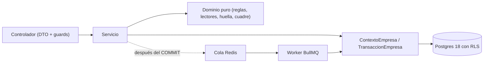
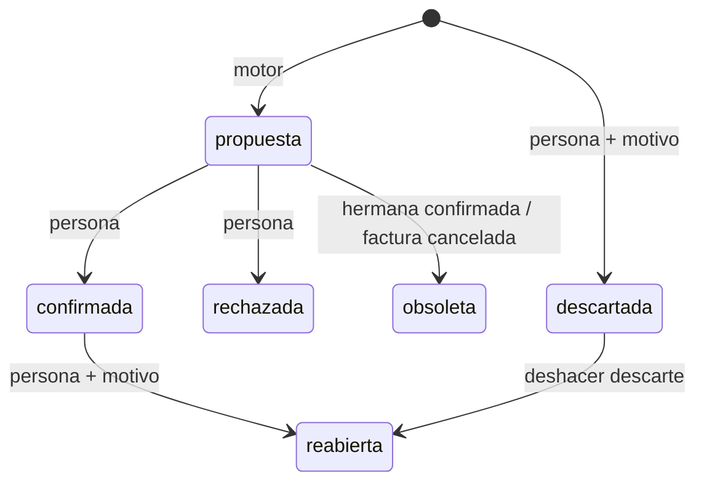
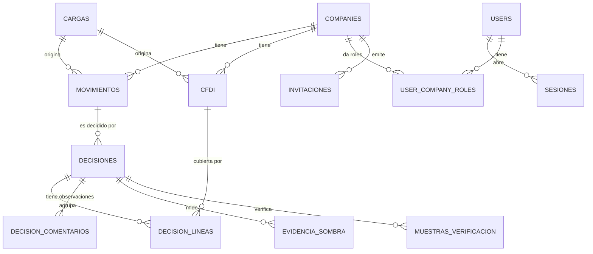
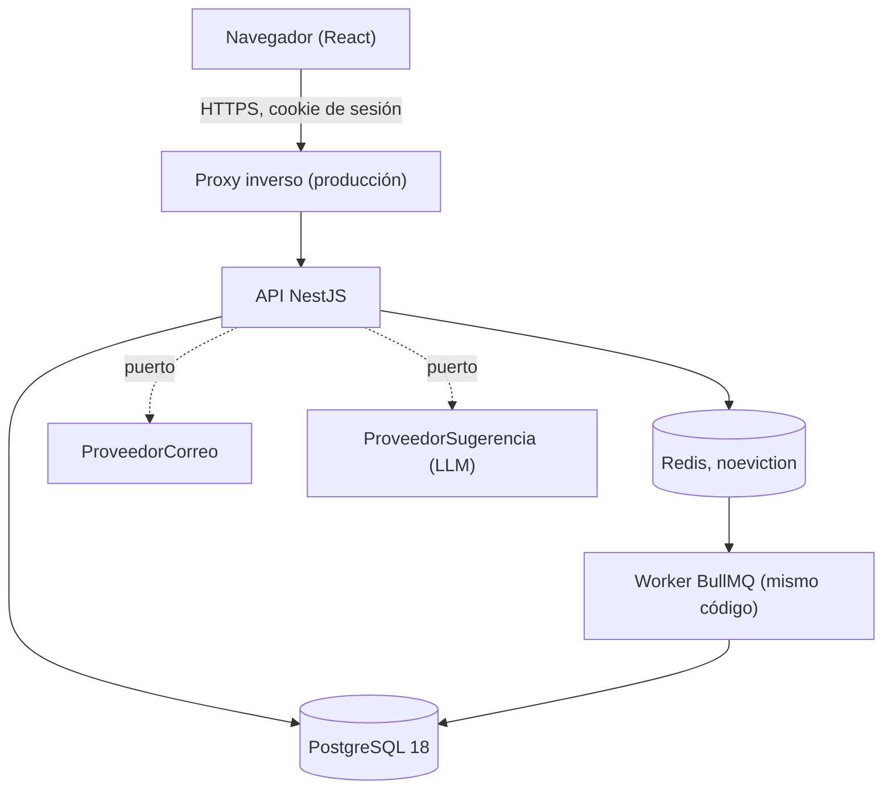

# Architecture Spine — Cuadra v2

## Design Paradigm

**Monolito modular** (ratifica la v1): un solo servicio NestJS, un módulo por capacidad, y la lógica de decisión como **funciones puras** sin Nest ni base de datos. El aislamiento entre empresas lo impone la base de datos (RLS), no el código.

Capas dentro de cada módulo de `src/`: `controlador → servicio → SQL parametrizado vía ContextoEmpresa`. No hay repositorios ni capa hexagonal. La lógica pura (reglas, lectores, huellas, cuadre) vive en archivos sin dependencias de framework.



## Invariants & Rules

### AD-1 — Paradigma y capas [ADOPTED]

- **Binds:** all
- **Prevents:** módulos que mezclan acceso a datos, reglas de negocio y HTTP; lógica de decisión que no se puede probar sin base de datos.
- **Rule:** el dominio puro no importa Nest, TypeORM ni `pg`. Los servicios acceden a datos solo con SQL parametrizado por `ContextoEmpresa.manager()`. Una dependencia nunca va de dominio puro hacia servicio.

### AD-2 — Tres clases de tabla, cada una con su acceso [ADOPTED en la clase 1]

- **Binds:** all, FR-45, FR-49, requisitos transversales
- **Prevents:** una consulta que filtra por empresa "a mano" y se equivoca; datos de una empresa visibles a otra; una tabla nueva sin clasificar y con permisos de más; que `cuadra_app` necesite un permiso que nadie le dio.
- **Rule:** toda tabla pertenece a una de tres clases y la migración que la crea declara cuál. Un solo rol de base de datos, `cuadra_app` (`NOBYPASSRLS`), con GRANTs exactos por clase:
  - **Clase 1, dominio** (`cargas`, `carga_archivos`, `cfdi`, `movimientos`, `decisiones`, `decision_lineas`, `decision_comentarios`, `bitacora`, `sugerencias_ia`, `evidencia_sombra`, `muestras_verificacion`): `company_id`, `ENABLE` y `FORCE ROW LEVEL SECURITY`, política sobre `current_setting('app.company_id')` y filtro `company_id` explícito en toda consulta. Sin `DELETE`; las de solo agregar (`bitacora`, `sugerencias_ia`, `evidencia_sombra`, `muestras_verificacion`) solo `SELECT` e `INSERT`.
  - **Clase 2, identidad** (`companies`, `users`, `user_company_roles`, `sesiones`, `invitaciones`, `tokens_recuperacion`): sin RLS porque se leen antes de elegir empresa. Solo las tocan los módulos `auth` y `companies`. `DELETE` solo sobre `sesiones`, `invitaciones`, `tokens_recuperacion` y `user_company_roles` (quitar un rol, FR-45). Las columnas editables de `companies` se otorgan una por una.
  - **Clase 3, plataforma** (`plataforma_usuarios`, `bancos_vista_previa`, `bitacora_plataforma`): sin `company_id` y sin RLS. Solo las referencia el módulo `plataforma/`; una prueba de arquitectura falla si otro módulo las nombra.
  Una petición abre una transacción que fija `app.company_id` (`TransaccionEmpresaInterceptor`); los workers usan `TransaccionEmpresa.ejecutar`. Los efectos externos (encolar, correo) van en `alConfirmar`, después del COMMIT. Los GRANTs viajan en la misma migración que la tabla.

### AD-3 — Nada cierra un caso sin una persona [ADOPTED]

- **Binds:** F2, F3, F4, F5, FR-15, FR-34, SM-C1
- **Prevents:** que un motor, una sugerencia de la IA o el modo sombra cierre un caso por accidente en la v2.
- **Rule:** el motor de reglas solo crea propuestas; la IA solo sugiere. Una decisión con estado `confirmada` exige `confirmada_por_id` y `confirmada_at` por restricción de base de datos (equivalente a `ck_conciliaciones_confirmada_requiere_persona` de la v1). El cierre por el sistema (etapa 2) se habilita cambiando esa restricción en una historia propia, no antes.

### AD-4 — Una confirmación es una decisión con sus líneas y un ciclo de vida cerrado

- **Binds:** F2, F3, F4, FR-10, FR-11, FR-14, FR-19..FR-21, FR-26..FR-33, FR-66, FR-68
- **Prevents:** un depósito con la mitad de sus facturas confirmadas; dos dueños del estado de una confirmación; perder el historial al reabrir; volver a proponer un par ya rechazado; una transición de estado que cada módulo interpreta a su modo.
- **Rule:**
  - **Tablas.** `decisiones` (cabecera: `movimiento_id`, `tipo` = `conciliacion` | `descarte`, `estado`, `origen`, `regla`, `score`, persona, fecha, `lote_id`, `motivo`, `requiere_revision`, `huella_conjunto`, diferencia del grupo) y `decision_lineas` (una fila por factura, vacía en un descarte). `decision_comentarios` guarda las observaciones de FR-68 (clase 1, solo agregar).
  - **Estados:** `propuesta`, `confirmada`, `rechazada`, `reabierta`, `descartada`, `obsoleta`. Transiciones legales, y no hay otras:

    | De | A | Quién | Efecto adicional |
    | --- | --- | --- | --- |
    | (nada) | `propuesta` | motor (`conciliar()`) | — |
    | `propuesta` | `confirmada` | persona | las propuestas hermanas del movimiento pasan a `obsoleta` |
    | `propuesta` | `rechazada` | persona | el conjunto no se vuelve a proponer |
    | (nada) | `descartada` | persona, con motivo | crea una decisión `tipo = descarte`, sin líneas |
    | `confirmada` | `reabierta` | persona autorizada, con motivo | el movimiento y las facturas vuelven a abiertos; `conciliar()` genera propuestas nuevas |
    | `descartada` | `reabierta` | persona autorizada (deshacer descarte) | el movimiento vuelve a pendiente |
    | `propuesta` | `obsoleta` | sistema | factura cancelada o ya cubierta por otra decisión |

    Cada transición es un `UPDATE ... WHERE estado = <origen> AND company_id = $n` y se verifica `rowCount = 1`; si no, respuesta 409. Reconfirmar crea una decisión nueva; la anterior queda como historial. Reabrir un lote es una sola transacción con los ids en orden ascendente; los casos ya reabiertos se omiten y se cuentan (FR-33).
  - **Unicidad sin triggers.** `decisiones.vigente` es una columna generada (`estado IN ('confirmada','descartada')`) con índice único parcial `(company_id, movimiento_id) WHERE vigente`. `decision_lineas` guarda `estado_decision` con clave foránea compuesta `(decision_id, estado_decision)` hacia `decisiones (id, estado)` con `ON UPDATE CASCADE`, y su propia columna generada `vigente`, con índice único parcial `(company_id, cfdi_id) WHERE vigente`. Un conjunto `(movimiento_id, huella_conjunto)` en estado `propuesta` o `rechazada` es único.
  - **Restricciones de coherencia.** `CHECK`: `tipo = 'descarte'` implica estado `descartada` o `reabierta` y `motivo` no nulo; `confirmada` exige persona (AD-3).
  - **Cachés derivados.** `movimientos.estado` y `cfdi.estado` se actualizan solo en la misma sentencia que la transición. Un CFDI cancelado (FR-66) ya conciliado marca `requiere_revision` y nunca reabre solo.





### AD-5 — Dos mundos: empresa y plataforma

- **Binds:** F6, F7, FR-3, FR-23, FR-39, FR-55, FR-67
- **Prevents:** que una sesión de empresa llegue a una ruta de plataforma o al revés; acciones del dueño sin dónde quedar registradas; una acción de plataforma que deja una bitácora escrita y la otra no.
- **Rule:** el dueño de Cuadra es una **identidad de plataforma aparte**. Sus rutas viven bajo `/plataforma` con un guard propio que exige sesión de tipo `plataforma`; las rutas de empresa exigen tipo `empresa`. Una petición de plataforma abre **una sola transacción**: si afecta a una empresa (crear la empresa, apagar la separación de funciones), fija `app.company_id` a esa empresa y escribe en `bitacora_plataforma` y en la `bitacora` de la empresa dentro de la misma transacción. Una acción de plataforma que no afecta a ninguna empresa (levantar la vista previa de un banco) escribe solo en `bitacora_plataforma`. `bitacora_plataforma` es solo `SELECT` e `INSERT`. El interceptor de transacción trata la sesión `plataforma` como un caso propio y nunca abre una transacción de empresa sin `company_id`.

### AD-6 — Sesión opaca en la base de datos

- **Binds:** F6, F8, FR-40, FR-43, FR-44, FR-59, AD-5
- **Prevents:** dos mecanismos de sesión; una sesión que sobrevive a cerrar sesión o a quitar un rol; un robo de token por guardarlo en el navegador; peticiones forzadas desde otro sitio.
- **Rule:** reemplaza el JWT de la v1 (D-09). Tabla `sesiones` (clase 2): hash del token, `user_id`, tipo `empresa` | `plataforma`, `company_id` (nulo mientras la persona no ha elegido empresa), `ultima_actividad`, `expira_en`. El token viaja en una cookie `httpOnly`, `Secure` y `SameSite=Lax` (`Strict` rompería la primera carga al abrir un enlace del correo). Elegir o cambiar de empresa actualiza `company_id` de la misma fila y rota el token. Toda petición que cambia datos exige que su cabecera `Origin` coincida con el origen autorizado (variable de entorno); sin eso se rechaza. 8 horas sin actividad vencen la sesión y la actividad la renueva. Cerrar sesión, quitar un rol o dar de baja a un usuario borra la fila. Los roles se siguen leyendo de la base en cada petición.

### AD-7 — Bitácora de solo agregar, en la misma transacción

- **Binds:** F7, FR-29, FR-50, FR-51, FR-52, FR-55, SM-C2
- **Prevents:** un cambio de estado sin su rastro; una bitácora que alguien pueda editar; una acción nueva que rompe el CHECK o el espejo del frontend.
- **Rule:** `bitacora` (empresa, con RLS) y `bitacora_plataforma` son solo `SELECT` e `INSERT`. Todo cambio de estado escribe su fila **en la misma sentencia o transacción** (patrón CTE de la v1). Acciones nuevas: `reabrir`, `descartar`, `deshacer_descarte`, `comentar`, `invitar`, `cambiar_rol`, `quitar_rol`, `desactivar_separacion`, `levantar_vista_previa`, `verificar_muestra`. Cada acción nueva exige a la vez: el valor en `tipos.ts`, su espejo en el frontend, el `CHECK` en la migración y la cuenta en la prueba de deriva. `ENTIDADES_BITACORA` suma `decisiones` y conserva `conciliaciones` para las filas históricas.

### AD-8 — Lectores de PDF como funciones puras con un cuadre común

- **Binds:** F1, FR-1, FR-2, FR-3, FR-7
- **Prevents:** tres lectores con criterios distintos de cuadre o rechazo; cargas a medias; pruebas que dependen de un PDF real.
- **Rule:** la extracción del texto del PDF es un adaptador delgado. Cada banco es un lector puro `texto → {saldoInicial, saldoFinal, movimientos[], lineasNoLeidas[]}` que produce el mismo movimiento normalizado que el CSV. **Una sola función común** verifica el cuadre (saldo inicial + abonos − cargos = saldo final); si falla, la carga se rechaza completa y no crea nada. Mientras la vista previa del banco no esté levantada (AD-5), la carga queda en `pendiente_vista_previa`. Un banco nuevo es código, no un JSON.

### AD-9 — Duplicados por huella, sin descartar nada solo

- **Binds:** F1, FR-6, FR-65
- **Prevents:** movimientos duplicados entre un PDF y un CSV del mismo mes; perder un movimiento real por un falso duplicado; dos cargas simultáneas que se duplican entre sí.
- **Rule:** `movimientos.huella` la calcula una función pura (cuenta + fecha + monto + referencia normalizada), con un índice **no único** `(company_id, huella)`. La comprobación de huellas corre dentro del candado de empresa (AD-19). El resumen "N nuevos, M ya existentes" lo confirma la persona usando el mismo estado `pendiente_vista_previa`. Un empate dudoso se importa como `pendiente_revision`; nunca se descarta solo. La idempotencia por `sha256` del archivo (FR-6) se conserva.

### AD-10 — Modo sombra y muestreo como evidencia que no se puede reescribir

- **Binds:** F5, FR-34..FR-38, FR-63, FR-69, SM-C1, SM-C2
- **Prevents:** que la tasa de desacuerdo se calcule sobre datos que cambian; que el muestreo se vuelva a sortear hasta salir bien; guardar resultados derivados que se desincronizan.
- **Rule:** `evidencia_sombra` (una fila por evento, nunca se actualiza: `company_id`, banco, `decision_id`, `evento` = `habria_cerrado` | `confirmo` | `rechazo` | `desmarco` | `reabrio`, fecha y persona) y `muestras_verificacion` (`company_id`, mes, `decision_id`, verificador, resultado `conforme` | `desacuerdo`) son de solo agregar. La selección al azar de una muestra se **guarda al generarse** y no se re-sortea. Las tasas de desacuerdo se **calculan por consulta**. Las fracciones de FR-69 salen de `cfdi.metodo_pago` (PPD) y de `movimientos.clase` (`comision` | `parcialidad` | nula), que una función pura asigna al importar; no se guardan aparte.

### AD-11 — Una sola matriz de permisos, evaluada en el servidor y expuesta al frontend

- **Binds:** F7, FR-25, FR-47, FR-53, FR-54
- **Prevents:** que el frontend decida qué puede hacer cada rol; reglas de rol duplicadas y desalineadas (la v1 las repite en el frontend: `ROLES_QUE_EDITAN_TOLERANCIA`, `ROLES_QUE_CARGAN`); un menú fijo para todos.
- **Rule:** la matriz de FR-53 vive en el backend y se evalúa en el servidor. `/auth/contexto` la expone al frontend como lista de capacidades; el frontend solo pinta menú y botones a partir de ella, sin literales de rol. La matriz entra en la prueba de deriva. Un endpoint nuevo declara su permiso; no basta con ser miembro.

### AD-12 — Dominio compartido con prueba de deriva [ADOPTED]

- **Binds:** all
- **Prevents:** que backend y frontend discrepen en estados, reglas, roles o acciones; enums de Postgres difíciles de migrar.
- **Rule:** `src/common/entities/tipos.ts` define las listas `as const`; el frontend las espeja en `shared/dominio/tipos.ts` y la prueba de deriva falla ante cualquier diferencia. Los estados son `VARCHAR` con `CHECK` nombrado (`ck_`, `ux_`, `ix_`, `fk_`), no enums. Los montos son `NUMERIC(18,4)`, viajan como texto y se operan con `decimal.js`, nunca como `number`. Una tabla nueva se registra en `entidades.ts` y en las listas de tablas de `rls.spec.ts` y `esquema.spec.ts`.

### AD-13 — Separación de funciones configurable y que falla cerrada

- **Binds:** F3, FR-22, FR-23, FR-24
- **Prevents:** que una configuración ausente o rota deje confirmar a quien subió la carga.
- **Rule:** `companies.separacion_funciones` es `true` por defecto. Si la lectura falta o falla, se aplica la separación. Se evalúa en el servicio de resolución, como en la v1. Solo se cambia desde `/plataforma`, con motivo obligatorio, y queda en ambas bitácoras (AD-5, AD-7). Las pruebas cubren los dos modos.

### AD-14 — Correo e invitaciones detrás de un puerto

- **Binds:** F6, F8, FR-40..FR-44, FR-46, FR-48, FR-61
- **Prevents:** atar el producto a un proveedor de correo; enlaces reutilizables o eternos; dejar una empresa sin administrador.
- **Rule:** `ProveedorCorreo` es un puerto con adaptadores simulado (desarrollo y pruebas) y real (por variables de entorno), igual que `ProveedorSugerencia`. `invitaciones` y `tokens_recuperacion` (clase 2) guardan un token de un solo uso con hash y caducidad (7 días y 1 hora). Reenviar invalida el enlace anterior. La respuesta nunca revela si un correo existe. Una persona que ya existe usa la misma cuenta. Quitar o degradar al último `admin` de una empresa se rechaza en el servicio.

### AD-15 — Límite de peticiones dentro de la aplicación

- **Binds:** F8, FR-57, FR-58
- **Prevents:** depender de un proxy que no existe en el despliegue; fuerza bruta en inicio de sesión, recuperación o invitaciones; limitar por la IP del proxy y no por la del cliente.
- **Rule:** reemplaza D-11. Contadores en Redis para inicio de sesión, recuperación e invitaciones, mediante un proveedor de cliente Redis que hoy no existe y se agrega. La IP del cliente se toma con `trust proxy` activado solo por variable de entorno. El origen autorizado (CORS y la comprobación de `Origin` de AD-6) es una variable de entorno; en desarrollo el navegador y la API comparten origen por el proxy de Vite.

### AD-16 — Cargas asíncronas con un payload mínimo [ADOPTED]

- **Binds:** F1, FR-1..FR-9
- **Prevents:** archivos grandes dentro de Redis; jobs duplicados o ignorados; un job que se ejecuta antes del COMMIT; perder trabajos por desalojo de Redis.
- **Rule:** los archivos esperan en `carga_archivos`; el job de BullMQ lleva solo `{cargaId, companyId}` con `jobId = cargaId`. BullMQ ignora un `add` si el `jobId` ya existe, así que al reencolar se elimina antes el job previo en estado `failed` o `completed` (como hace `cola-cargas.ts`). Se encola en `alConfirmar`. Redis corre con política `noeviction`. El guard de `multer` corre antes de abrir la transacción de empresa. Al terminar la carga corren `conciliar()` y después las sugerencias.

### AD-17 — Despliegue: Docker Compose, host diferido

- **Binds:** F8, FR-56, FR-60, FR-62
- **Prevents:** pasos manuales no escritos; secretos en el repositorio; atarse a un proveedor antes de tener un cliente; un respaldo que nunca se probó.
- **Rule:** la unidad de despliegue es Docker Compose con variables de entorno. Las migraciones son un paso explícito (`synchronize:false`). Fuera de desarrollo, un proxy inverso entrega el frontend y reenvía `/api` al mismo origen, y termina TLS (la cookie `Secure` lo exige). Hay un script de respaldo de Postgres y se prueba restaurarlo antes de cada demo. Los registros salen estructurados por la salida estándar y la ruta de salud ya existe. Las credenciales por defecto no sirven fuera de desarrollo. La prueba real con el proveedor de IA se hace antes de activarlo (FR-62). El host y el proveedor de correo están diferidos (ver Deferred).

### AD-18 — Las pruebas de extremo a extremo son por HTTP y obligatorias

- **Binds:** F8, FR-70, UJ-1, UJ-2, UJ-3
- **Prevents:** una puerta de salida basada en una suite de navegador frágil; recorridos que nunca se probaron contra Postgres real.
- **Rule:** hay un recorrido por UJ-1 a UJ-3 con `supertest`, contra la API, Postgres y Redis reales. Es obligatorio antes de la fase 2a. Un recorrido de Playwright (UJ-1) es opcional. Antes de cada demo se corre la lista de verificación manual del frontend con la API real. El frontend conserva sus pruebas propias (Vitest, MSW, deriva).

### AD-19 — Un candado por empresa y un orden fijo de bloqueos [ADOPTED en parte]

- **Binds:** F1, F2, F3, F4, FR-11, FR-32, FR-65
- **Prevents:** dos confirmaciones simultáneas del mismo movimiento que terminan en un error 500; interbloqueos entre lotes; cargas simultáneas que se duplican.
- **Rule:** `conciliar()`, toda transición de AD-4, la importación con su comprobación de huellas y las sugerencias toman primero el candado de empresa (`pg_advisory_xact_lock`, como `candado.ts` de la v1). Dentro, el orden de bloqueo de filas es fijo: decisiones por `id` ascendente, luego CFDI, luego movimiento. Una violación de índice único (`23505`) en una transición se traduce a 409, nunca a 500.

### AD-20 — Migración de `conciliaciones` a `decisiones` en pasos que no rompen la v1

- **Binds:** F2, F3, F4, FR-11, FR-31, sección 11 del PRD
- **Prevents:** perder la correspondencia con la bitácora histórica; dos funciones de huella distintas; una migración que deja la aplicación sin tabla.
- **Rule:** orden fijo: (1) crear `decisiones`, `decision_lineas` y `decision_comentarios` con RLS y GRANTs; (2) copiar cada fila de `conciliaciones` a una decisión **conservando el mismo `id`** y a una línea; la bitácora histórica sigue apuntando a esos ids; (3) cambiar el código; (4) borrar `conciliaciones` en una migración posterior. `huella_conjunto` es una sola función SQL (ids ordenados y hasheados) con su espejo en TypeScript y una prueba de paridad, igual que `normalizar_referencia`.

### AD-21 — La IA solo recibe una lista cerrada de campos [ADOPTED]

- **Binds:** F2, FR-64
- **Prevents:** enviar datos bancarios o fiscales de más al proveedor de IA.
- **Rule:** `sugerencias` es el único módulo que habla con el LLM, mediante `ProveedorSugerencia`, y solo envía la lista cerrada de campos del texto bancario. Una sugerencia nunca cierra un caso ni queda marcada. Si el proveedor falla, el caso cae en la bandeja sin sugerencia.

## Consistency Conventions

| Concern | Convention |
| --- | --- |
| Naming | Tablas y columnas en `snake_case`; el ORM traduce a camelCase. Restricciones con prefijo `ck_`, `ux_`, `ix_`, `fk_`. Módulos en español, `<modulo>/dto/*.dto.ts`, `*.entity.ts` y `*.module.ts` junto al módulo. |
| Data & formats | PK `uuidv7()`. Montos `NUMERIC(18,4)`, texto en la API. Fechas con zona horaria. Errores con la forma estándar de Nest; los motivos de "sin propuesta" son códigos estables de `tipos.ts` que no se renombran. Conflicto de estado o de unicidad: 409. |
| State & cross-cutting | Estados con `CHECK`, nunca enum de Postgres. Cambio de estado y su bitácora van en la misma transacción. Config por variables de entorno validadas al arrancar. Efectos externos solo en `alConfirmar`. |
| Tests | `*.spec.ts` junto al código; los que usan base se llaman `*.integracion.spec.ts`. Postgres de pruebas `<base>_test` creada sola. La lógica pura se prueba sin base. |
| Frontend | `app → features → shared`, sin imports hacia arriba; los componentes presentacionales no importan `shared/api` ni `shared/sesion`. Sin literales de dominio ni de rol en pantallas. Cada pantalla parte de su mockup. |

## Stack

| Name | Version |
| --- | --- |
| NestJS | ^11 |
| TypeORM | ^1.1.1 |
| pg (driver) | ^8.23 |
| TypeScript (backend) | ^5.7 |
| PostgreSQL | 18 |
| Redis | 7 |
| BullMQ | ^6 |
| decimal.js | ^10.6.0 |
| Jest | ^30 |
| React | ^19.3 |
| Vite | ^8 |
| Vitest | ^5 |
| react-router | ^8 |
| TanStack Query | ^5 |
| zod | ^4 |
| TypeScript (frontend) | ~6.0 |

## Structural Seed



```text
src/
  common/        # tipos.ts, decoradores, dinero
  auth/          # sesión opaca, guards (empresa / plataforma), permisos
  plataforma/    # rutas del dueño, bitacora_plataforma, bancos_vista_previa (clase 3)
  companies/     # empresas, usuarios, roles, invitaciones, tolerancia, separacion_funciones
  cargas/        # subida, cola, worker, estados de carga
  bancos/        # lectores puros por banco, cuadre común, extracción de texto
  cfdi/          # lector de CFDI, cancelación
  conciliacion/  # motor de reglas puro, propuestas, candado
  resolucion/    # decisiones: confirmar, rechazar, reabrir, descartar, comentar, lote
  bandeja/ casos/
  sombra/        # evidencia_sombra, muestras_verificacion, tasas
  bitacora/
  sugerencias/   # único módulo que habla con el LLM
  database/      # migraciones, ContextoEmpresa, TransaccionEmpresa
frontend/src/{app,features,shared}
```

## Capability → Architecture Map

| Capability / Area | Lives in | Governed by |
| --- | --- | --- |
| F1 Cargas (PDF, CSV, CFDI, duplicados, historial FR-8) | `cargas`, `bancos`, `cfdi` | AD-8, AD-9, AD-16, AD-19 |
| F2 Propuestas, cancelación (FR-66), IA (FR-64) | `conciliacion`, `sugerencias`, `cfdi` | AD-3, AD-4, AD-21 |
| F3 Bandeja, revisión, comentarios (FR-68) | `bandeja`, `casos`, `resolucion` | AD-3, AD-4, AD-11, AD-13, AD-19 |
| F4 Reapertura y lote | `resolucion` | AD-4, AD-7, AD-19, AD-20 |
| F5 Modo sombra, muestreo (FR-63), fracciones (FR-69) | `sombra` | AD-10 |
| F6 Empresas, usuarios, invitaciones (FR-39..FR-50) | `companies`, `plataforma`, `auth` | AD-2, AD-5, AD-6, AD-14 |
| F7 Bitácora y menú por rol | `bitacora`, `auth` | AD-7, AD-11 |
| F8 Base para producción (FR-56..FR-62, FR-70) | transversal | AD-6, AD-15, AD-16, AD-17, AD-18 |

## Deferred

- **Host y proveedor de correo.** Se revisan cuando se decida lanzar a un cliente real; el compose y las variables ya lo permiten. Qué proxy inverso se usa también se decide entonces.
- **Librería de extracción de texto de PDF.** Se elige y verifica al recibir los PDF reales anonimizados. Si un banco resulta ilegible por texto, se revisa AD-8; el contrato del lector se mantiene.
- **Librería del límite de peticiones y cliente Redis.** Se verifican al implementar AD-15.
- **Un segundo rol de base de datos para plataforma.** Hoy basta `cuadra_app` con GRANTs por clase (AD-2) y la prueba de arquitectura. Se reconsidera si aparece un cliente real con requisitos de auditoría más estrictos.
- **Cierre automático (etapa 2).** Cambia la restricción de AD-3 y se activa solo desde `/plataforma`; no se diseña ahora.
- **Parcialidades, PPD con complemento de pago y comisiones.** Fuera de la v2; AD-10 solo mide cuánto pesan.
- **Cierre de periodo contable y plazo de reapertura.** No existe en la v2.
- **Otras monedas, PDF escaneados y cuentas personales.** Fuera de alcance.
- **Playwright.** Opcional, tras AD-18.
- **Puerta de salida de la fase 1 sin clientes.** Pregunta para el paso de épicas: sin un cliente real, esa fase se mide como calidad demostrable.
